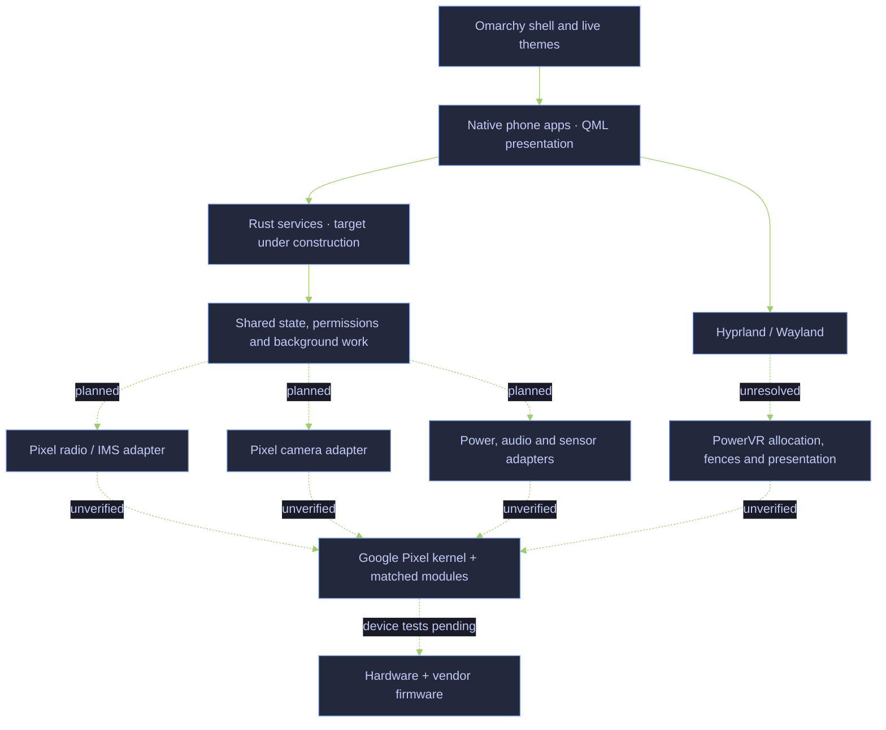
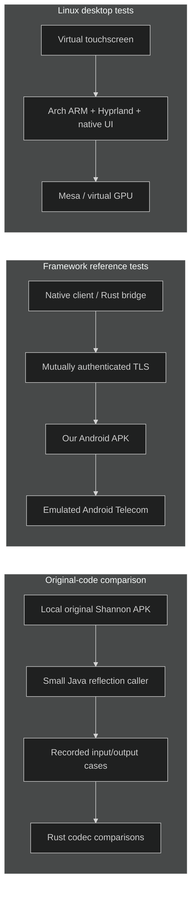
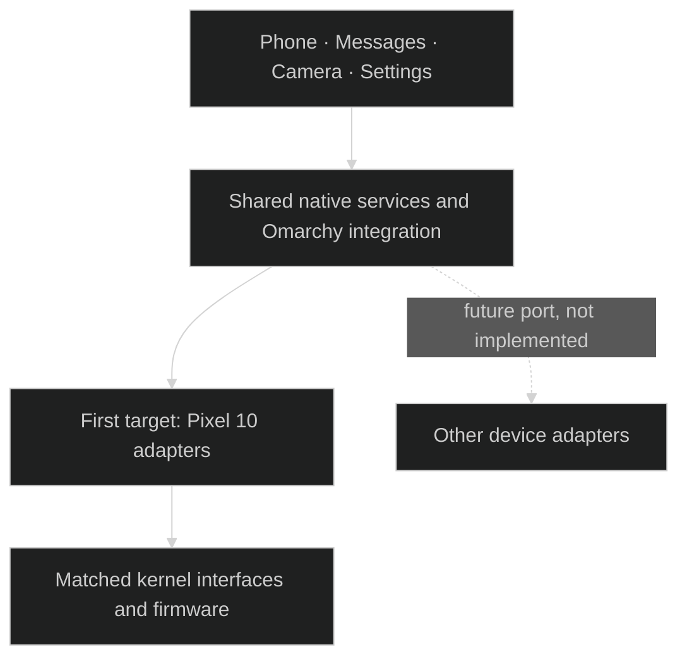

# Pokélinux — independent mobile Linux research

**Native Linux phone software, with Pixel 10 as the first hardware target and Omarchy as the intended desktop and theme environment.**

The target is Arch Linux ARM, Hyprland, native phone apps and Rust services for calls, messages, camera, power and other phone functions. The initial hardware strategy uses Google's matched Pixel kernel, modules and firmware. Replacing Android framework userspace is the goal; it is not yet achieved. The [completion criteria](docs/smartphone-goal.md#completion-matrix) require native service integration; Android framework tests provide reference evidence.

> **Development status:** no physical phone has been accessed. There is no verified bootable phone image. Modem communication, carrier IMS registration, physical call audio, Pixel GPU rendering, camera capture and suspend remain unverified.

This is an independent project, not an official release of Omarchy, Arch Linux or Google. Project branding does not grant rights to their names or artwork.

## Architecture we are building



Dashed connections are work still required, not working hardware paths. “Rust services” is the implementation direction; only a small part of native IMS exists today. We are not rewriting the Linux kernel or modem firmware in Rust.

## What has been tested

| Area | Evidence and scope | Still missing |
|---|---|---|
| Native IMS codecs | 207 cases match outputs from the original Shannon APK: 45 scalar writes and 162 payload encodings for two request classes. [Tests](native-ims/tests) · [provenance](docs/evidence/codec-provenance.json) | Transport, state machine, valid state/RAT semantics, registration and carrier operation |
| Original radio proxy | Ten payload cases and two rejected transactions through the original raw and segmented request proxies into an in-process Binder capture endpoint. [Provenance](docs/evidence/binder-provenance.json) | Actual vendor service and modem behavior |
| Original request segmentation | Five executed boundary cases reproduce missing final chunks for exact multiples of 2,048 above 2,048 bytes. [Evidence](docs/evidence/segmentation-provenance.json) | Vendor endpoint acceptance and real-world impact |
| Original indication assembly | Eight executed cases verify index ordering, duplicate handling, missing-index exceptions, excess bytes and empty payloads in the original APK accumulator. [Evidence](docs/evidence/indication-assembly-provenance.json) | Interleaved message identity and vendor reset guarantees |
| Original indication adapter | Seven executed cases cover slot filtering, ID reuse, interleaving, changed totals and state retained after exceptions. [Evidence](docs/evidence/indication-adapter-provenance.json) | Producer serialization and reset guarantees; malformed input acceptance is not a Rust requirement |
| Native callback lifecycle | Blocking delivery, cancellation, owner-inbox loss, replacement, rejection of late callbacks to an old endpoint, and peer death during/after registration pass through Binder on Harbour. [Latest evidence](docs/evidence/inbox-drop-provenance.json) | Full session owner, reconnect, fencing already-consumed events and atomic publication |
| Native indication assembly | Bounded single-candidate Rust assembly passes Linux/ARM64 component tests and a real Binder fragment-to-result test. [Evidence](docs/evidence/native-assembly-provenance.json) | Session deadlines, aggregate budgets, epoch fencing and vendor message identity |
| Native request splitting | Lossless Rust planner tested on Linux x86-64 and ARM64/QEMU across 14,337 segmented payload lengths. [Evidence](docs/evidence/request-parts-provenance.json) | Vendor endpoint acceptance |
| Native Linux Binder | Static Linux Rust client performs service lookup and receives a one-way Android callback through the real Binder driver with SELinux enforcing. [Report](docs/native-binder.md) | Vendor radio calls/callbacks, ARM64 kernel IPC and Pixel permissions |
| Native radio transport | Rust registration, request/response round trips, raw/segmented indication delivery and shared inbox overflow through real Binder to an independent Java test peer, SELinux enforcing. [Evidence](docs/evidence/radio-indication-provenance.json) | Vendor service, session recovery and modem operation |
| Vendor response metadata | Generated Rust AIDL binding matches seven original Android typed-object fixtures on Linux and ARM64/QEMU; selected malformed boundaries are rejected. [Evidence](docs/evidence/response-info-provenance.json) | Full vendor callback transactions, response semantics and reassembly |
| Native desktop | Arch ARM VM, Hyprland, virtual touch, installed app lifecycle and live theme tests. [Report](docs/native-virtual-graphics.md) | Physical display/input, full phone shell and device boot |
| Android reference bridge | Enrollment, permissions, callbacks and call controls tested against Android Telecom in an emulator. [Report](docs/android-framework-tests.md) | These tests do not prove native IMS or real voice calls |
| Graphics compatibility | Stock Pixel EGL/GLES libraries load through libhybris; initialization reaches the missing-GPU boundary. [Audit](docs/hardware-boundary-decision.md) | Successful Pixel EGL initialization, dma-buf allocation/import, fences and scanout |
| Complete smartphone | Scope and hardware dependency audit recorded. [Completion matrix](docs/smartphone-goal.md) | SMS, camera, audio, cellular data, sensors, power and background wake require further implementation and integration |

Historical reports refer to local `artifacts/` paths. Those files are not all published. A source test or old report is not a current hardware qualification certificate.

## Real UI evidence

These are captures from an **Arch ARM virtual machine**, showing the same phone app under two Omarchy themes. The bridge is deliberately unavailable in this test. They demonstrate theme integration, not a working cellular phone.

| Tokyo Night | Catppuccin Latte |
|---|---|
|  |  |

## Why keep an Android test environment?

The repository contains a functioning reference bridge and earlier Python/GTK experiments. They help compare behavior and test boundaries. They are **not a commitment to retain Android framework userspace or two production runtimes**. The current implementation direction is Rust service logic, QML presentation and only necessary low-level ABI glue.



These are separate test paths. None emulates the Pixel modem, PowerVR GPU or camera sensor. The Shannon caller invokes selected serializers and a generated proxy connected to a local capture endpoint; it does not activate a working IMS service. REA is the chosen analysis tool for closed components; original-code execution and device evidence must validate recovered behavior.

## Pixel first, portable where it helps

Phone UI, theme integration, common state models and test tools can be reused. Radio protocols, camera interfaces, GPU/display paths, boot configuration and power behavior depend on the device. Another phone will need its own adapters and hardware qualification.

We will build the concrete Pixel target first and extract shared interfaces when supported by real needs. We do not claim a universal phone hardware layer or support for untested devices.

The [device portability decision](docs/device-portability.md) keeps vendor protocols outside shared phone logic. The current `native-radio` crate implements Samsung radioExternal; it is not a universal modem API. Java peers are Android test infrastructure, not the target phone runtime.



## Decisions

| Decision | Reason |
|---|---|
| Native Rust service logic | One target implementation, explicit state and resource ownership, testable recovery behavior |
| QML presentation | Align with the target Omarchy shell and theme integration; presentation is separate from hardware policy |
| Google kernel initially | Preserve the device driver baseline while replacing userspace; a mainline kernel port is a separate task |
| Open interfaces first | Reuse suitable upstream work; investigate closed interfaces where necessary |
| Android as reference infrastructure | Compare real framework behavior without treating emulator success as native phone support |
| No backwards compatibility for prior iterations | Do not preserve obsolete formats, adapters or parallel production runtimes |
| Pinned upstream fetches | Keep source identity and patches reviewable without vendoring whole repositories |

[Current scope](docs/smartphone-goal.md) supersedes older architecture recommendations. [Language decision](docs/runtime-language-decision.md) · [UI decision](docs/ui-framework-decision.md) · [Native IMS investigation](docs/shannon-native-recovery.md) · [Dependency policy](docs/dependencies.md).

## Build and test

The smallest public test needs a current Rust toolchain and no vendor APK:

```sh
cargo test --locked --manifest-path native-ims/Cargo.toml
cargo clippy --locked --manifest-path native-ims/Cargo.toml --all-targets -- -D warnings
python3 -m unittest discover -s tests -p test_fetch_upstreams.py
```

Fetch public source pinned by commit and checksum:

```sh
python3 tools/fetch_upstreams.py --omarchy
```

The larger suites require a prepared Linux Docker host, separate downloaded inputs and, for Android emulation, KVM. They are not a one-command phone installer:

```sh
bash tools/offline-suite.sh       # Graphics / ARM VM environment
bash tools/framework-suite.sh prepare
bash tools/framework-suite.sh build
bash tools/framework-suite.sh shannon-codec  # Requires exact local Shannon APK
```

Read the scripts and [framework report](docs/android-framework-tests.md) before running the larger suites. They use dedicated containers and emulators. Temporary build servers are validation capacity, not runtime dependencies. No instruction here authorizes flashing a phone.

## Source map

| Path | Role |
|---|---|
| `native-ims/` | New native Rust protocol work and original-code comparison fixtures |
| `runtime/` | Rust state, local IPC, journal and reference bridge transport |
| `native-app/` | Native QML phone UI and integration tests |
| `src/`, `patches/` | Graphics compatibility implementation and small upstream patches |
| `framework/` | Android reference components and original-code callers |
| `sim/guest/`, `sim/tests/`, `tools/` | Build and offline integration harnesses |
| `omarchy-plugin/`, `transport/` | Earlier integration experiments; not the final production language/runtime choice |
| `docs/` | Decisions, evidence, limitations and remaining work |

Vendor binaries, firmware, factory images, SDKs, decompilation dumps, private keys, enrollment data, caches and VM disks are excluded from Git. Upstream code and proprietary inputs retain their own terms. A public repository is not permission to redistribute those inputs.

## License and attribution

Original project code is MIT licensed. See [LICENSE](LICENSE) and [third-party notices](THIRD_PARTY.md). Pokélinux is independent of Omarchy, Arch Linux, Google and other named projects.
