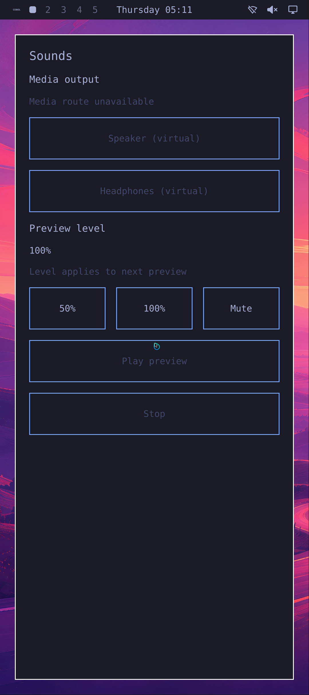
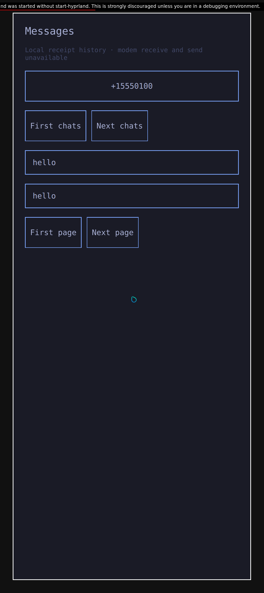
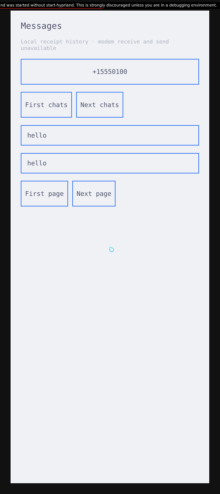
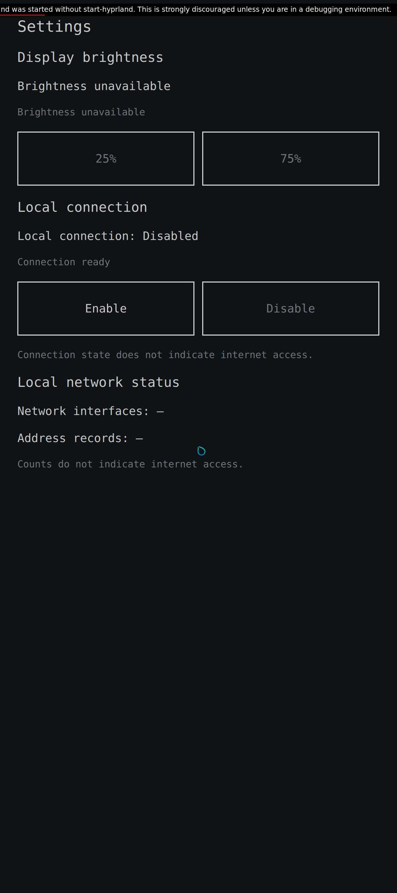
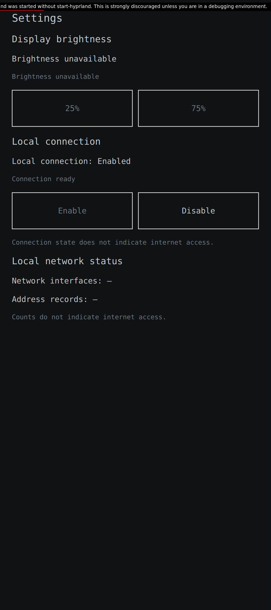
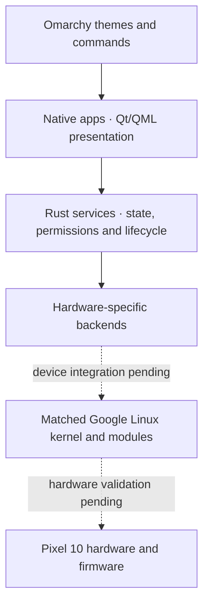

# Pokélinux

**Building an Omarchy smartphone system with native Rust services. Pixel 10 first.**

The target is Arch Linux ARM, Hyprland and native phone apps, with shared Rust
services behind hardware-specific backends. Google's matched Pixel kernel,
modules and firmware provide the initial device-support baseline.

**Current status: working VM prototypes and installed ARM service checkpoints.
No physical phone has been tested, and there is no verified bootable phone image.**

## See it running

These are real, unedited x86 VM captures at the
[Pixel 10 display profile](docs/native-phone-display-profile.md): 1080 × 2424
pixels, 422 PPI and 420 logical density. Some captures retain upstream development notices.

The latest [viewer test](docs/native-omarchy-viewer.md) drives genuine Omarchy:
open Sounds, close it with Super+W, reopen it, receive the final image and shut
down normally. This automated VM path passes; a user-launchable preview is next.
Permission remains withheld in this capture, so Play stays disabled.



The same Messages window follows an original Omarchy theme change from Tokyo
Night to Catppuccin Latte while preserving its local history. Both its Messages
and appearance client engines run in Rust; Qt renders the interface. The two
messages are authored test data; this checkpoint does not send or receive SMS.
[Theme and permission test](docs/native-messages-appearance-rust-tracer.md).

| Messages · Tokyo Night | Same window · Catppuccin Latte |
| --- | --- |
|  |  |

Settings now controls a real virtual network through the Rust service stack.
Enable exchanges packets; closing Settings leaves the connection working.
A fresh app instance observes that connection, exchanges another packet, then
Disable removes the address and stops traffic. This passes in an x86 VM with
explicit test session authority. Wi-Fi and Internet connectivity remain open.
[App-to-packets test](docs/native-settings-connectivity-window.md).

| Before Enable | Reopened with the connection preserved |
| --- | --- |
|  |  |

## What works today

These are separate, documented test checkpoints. They have not all been joined
into one complete phone session.

| Area | Demonstrated behavior | Evidence |
| --- | --- | --- |
| Native apps and themes | Real Messages, Settings and Sounds windows in prepared VMs; live original Omarchy theme changes and permission controls in qualified app sessions. | [Messages](docs/native-messages-appearance-rust-tracer.md), [Settings brightness](docs/native-brightness.md), [Sounds](docs/native-normal-upstream-tracer.md#prepared-full-appservice-slice-passes) |
| Viewer controls | Seven mouse/keyboard actions open, close and reopen Sounds; native final image and normal VM shutdown pass. Human connection workflow remains open. | [Viewer test](docs/native-omarchy-viewer.md) |
| App lifecycle | Genuine Omarchy menu → Sounds → Super+W close → fresh menu reopen → normal shutdown, with the same Rust session owner and permission withheld. | [Close/reopen test](docs/native-omarchy-app-lifecycle.md) |
| Connection ownership | Touch Enable → packets → app close/reopen → explicit Disable and silence through the normal Settings app and Rust services. | [Settings connection](docs/native-settings-connectivity-window.md) |
| Session recovery | The same Sounds window survives a compositor pause; fresh state returns about 55 ms after resume, followed by measured playback and permission-revoke silence. Earlier audio failures remain under investigation. | [Recovery checks](docs/native-session-timing-recovery.md) |
| Connection reliability | A delayed idle poll no longer kills the connection worker; overdue received commands are still rejected. Host process tests only. | [Idle polling](docs/native-connectivity-idle-receive.md) |
| Wireless | Native Rust discovery, open-AP association, fixed IP setup, two packet round trips, address removal and disconnect pass against Linux virtual radios in an ARM VM. WPA, DHCP/DNS, Settings integration and Pixel hardware remain open. | [Discovery](docs/native-wireless-scan.md), [connection](docs/native-wireless-association.md), [IP and packets](docs/native-wireless-address-packets.md) |
| ARM app build and partial runtime | Current Settings builds/installs with native Qt 6.12 and matching Rust libraries. A failed ARM trace reaches one Enable touch, a virtual address and one packet; background persistence, reopen and Disable remain open. | [ARM build/install](docs/native-settings-connectivity-window.md#native-arm-build-and-installation), [partial failed trace](docs/native-settings-connectivity-window.md#fourth-attempt-partial-touch-and-packets) |
| Audio | Preview Play/Stop, volume and mute verified against measured virtual audio; separate installed ARM service startup and shutdown checks. Physical phone audio remains open. | [Preview](docs/native-sounds-preview.md), [live mute](docs/native-live-preview-mute.md) |
| Battery and brightness | Rust services follow real Linux test drivers, including value changes and device loss; installed ARM startup and recovery checkpoints pass. | [Battery](docs/native-battery.md), [brightness](docs/native-brightness.md) |
| Background services | Seven installed services cold-boot together in a headless ARM development image: battery, brightness, network status and the four-unit audio stack. | [Combined ARM image](docs/native-arm-development-image.md) |
| Local messages | Permission-aware history, revocation, durable storage and clean-reboot persistence; synthetic incoming Binder tests are tracked separately. Carrier SMS remains open. | [Installed history](docs/native-installed-messages-history.md), [incoming test boundary](docs/native-messages-incoming.md) |
| Radio, camera and sensors | Rust protocol, ownership and lifecycle components with original-code comparisons and synthetic IPC tests, including actual ARM kernel Binder. Complete IMS, calls and physical capture/sensors remain open. | [Radio](docs/native-radio-operator.md), [camera](docs/native-camera-service.md), [sensors](docs/native-sensors-boundary.md) |

A controlled [audio startup test](docs/native-audio-startup-deadline.md) now survives
a delayed backend within the original Play time limit. Losing session authority or
reaching the app timeout still cancels it without retry. This is a host integration
result; repeatable graphical playback and phone audio remain open.

The current [Messages background owner](docs/native-installed-messages-history.md#current-owner-integration) now passes one fresh ARM/PID1 cold boot, exact private history reads and normal Stop. A second new boot and graphical session remain open.

An earlier cold x86 recovery trace starts genuine Omarchy and the Rust-backed Sounds
window, recovers from a compositor pause without restarting the app, then measures
50% playback on the virtual speaker and silence after an operator permission
revoke. Normal shutdown also passes at the Pixel 10 display profile. This run
adds diagnostics; earlier audio failures remain unresolved, and repeatability
is not established. Interactive use and phone hardware remain open.
[Cold trace and evidence](docs/native-cold-omarchy-sounds.md).

The [genuine Omarchy menu now launches Sounds](docs/native-omarchy-menu-launch.md)
through three real taps and the Rust-owned app service. Window, focus and
permission-withheld silence checks pass; later playback in that run still fails.
A later [complete app-lifecycle run](docs/native-omarchy-app-lifecycle.md) now
passes menu launch, standard close, fresh reopen and normal shutdown. Both app
instances retain the Pixel 10 display profile and remain silent without permission.

The later [viewer run](docs/native-omarchy-viewer.md), pictured above, carries this
loop through actual viewer input and final framebuffer receipt.

Host component tests, original-code execution, Android reference tests, ARM
user-mode emulation, full-system VMs and physical hardware evidence are recorded
separately. A passing component or virtual device does not qualify a phone.
The [integration map](docs/native-integration-map.md) links the wider service work;
the [development handoff](docs/development-handoff.md) records current attempts
and next steps, including failed runs.

## What remains before a usable phone

- Reliable cold startup into the full Omarchy shell, with trusted lock/unlock,
  app launching, notifications and background behavior.
- Complete native calls, cellular/IMS and SMS, plus camera, sensors, location,
  Wi-Fi/Bluetooth and the remaining audio and power paths.
- One installed system with setup, permissions, updates, durable user data and
  recovery working together.
- Pixel hardware validation: boot and restoration, graphics/display/touch,
  matched driver interfaces, modem/carrier behavior, physical audio/camera,
  suspend/wake, thermal behavior and battery life.

The [smartphone completion matrix](docs/smartphone-goal.md#completion-matrix)
defines the full target. **Zero phone models are hardware-qualified.** Pixel 10
is the first target; another model needs its own matched assets, backend/profile
and device evidence. [Portability strategy](docs/device-portability.md).

## Architecture

The target separates common phone behavior from device-specific operations:



Rust owns phone-service policy, request/model state, deadlines, resource ownership
and recovery. Upstream Hyprland, Aquamarine and Qt remain C++ dependencies.
The experimental custom renderer is component research; the integrated app path
uses the normal upstream compositor.
[Language and graphics decision](docs/runtime-language-decision.md).

The Android-derived kernel is an initial hardware-support choice. We retain its
Linux drivers and firmware while building native userspace; we are not rewriting
the kernel or modem firmware in Rust. Shared services stay portable through
separate hardware backends.

Use open-source interfaces first. Where vendor interfaces are closed, use REA
and original-code comparisons to recover and validate their contracts. Android
and Java components are reference/test infrastructure; the final production
architecture targets native Rust services and native apps.
[Reference environment](docs/android-framework-tests.md),
[native IMS investigation](docs/shannon-native-recovery.md).

## Build and contribute

Start with the [development handoff](docs/development-handoff.md),
[working rules](AGENTS.md) and [dependency policy](docs/dependencies.md).
Small public checks need a recent Rust toolchain and Python, without vendor APKs:

```sh
cargo test --locked --manifest-path native-ims/Cargo.toml
cargo clippy --locked --manifest-path native-ims/Cargo.toml --all-targets -- -D warnings
python3 -m unittest discover -s tests -p test_fetch_upstreams.py
```

Fetch the pinned public Omarchy source with:

```sh
python3 tools/fetch_upstreams.py --omarchy
```

The larger integration suites need a prepared Linux build host, pinned packages,
SDKs and VM inputs. See [remote development](docs/remote-development.md) and the
relevant evidence report before running them. Build servers are temporary
validation capacity, not phone runtime dependencies. A one-command phone
installer is not available.

| Source | Role |
| --- | --- |
| `native-lifecycle/`, `native-process-owner/`, `native-session-owner/` | Shared permissions, process ownership and session composition |
| `native-*-ui/`, `native-app/` | Native app frontends, Rust client engines and shared appearance |
| `native-radio/`, `native-ims/`, other `native-*` services | Phone protocols, services and backend work |
| `framework/`, `runtime/` | Android/reference components and earlier bridge work |
| `sim/`, `tools/`, `docs/` | Offline integration, build tooling, decisions and evidence |

Proprietary inputs, raw decompilation, credentials, private runtime artifacts,
firmware and VM disks are excluded from publication.
[Public repository audit](docs/publication-audit.md).

## License

Original project code is MIT licensed. See [LICENSE](LICENSE) and
[third-party notices](THIRD_PARTY.md). Pokélinux is independent of Omarchy,
Arch Linux, Google and other named projects; their code, names and artwork
retain their own terms.
