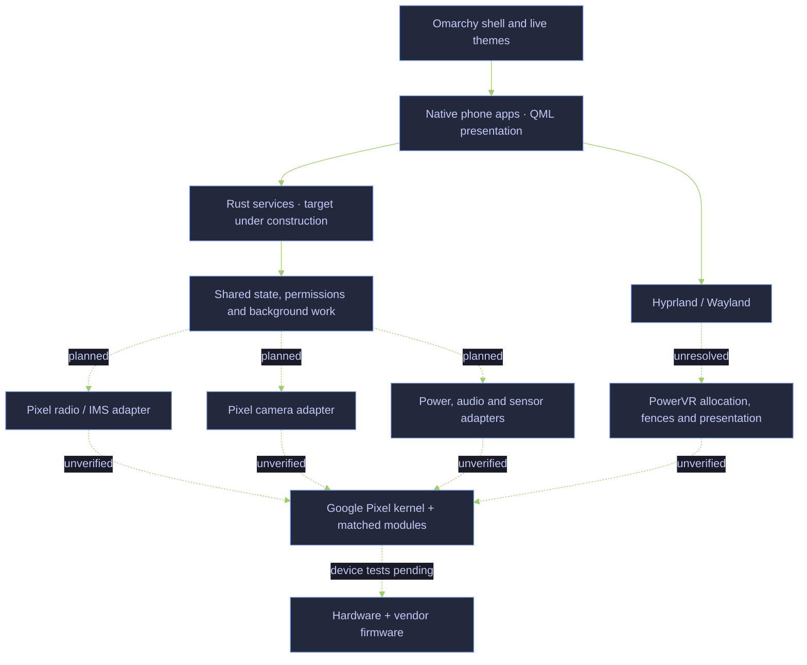
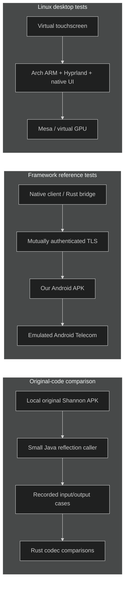
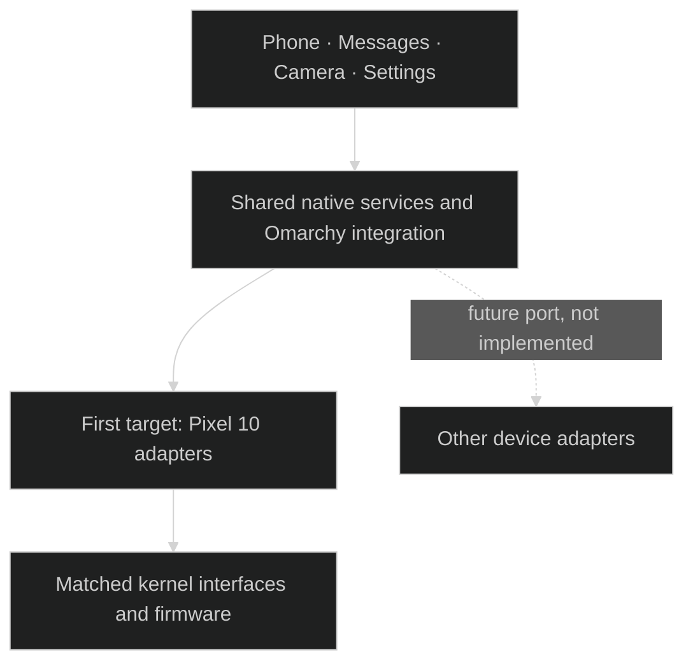

# Pokélinux — independent mobile Linux research

**Native Linux phone software, with Pixel 10 as the first hardware target and Omarchy as the intended desktop and theme environment.**

The target is Arch Linux ARM, Hyprland, native phone apps and Rust services for calls, messages, camera, power and other phone functions. The initial hardware strategy uses Google's matched Pixel kernel, modules and firmware. Replacing Android framework userspace is the goal; it is not yet achieved. The [completion criteria](docs/smartphone-goal.md#completion-matrix) require native service integration; Android framework tests provide reference evidence.

> **Development status:** no physical phone has been accessed. There is no verified bootable phone image. Modem communication, carrier IMS registration, physical call audio, Pixel GPU rendering, camera capture and suspend remain unverified.

This is an independent project, not an official release of Omarchy, Arch Linux or Google. Project branding does not grant rights to their names or artwork.

## Architecture we are building



Dashed connections are work still required, not working hardware paths. “Rust services” is the implementation direction; only a small part of native IMS exists today. We are not rewriting the Linux kernel or modem firmware in Rust. The [current integration map](docs/native-integration-map.md) separates components, installed service/app composition and remaining backend evidence.

## What has been tested

| Area | Evidence and scope | Still missing |
|---|---|---|
| Native SMS codecs and outbox | 27 encoder and 33 decoder comparisons with Android’s actual implementation; bounded multipart planning and durable SQLite admission pass Linux/ARM64 tests. SIGKILL/restart retains uncertainty under an actual ARM64 kernel. [Report](docs/native-messaging.md) · [Codec evidence](docs/evidence/sms-submit-provenance.json) · [Outbox evidence](docs/evidence/sms-outbox-provenance.json) · [Receive evidence](docs/evidence/sms-receive-provenance.json) | Installed sending and continuous incoming composition, qualified transport receipts, delivery, carrier and wake behavior |
| Native GSM status reports | Bounded Rust status-report parsing passes57 actual AOSP comparisons and12 focused tests on x86/ARM64 user-QEMU;61 stricter malformed and8 unsupported cases remain explicit. [Report](docs/native-sms-status-report.md) · [Evidence](docs/evidence/native-sms-status-report-provenance.json) | Production receive/ACK identity, separately qualified delivery correlation, installed apps/notifications and modem/carrier proof |
| Installed native Messages history | One lifecycle actor and owned raw/inbox child release bounded history to an actual distinct-UID Qt window in original Omarchy. Eleven ARM64 desktop groups, nested ten service groups and two retained-descriptor cases pass; x86 service/recovery, current permission/EAGAIN fences, SQLite recovery and seven actual Qt worker checks pass. [Report](docs/native-messages-service.md) · [Current evidence](docs/evidence/native-messages-correction-provenance.json) · [Qt worker](docs/native-messages-ui-worker.md) | Incoming synthetic composition is qualified separately below; enumeration is qualified separately below; trusted lock/focus/session ingress, Wayland containment, notifications/wake, send/ACK/producer identity, production session ACLs and modem/carrier/device proof |
| Synthetic incoming Messages composition | Separately built receive-only fixture composes genuine ARM64 Binder callbacks with the sole raw/inbox child and current-authority native client reads. Eighteen actual kernel integration groups plus three identity checks pass; three executed reds establish background projection and authenticated stop-to-exit correction. [Report](docs/native-messages-incoming.md) · [Evidence](docs/evidence/native-messages-incoming-provenance.json) | Normal installed service remains history-only. Modem/producer/ACK/reset, raw retention/capacity and cold backlog availability, callback allocation/completion bounds, trusted session, notifications/wake and hardware remain open |
| Independent Messages receiving/read lifetimes | An owned readonly child cancels/reaps independently of the sole raw/inbox writer. Actual ARM Binder and SQLite qualification preserves the same live source/generation through held-read close/expiry; exact occurrence permits exclude held SQLite transactions. [Report](docs/native-messages-receive-isolation.md) · [Evidence](docs/evidence/native-messages-receive-isolation-provenance.json) | Production incoming backend, producer/ACK/reset, filesystem stalls, unqualified cold backlog, notifications/wake, retention and successful cold current-session/Qt reopen; incoming composition is qualified separately below |
| Complete bounded receipt enumeration | Fixed-upper owner-bound pages and eight-import turns cover every committed ID within the append-only4096 limit. Fresh SQLite33 and live Binder33 reds precede six ARM integration greens;22 receipt and6 projection cases pass per architecture. [Report](docs/native-messages-enumeration.md) · [Evidence](docs/evidence/native-messages-enumeration-provenance.json) | Retention/eviction, inbox2048 text/4096 key limits, cold backlog deadlines, current session integration and production throughput remain separate |
| Native inbox projection |20 actual SQLite/access/process tests pass on x86 and an ARM64 guest kernel;33 recorded AOSP outputs survive durable import/restart. Exact local occurrence IDs, separate equal arrivals, cancellation/deletion tombstones and storage-time local revocation qualify. [Report](docs/native-inbox.md) · [Evidence](docs/evidence/native-inbox-provenance.json) | Continuous incoming composition, trusted lifecycle/lock ingress, complete receipt enumeration/retention, multipart association, notifications and modem/carrier behavior |
| Native incoming receipt ownership |19 actual SQLite tests pass on x86 and an ARM64 guest kernel, including owned-child SIGKILL/restart;12 frozen V3 NDK/Rust Binder groups qualify raw-before-ACK, durable uncertainty and source/cancellation fencing. Equal arrivals remain distinct. [Report](docs/native-sms-receipt-owner.md) · [Evidence](docs/evidence/native-sms-receipt-owner-provenance.json) | Production producer/ACK identity and policy, receive worker/storage supervision, retention, delivery correlation, installed permission/app/background and ARM64 Binder/device proof |
| Native SMS submission ownership | Ten actual frozen V3 NDK/Rust Binder groups qualify durable uncertainty, exact final receipts, malformed metadata and cancellation/death/restart fences. Seven additional SQLite owner tests pass on x86/ARM64 user-QEMU. [Report](docs/native-sms-transport.md) · [Evidence](docs/evidence/native-sms-binder-provenance.json) | Production modem/error adapter, receive/ack identity, delivery correlation, installed permissions/app/background and ARM64 Binder/device proof |
| Original SMS transport contracts | Frozen standard messaging V3 recovered;50 isolated original Shannon codec/tracker outcomes and8 message IDs observed. [Report](docs/native-sms-transport.md) · [Evidence](docs/evidence/native-sms-transport-provenance.json) | Real frozen Binder callback/lifetime qualification, receive identity/ack replay, delivery correlation and modem/IMS behavior |
| Native IMS registration payload | 121 pure original APK probes qualify 37 complete populated-field cases and 84 explicit native refusals; an immutable decoder returns opaque bytes and absent extensions without partial/old fields. Eight focused tests and all prior tests pass: 24 per x86/ARM64 user-QEMU target. [Report](docs/native-ims-registration.md) · [Evidence](docs/evidence/native-ims-registration-provenance.json) | Producer/slot/message/reset identity, semantic IMS/RAT/bearer/call/media/carrier integration, installed service and ARM64 Binder/device proof |
| Native IMS wire reader |148 valid scalar/opaque-field values and remaining counts match247 original APK probes;96 bounded refusals and3 oversized inputs remain explicit. Ten focused tests plus all prior codec tests pass on x86/ARM64 user-QEMU. [Report](docs/native-ims-reader.md) · [Evidence](docs/evidence/native-ims-reader-provenance.json) | Whole IMS response layouts and producer identity, semantic publication, state/bearer/call/media/carrier integration, installed service and ARM64 Binder/hardware |
| Native IMS codecs | 207 cases match outputs from the original Shannon APK: 45 scalar writes and 162 payload encodings for two request classes. [Tests](native-ims/tests) · [provenance](docs/evidence/codec-provenance.json) | Transport, state machine, valid state/RAT semantics, registration and carrier operation |
| Original radio proxy | Ten payload cases and two rejected transactions through the original raw and segmented request proxies into an in-process Binder capture endpoint. [Provenance](docs/evidence/binder-provenance.json) | Actual vendor service and modem behavior |
| Original request segmentation | Five executed boundary cases reproduce missing final chunks for exact multiples of 2,048 above 2,048 bytes. [Evidence](docs/evidence/segmentation-provenance.json) | Vendor endpoint acceptance and real-world impact |
| Original indication assembly | Eight executed cases verify index ordering, duplicate handling, missing-index exceptions, excess bytes and empty payloads in the original APK accumulator. [Evidence](docs/evidence/indication-assembly-provenance.json) | Interleaved message identity and vendor reset guarantees |
| Original indication adapter | Seven executed cases cover slot filtering, ID reuse, interleaving, changed totals and state retained after exceptions. [Evidence](docs/evidence/indication-adapter-provenance.json) | Producer serialization and reset guarantees; malformed input acceptance is not a Rust requirement |
| Native callback lifecycle | Blocking delivery, cancellation during held registration, rejection of late registration success, owner-inbox loss, replacement, late callbacks and peer death pass through Binder on Harbour. [Held-registration evidence](docs/evidence/held-registration-provenance.json) | Vendor cleanup/re-registration, candidate/operation lifetimes and native phone-state integration |
| Factory radio recovery contracts | 52 static REA records identify the exact native V1 binding, actual service adapter and scoped manager/producer/death paths; seven retained targets are hash-verified. [Report](docs/native-radio-recovery-contract.md) · [Evidence](docs/evidence/native-radio-recovery-contract-provenance.json) | Actual factory adapter/manager/pending-reset execution, complete producer identity/serialization and cleanup acknowledgement before safe successor registration; no new runtime or retry enabled |
| Native owned registration | One owned worker and retained death watch now pass held cancellation/expiry, capacity retention, no-retry, and death before/after activation through Binder. [Evidence](docs/evidence/radio-worker-provenance.json) | Remote cleanup/reset contract, installed service supervision and complete request/outcome integration |
| Native owned requests | Six actual Binder scenarios and five x86/ARM64 user/kernel checks qualify guarded dispatch, NotSent/OutcomeUnknown, one-way submission and a late raw callback. [Report](docs/native-radio-requests.md) · [Evidence](docs/evidence/radio-request-provenance.json) | Qualified final IMS receipts, durable request admission, safe subsequent operations, driver pressure, installed service and modem behavior |
| Native process reclamation | Rust parent terminates/reaps a child permanently blocked in synthetic Binder, revokes old output and refuses registration after supervisor restart using a synced admission marker. [Evidence](docs/evidence/radio-supervisor-provenance.json) | Vendor cleanup and safe successor registration, installed service manager/IPC integration and matched Pixel-kernel/policy qualification |
| ARM64 process boundary | Actual Rust components, blocked-worker SIGABRT and failed-exec admission persistence pass as an unprivileged user under an Arch Linux ARM kernel in system-QEMU. [Evidence](docs/evidence/arm64-radio-process-provenance.json) | Pixel kernel/policy and physical hardware; Binder qualification is recorded separately below |
| ARM64 kernel Binder | Nine actual Rust/manual peer scenarios pass under unchanged Arch ARM7.1.6, including held cancellation/expiry, callbacks/death, requests and permanent Binder-worker reap/restart refusal. Three separate genuine Android Binder/Bionic NDK interop scenarios pass with runtime/stub separation. [Report](docs/native-arm64-binder.md) · [Evidence](docs/evidence/native-arm64-binder-provenance.json) | Matched Pixel kernel/SELinux/discovery, installed service composition, complete producer identity, vendor cleanup/reset, modem/carrier and physical hardware |
| Native publication owner | Raw response snapshots reject consumed work after cancellation/replacement; activation, failure and commit share one gate. Linux/ARM64 tests and real Binder owner scenario pass. Absolute boot-time session expiry also rejects held registration success with timer delivery withheld. [Deadline evidence](docs/evidence/radio-deadline-provenance.json) · [Owner evidence](docs/evidence/radio-owner-provenance.json) | Installed service recovery, candidate deadlines, qualified final receipts, watch notifications and decoded IMS/call state |
| Native indication assembly | Bounded single-candidate Rust assembly passes Linux/ARM64 component tests and a real Binder fragment-to-result test. [Evidence](docs/evidence/native-assembly-provenance.json) | Session deadlines, aggregate budgets, epoch fencing and vendor message identity |
| Native request splitting | Lossless Rust planner tested on Linux x86-64 and ARM64/QEMU across 14,337 segmented payload lengths. [Evidence](docs/evidence/request-parts-provenance.json) | Vendor endpoint acceptance |
| Native Linux Binder | Static Linux Rust client performs service lookup and receives a one-way Android callback through the real Binder driver with SELinux enforcing. [Report](docs/native-binder.md) | Actual vendor radio calls/callbacks and Pixel permissions; ARM64 synthetic IPC is qualified separately below |
| Native radio transport | Rust registration, request/response round trips, raw/segmented indication delivery and shared inbox overflow through real Binder to an independent Java test peer, SELinux enforcing. [Evidence](docs/evidence/radio-indication-provenance.json) | Vendor service, session recovery and modem operation |
| Vendor response metadata | Generated Rust AIDL binding matches seven original Android typed-object fixtures on Linux and ARM64/QEMU; selected malformed boundaries are rejected. [Evidence](docs/evidence/response-info-provenance.json) | Full vendor callback transactions, response semantics and reassembly |
| Original Omarchy appearance | Eight actual original Omarchy/native renderer comparisons pass in an ARM64 Hyprland guest, including live themes, font changes and token overrides while retaining the window/draft. Six Qt/process cases qualify owned font-helper teardown and boot-time completion. [Report](docs/native-theme.md) · [Worker evidence](docs/evidence/native-theme-worker-provenance.json) | Complete installed smartphone/shell provisioning, arbitrary themes/wallpapers, actual suspend and mobile display/input; Messages composition is qualified separately above |
| Native desktop | Arch ARM VM, Hyprland, virtual touch, installed app lifecycle and live theme tests. [Report](docs/native-virtual-graphics.md) | Physical display/input, full phone shell and device boot |
| Android reference bridge | Enrollment, permissions, callbacks and call controls tested against Android Telecom in an emulator. [Report](docs/android-framework-tests.md) | These tests do not prove native IMS or real voice calls |
| Graphics compatibility | Stock Pixel EGL/GLES libraries load through libhybris; initialization reaches the missing-GPU boundary. [Audit](docs/hardware-boundary-decision.md) | Successful Pixel EGL initialization, dma-buf allocation/import, fences and scanout |
| Native camera ownership | Nine real-Binder checks use exact frozen cameraV4 types/callbacks and original generated NDK code: return/completion/release split, cached reuse, single-shot receipts, held revocation and death quarantine. [Report](docs/native-camera-owner.md) · [Evidence](docs/evidence/native-camera-owner.json) | Installed camera service, atomic media publication, durable quarantine/reset, multi-stream/FMQ, sync_file/gralloc/DMA, actual capture and ARM64/device proof |
| Camera Binder boundary | Original generated NDK dispatcher/proxy and independent Rust client pass error-count omission, real FD transfer/release, 64-cycle FD bounds and peer death with SELinux enforcing. [Report](docs/native-camera-boundary.md) · [Evidence](docs/evidence/native-camera-boundary.json) | Camera service, exact provider ABI, gralloc/sync_file/DMA, capture and ARM64/device qualification |
| Native connectivity boundary | Eight stages against original NetworkManager/private D-Bus pass with x86 and ARM64 user-QEMU Rust clients, including owner replacement, late-response expiry and actual daemon/bus death. [Report](docs/native-connectivity.md) · [Evidence](docs/evidence/native-connectivity-provenance.json) | Installed authority/permissions, scan/activation/IP/portal behavior, BlueZ, physical Wi-Fi/Bluetooth, coexistence and USB |
| Native audio authority | Five policy tests pass on x86/ARM64 user-QEMU;16 original PipeWire/WirePlumber stages plus authenticated stop qualify private routing, responsive status, owned blocked-worker reaping and explicit recovery. [Report](docs/native-audio.md) · [Evidence](docs/evidence/native-audio-process-provenance.json) | Installed audio service, app PCM broker, durable reconciliation, physical routes/mute, AoC/carrier audio, DND/volume/haptics and idle power |
| Native suspend coordination |27 checks pass on x86 and under an actual ARM64 kernel;24 component checks pass in ARM64 user-QEMU. Eight unmodified Android17 source cases qualify ordering and wake-object lifetime. [Report](docs/native-suspend.md) · [Evidence](docs/evidence/native-suspend-provenance.json) | Installed suspend authority, actual kernel abort/count semantics, stuck-driver supervision and Pixel wake/thermal/charging behavior |
| Retained suspend Binder boundary |18 actual x86 Binder outcomes qualify frozen V1 NDK/Rust interoperability, wake-object transfer/destruction, authority death and both original libpower cache branches. [Report](docs/native-suspend-boundary.md) · [Evidence](docs/evidence/native-suspend-boundary-provenance.json) | Default service registration/VINTF/SELinux, production permissions, ARM64 Binder, supervised backend IO and real suspend/wake |
| Native power arbitration | Owned leases, boot-time expiry, cancellation, application uncertainty and stale-result fencing pass18 tests on x86/ARM64 user-QEMU;18 outcomes match actual public reference execution. [Report](docs/native-power.md) · [Evidence](docs/evidence/native-power-provenance.json) | Installed power/suspend authority, authenticated lifecycle, backend IO/reclamation, Pixel policy and hardware |
| Native sensor ownership |11 actual x86 Binder/original-FMQ groups qualify frozen SensorsV3, raw Event ABI, authenticated subscriptions, processing-before-ACK, queue backpressure and malformed/death quarantine. [Report](docs/native-sensors-boundary.md) · [Evidence](docs/evidence/native-sensors-boundary.json) | Actual suspend wake acquisition/handoff, USF200ms and HAL1s obligations, app delivery/lifecycle, restart reconciliation, calibration and ARM64/device proof |
| Native lifecycle storage supervision |27 installed/process groups and7 real file/pidfd components pass on x86 and an ARM64 guest kernel. One owned storage child keeps controls responsive, fences late replies, seals healthy shutdown and refuses uncertain restart; cleanup faults abort before relinquishing children. [Report](docs/native-lifecycle-storage.md) · [Evidence](docs/evidence/native-lifecycle-storage-provenance.json) | Actual Omarchy launch/lifecycle ingress, atomic backend dispatch, startup/launch filesystem supervision, service-manager/cgroups, power-loss and uninterruptible kernel tasks |
| Native sensor wake ownership |10 actual original-FMQ/frozen-V1 Binder groups qualify acquire-before-read, processing/ACK backpressure, shared blockers, real futex-error quarantine and authority fencing. [Report](docs/native-sensor-wake.md) · [Evidence](docs/evidence/native-sensor-wake-provenance.json) | Installed source/reader wake participation, USF200ms/HAL1s duties, durable quarantine, permission/app delivery, ARM64 and hardware |
| Native device contracts | Exact Android17 camera/audio/power/sensor schemas, selected factory hash matches and focused REA lifecycle facts. Public power-source checks and AIDL compiler generation pass. [Report](docs/native-device-contracts.md) | Installed Rust services, actual ABI/FMQ/DSP/buffer integration and device gates |
| Native compositor source boundary | Owned focused pidfds replace scalar identity. Earlier14 leaf/26 observer,15 host/14 ARM actor and17 original-compositor groups remain separately frozen. Four fresh process reds precede bounded continuous-queue correction;34 cases pass on both host and actual ARM kernels. [Owned focus](docs/native-session-owned-focus.md) · [Freshness](docs/native-session-freshness-chain.md) | Genuine publisher gaps still fail the unchanged100ms lease; broad graphics availability, matched kernel, trusted launch/procfs/namespace and Quickshell/PAM containment, secure frames, resume/wake and hardware |
| Native display containment and setup | Fifteen original ARM compositor/normal Qt identity groups and22 owned-supervisor observations across six ARM epochs pass. Actual bind denial, held-worker control, original deadlines, queued Ready fencing, source/parent death and reaping remain separately selected. [Report](docs/native-display-containment.md) | Per-app context generation/relaunch, production privileged-runtime/PAM provisioning, complete protocol/data restrictions, secure presentation, suspend/wake and Pixel kernel/display hardware; current actor composition is qualified separately below |
| Original compositor to installed native Messages | Six normal production Qt groups and a fresh ten-group diagnostic epoch now pass with the writer/readonly split under an actual ARM64 kernel. Earlier three diagnostic epochs remain separately frozen. Owned source/focus handles, independent grants, null/layer focus, held storage and source failure reach the real UID11010 window. [Report](docs/native-session-installed-app.md) · [Initial evidence](docs/evidence/native-session-installed-app-provenance.json) · [Combined replay](docs/native-session-receive-read-combined.md) | Local synthetic history only; locked graphics can exceed the original100ms lease. Production source provisioning, Quickshell/PAM restore, privileged Wayland containment, secure frames, successful cold incoming/session/Qt reopen, notifications/wake and Pixel hardware remain open |
| Current actor with owned restricted display | Required source stop/occupancy joins the supervised Rust SDK child to actor cleanup. Original compositor, exact current app focus, independent grants and unchanged normal Qt pass25 ARM groups after two integration reds. [Report](docs/native-session-display-composition.md) | Service-epoch context only; per-app contexts/relaunch, incoming plus restricted display, production source/PAM provisioning, secure frames, cold availability, wake and Pixel remain open |
| Frozen incoming Binder to original session and normal Qt | Actual ARM64 Binder arrivals compose the sole writer, independent readonly child, owned-focus actor and normal UID11010 Qt app. Historical failures remain frozen. Exact current baseline RED precedes the corrected nine-group cold-reopen/source-loss/peer-death ARM matrix, with receiving preserved and100ms unchanged. [Report](docs/native-incoming-session-installed-app.md) · [Freshness proof](docs/native-session-freshness-chain.md) | Observed publisher gap99.2ms leaves narrow availability margin; broad scheduling, production modem/ACK/reset, incoming plus restricted display, secure presentation/PAM, notifications/wake and Pixel hardware remain open |
| Native permission/lifecycle authority (initial checkpoint) |18 installed Linux credential/process groups and4 pidfd/file checks pass on x86 and an actual ARM64 kernel. Distinct-UID launcher, per-packet identity, stale permit fencing and private durable uncertainty are qualified. [Report](docs/native-lifecycle.md) · [Evidence](docs/evidence/native-lifecycle-provenance.json) | Trusted Omarchy lock/focus/session ingress, complete installed phone bundle and atomic backend dispatch; supervised storage and local Messages are qualified separately above |
| Native deployment admission |29 groups pass on x86/ARM64 user-QEMU; actual compiled ELF geometry, streaming file identity, ownership/dependency declarations and constrained inventory loading qualify. [Report](docs/native-deployment.md) · [Correction evidence](docs/evidence/native-deployment-correction-provenance.json) | Selected Pixel deployment refused: nine offline requirements, one physical gate and three absent artifact pins; no native boot/install or transitive ABI/KMI qualification |
| Complete smartphone | Scope and hardware dependency audit recorded. [Completion matrix](docs/smartphone-goal.md) | SMS, camera, audio, cellular data, sensors, power and background wake require further implementation and integration |

Historical reports refer to local `artifacts/` paths. Those files are not all published. A source test or old report is not a current hardware qualification certificate.

Public-source publication excludes proprietary inputs, raw decompilation, credentials, private runtime artifacts and macOS resource-fork sidecars. The [public audit](docs/publication-audit.md) checked current files, all reachable history and GitHub attachment surfaces: no validated credentials, proprietary input binaries or raw decompilation dumps were found. Benign historical metadata and removed private conversation references remain in old commits; source/log hashes were validated as scanner false positives.

## Real UI evidence

These are captures from an **Arch ARM virtual machine**, showing the same phone app under two Omarchy themes. The bridge is deliberately unavailable in this test. They demonstrate theme integration, not a working cellular phone.

| Tokyo Night | Catppuccin Latte |
|---|---|
|  |  |

## Why keep an Android test environment?

The repository contains a functioning reference bridge and earlier Python/GTK experiments. They help compare behavior and test boundaries. They are **not a commitment to retain Android framework userspace or two production runtimes**. The current implementation direction is Rust service logic, QML presentation and only necessary low-level ABI glue.



These are separate test paths. None emulates the Pixel modem, PowerVR GPU or camera sensor. The Shannon caller invokes selected serializers and a generated proxy connected to a local capture endpoint; it does not activate a working IMS service. REA is the chosen analysis tool for closed components; original-code execution and device evidence must validate recovered behavior.

## Pixel first, portable where it helps

Phone UI, theme integration, common state models and test tools can be reused. Radio protocols, camera interfaces, GPU/display paths, boot configuration and power behavior depend on the device. Another phone will need its own adapters and hardware qualification.

We will build the concrete Pixel target first and extract shared interfaces when supported by real needs. We do not claim a universal phone hardware layer or support for untested devices.

The [device portability decision](docs/device-portability.md) keeps vendor protocols outside shared phone logic. The current `native-radio` crate implements Samsung radioExternal; it is not a universal modem API. Java peers are Android test infrastructure, not the target phone runtime.



## Decisions

| Decision | Reason |
|---|---|
| Native Rust service logic | One target implementation, explicit state and resource ownership, testable recovery behavior |
| QML presentation | Align with the target Omarchy shell and theme integration; presentation is separate from hardware policy |
| Google kernel initially | Preserve the device driver baseline while replacing userspace; a mainline kernel port is a separate task |
| Open interfaces first | Reuse suitable upstream work; investigate closed interfaces where necessary |
| Android as reference infrastructure | Compare real framework behavior without treating emulator success as native phone support |
| No backwards compatibility for prior iterations | Do not preserve obsolete formats, adapters or parallel production runtimes |
| Pinned upstream fetches | Keep source identity and patches reviewable without vendoring whole repositories |

[Current scope](docs/smartphone-goal.md) supersedes older architecture recommendations. [Language decision](docs/runtime-language-decision.md) · [UI decision](docs/ui-framework-decision.md) · [Native IMS investigation](docs/shannon-native-recovery.md) · [Dependency policy](docs/dependencies.md).

## Build and test

The smallest public test needs a current Rust toolchain and no vendor APK:

```sh
cargo test --locked --manifest-path native-ims/Cargo.toml
cargo clippy --locked --manifest-path native-ims/Cargo.toml --all-targets -- -D warnings
python3 -m unittest discover -s tests -p test_fetch_upstreams.py
```

Fetch public source pinned by commit and checksum:

```sh
python3 tools/fetch_upstreams.py --omarchy
```

The larger suites require a prepared Linux Docker host, separate downloaded inputs and, for Android emulation, KVM. They are not a one-command phone installer:

```sh
bash tools/offline-suite.sh       # Graphics / ARM VM environment
bash tools/framework-suite.sh prepare
bash tools/framework-suite.sh build
bash tools/framework-suite.sh shannon-codec  # Requires exact local Shannon APK
```

Read the scripts and [framework report](docs/android-framework-tests.md) before running the larger suites. They use dedicated containers and emulators. Temporary build servers are validation capacity, not runtime dependencies. No instruction here authorizes flashing a phone.

Development can run on a remote Linux build host. Native builds, component tests and Binder/radio IPC qualification pass from the relocated checkout. See [remote development](docs/remote-development.md) for setup and handoff guidance.

The current stopping point and next implementation gates are in the [development handoff](docs/development-handoff.md).

## Source map

| Path | Role |
|---|---|
| `native-ims/` | New native Rust protocol work and original-code comparison fixtures |
| `runtime/` | Rust state, local IPC, journal and reference bridge transport |
| `native-app/` | Native QML phone UI and integration tests |
| `src/`, `patches/` | Graphics compatibility implementation and small upstream patches |
| `framework/` | Android reference components and original-code callers |
| `sim/guest/`, `sim/tests/`, `tools/` | Build and offline integration harnesses |
| `omarchy-plugin/`, `transport/` | Earlier integration experiments; not the final production language/runtime choice |
| `docs/` | Decisions, evidence, limitations and remaining work |

Vendor binaries, firmware, factory images, SDKs, decompilation dumps, private keys, enrollment data, caches and VM disks are excluded from Git. Upstream code and proprietary inputs retain their own terms. A public repository is not permission to redistribute those inputs.

## License and attribution

Original project code is MIT licensed. See [LICENSE](LICENSE) and [third-party notices](THIRD_PARTY.md). Pokélinux is independent of Omarchy, Arch Linux, Google and other named projects.
