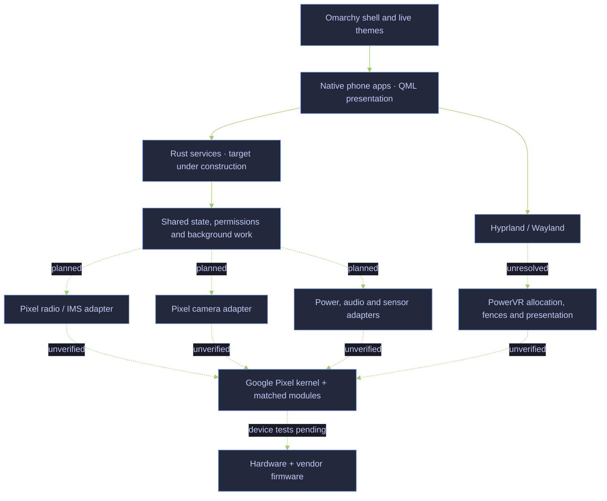
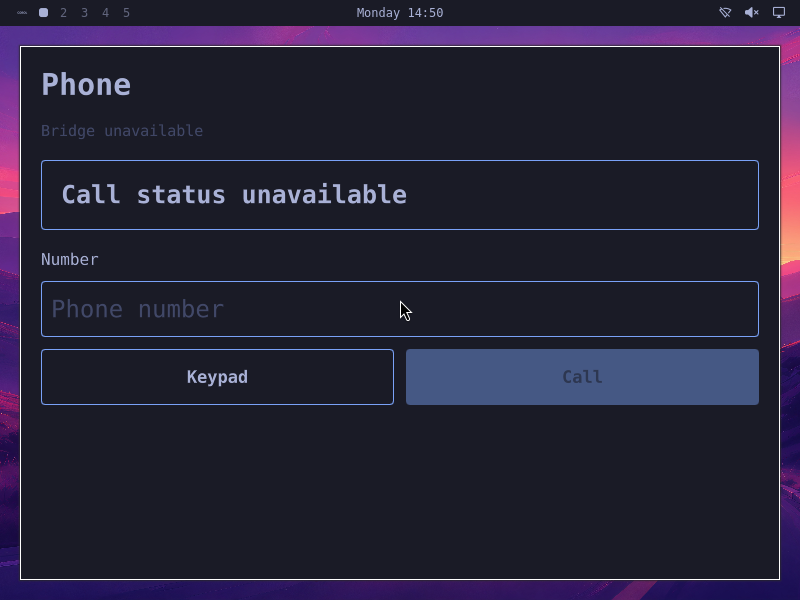
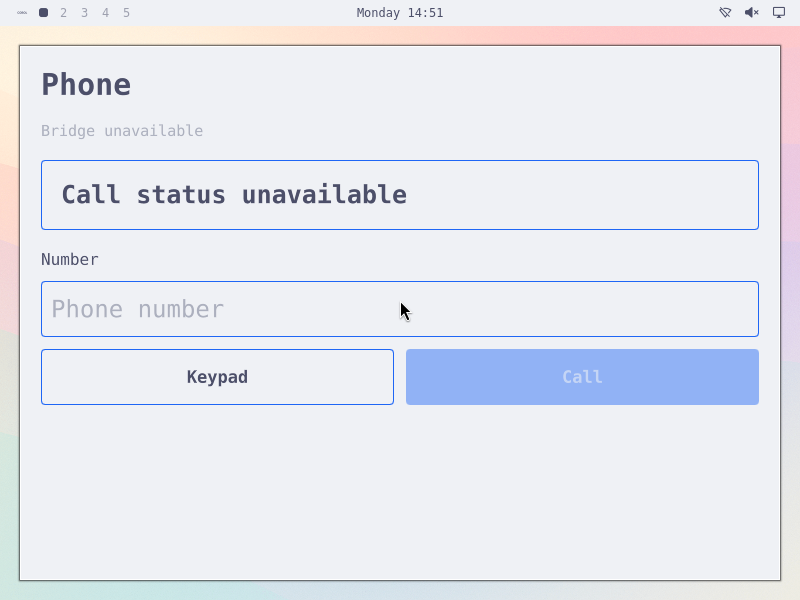
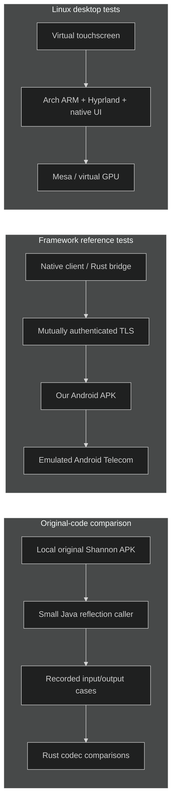
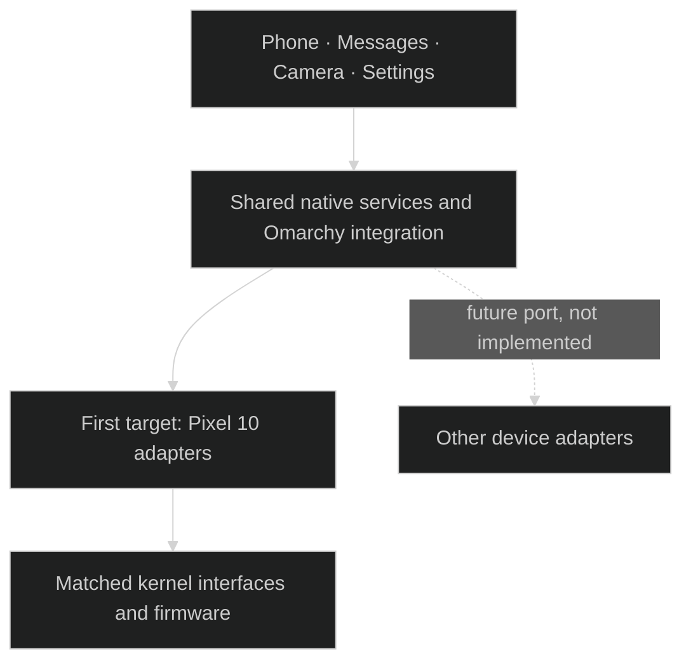

# Pokélinux — independent mobile Linux research

**Native Linux phone software, with Pixel 10 as the first hardware target and Omarchy as the intended desktop and theme environment.**

The target is Arch Linux ARM, Hyprland, native phone apps and Rust services for calls, messages, camera, power and other phone functions. The initial hardware strategy uses Google's matched Pixel kernel, modules and firmware. Replacing Android framework userspace is the goal; it is not yet achieved. The [completion criteria](docs/smartphone-goal.md#completion-matrix) require native service integration; Android framework tests provide reference evidence.

> **Development status:** no physical phone has been accessed. There is no verified bootable phone image. Modem communication, carrier IMS registration, physical call audio, Pixel GPU rendering, camera capture and suspend remain unverified.

Future UI runs and screenshots target the [Pixel 10 display profile](docs/native-phone-display-profile.md):1080 ×2424 native pixels at422PPI, with the matched image's420 logical density. Three actual ARM checks now qualify virtual physical metadata, native capture pixel equality and normal unload restoration. Each UI fixture must retain the profile and capture guards; older screenshots keep their original geometry.

This is an independent project, not an official release of Omarchy, Arch Linux or Google. Project branding does not grant rights to their names or artwork.

## Architecture we are building



Dashed connections are work still required, not working hardware paths. “Rust services” is the implementation direction; only a small part of native IMS exists today. We are not rewriting the Linux kernel or modem firmware in Rust. The [current integration map](docs/native-integration-map.md) separates components, installed service/app composition and remaining backend evidence.

## What has been tested

The [native Rust session owner](docs/native-session-owner.md) retains the
compositor Child and composes Source, lifecycle, per-app display and audio.
The current [Messages history assembly](docs/native-messages-session-composition.md)
adds an explicit history/disabled target and the shared appearance client. Current
host components36 and Source-status12 pass in one recorded selection; later
retained release owner/launch-client builds and three exact-owner history cases
pass separately. Actual eight-file Make staging also passes without activation.
The earlier missing-fixture aggregate remains failed. Normal
Messages GUI/session composition, ARM availability and all phone gates remain open.
Host ownership/storage checks, strict host/ARM builds and Make staging qualify
within their recorded scopes. [Source observation](docs/native-source-observation.md)
adds four actual IPC/four local passes after genuine RED. The separate default
library run passes68 tests, including those four local cases, with20 ignored. The startup gate separately passes two real
ARM Wayland/socket cases.

The [non-presenting discovery replay](docs/native-session-owner.md#non-presenting-discovery-replay)
still fails before Sounds/PCM. A later [startup-event witness](docs/native-session-owner.md#startup-event-witness-replay)
retains13 committed landmarks with no error flags. Its last observed completion
precedes the last accepted Source sample by1.35s; Source reaches sequence50 before
a119ms expiry against the unchanged100ms lease. This does not justify another
startup gate or identify a cause. A [native x86 KVM runtime](docs/native-session-x86-runtime.md)
now boots the authenticated stock Arch guest and shuts down normally; the matching
Rust payload builds. A later [offline install](docs/native-session-x86-runtime.md#offline-installed-guest)
qualifies the signed367-package cohort, actual Hyprland binary/SDK and audio tools.
A later [native composition attempt](docs/native-session-x86-runtime.md#actual-native-qt-and-composition-attempt)
passes the current30 audio behaviors and29 appearance cases, but Source fails
with `InvalidData` during compositor startup before Sounds/PCM. The rejection
cause remains unknown. [Typed first-rejection status](docs/native-source-observation.md#first-observer-rejection-evidence)
now passes12 actual admin cases after eight missing-record REDs, with57 Observer
process and four lifecycle regression passes. Its [original native replay](docs/native-session-x86-runtime.md#typed-rejection-replay)
now identifies a110.824ms producer sample gap before Sounds/PCM. The particular
compositor operation remains unknown. A later [render-witness replay](docs/native-session-x86-runtime.md#render-witness-replay)
places a112.844ms separation between adjacent late-render landmarks inside a
113.029ms producer gap. It still fails before Sounds/PCM; no particular call or
rendering cause is established. A later paired [endRender observation](docs/native-endrender-observation.md),
after13 component passes and a separate native source build, observes116.618ms
around fence creation inside a116.918ms Source gap. Matching SDK/plugins and
current Qt checks pass; full composition still fails before Sounds/PCM. This
narrows the span without identifying an exclusive CPU/driver cause. A later
inner-fence component passes24 frozen-v2 cases after eight semantic REDs, and a
second complete native source build passes with its matching499-file SDK. The
new matching replay observes113.338ms around eglCreateSyncKHR inside a113.644ms
Source gap, then still fails before Sounds/PCM. This supplies no inner driver or
earlier-failure cause. A separate kernel capability probe qualifies specific
tracefs metadata/private control readbacks, without observer activation or an
ioctl/timing result. Root8 plans header-selected EXECBUFFER, WAIT, TRANSFER_TO_HOST
and TRANSFER_FROM_HOST observations. A later14-case observer-absent baseline
qualifies expected RED:6pass/8 missing-observer failures,0 errors or setup failures.
A first observer attempt passes13/14; corrected timestamp decoding then passes
the same14 component tests. This GREEN covers EXECBUFFER/VERSION helpers only;
Root8 then reaches policy readiness but discovery aborts before Sounds/PCM. Its
diagnostic gate skips collection, so no kernel timing measurement qualifies. A
corrected Root9 capture qualifies11 selected pairs and a long successful
EXECBUFFER interval inside the EGL bracket, while full runtime still fails before
Sounds/PCM. A bounded source review finds no concrete driver repair and closes
that investigation. A later [prepared rendering-stall baseline](docs/native-render-authority.md)
qualifies actual RED: three controls and an authority-stall negative pass, while
focus/death/lock under entered rendering holds all time out. Production ownership
separation and GREEN remain open. The interval proves no avoidable wait or cause.
The selected set is not exhaustive:
short or absent selected calls leave the delay unresolved and establish neither a
userspace-only cause nor offload. ARM and phone gates stay open.
A later [connected Rust immutable SHM import](docs/native-render-import.md) now
passes formatting/Clippy, an actual x86 Release library build, five real C++/Rust
lifetime groups and a full native compositor build with its matching501-file SDK.
GL remains on the original owner. A later actual Wayland no-attach case qualifies
RED: import identity changes7→8 while the same16,384 pixel bytes remain. A one-file
incoming-buffer guard repair passes the matching full rebuild/five FFI groups and
the unchanged actual no-attach oracle: identity stays7→7. This CPU identity GREEN
leaves rendering ownership and Source GREEN open. A separate actual padded ARGB
Cairo-consumer case now qualifies RED: intact stride144 source rows are consumed
as stride128, producing992 wrong pixels out of1,024. The one-helper stride repair
passes its matching native rebuild and unchanged actual oracle: both live Cairo
comparisons check1,024 pixels with zero mismatches. Post-client-exit checks retain
raw Rust snapshot bytes only. No complete cursor output or presentation is qualified.
A separate original Rust commit-permit component passes eight native Linux
thread/clock/admission tests and formatted-source QA after an actual owner-drop
RED and repair. It supplies one-shot attempt ordering and same-epoch invalidation;
connected worker, AQ/GL and Source integration remain open.
The complete [31-file scene prerequisite checkpoint](docs/native-render-import.md#qualified-scene31-checkpoint)
passes its full native build/505-file SDK. Its new producer/GL primitives compile;
the unchanged actual Source7 replay still has four controls and three rendering
failures. That ELF selects the earlier snapshot-only Rust archive.
A later [immutable frame CPU checkpoint](docs/native-render-frame.md) passes14
postimplementation Rust boundary cases. A separate historical FULL33 build/507-file
SDK passes five snapshot FFI and four real codec CPU groups using authored plan
values. The implemented-only public frame header has fresh Rust QA and a separate
successful native33 build/507-file SDK with the same five FFI/four codec groups. Live scene production, GL/worker execution and Source GREEN
remain open.
Earlier [permission-aware ARM Sounds composition](docs/native-audio-arm-lifecycle.md)
passes four touch/graph/PCM groups using root-authored focus. Physical audio,
production session completion and all phone gates remain open.

| Area | Evidence and scope | Still missing |
|---|---|---|
| Native SMS codecs and outbox | 27 encoder and 33 decoder comparisons with Android’s actual implementation; bounded multipart planning and durable SQLite admission pass Linux/ARM64 tests. SIGKILL/restart retains uncertainty under an actual ARM64 kernel. [Report](docs/native-messaging.md) · [Codec evidence](docs/evidence/sms-submit-provenance.json) · [Outbox evidence](docs/evidence/sms-outbox-provenance.json) · [Receive evidence](docs/evidence/sms-receive-provenance.json) | Installed sending and continuous incoming composition, qualified transport receipts, delivery, carrier and wake behavior |
| Native GSM status reports | Bounded Rust status-report parsing passes57 actual AOSP comparisons and12 focused tests on x86/ARM64 user-QEMU;61 stricter malformed and8 unsupported cases remain explicit. [Report](docs/native-sms-status-report.md) · [Evidence](docs/evidence/native-sms-status-report-provenance.json) | Production receive/ACK identity, separately qualified delivery correlation, installed apps/notifications and modem/carrier proof |
| Installed native Messages history | One lifecycle actor and owned raw/inbox child release bounded history to an actual distinct-UID Qt window in original Omarchy. Eleven ARM64 desktop groups, nested ten service groups and two retained-descriptor cases pass; x86 service/recovery, current permission/EAGAIN fences, SQLite recovery and seven actual Qt worker checks pass. [Report](docs/native-messages-service.md) · [Current evidence](docs/evidence/native-messages-correction-provenance.json) · [Qt worker](docs/native-messages-ui-worker.md) | Incoming synthetic composition is qualified separately below; enumeration is qualified separately below; trusted lock/focus/session ingress, Wayland containment, notifications/wake, send/ACK/producer identity, production session ACLs and modem/carrier/device proof |
| ARM phone tracer | Eight actual ARM groups compose authored closed-window SMS, native Rust storage/current reads, genuine Omarchy and unchanged UID11010 Qt Messages with keyboard submission and fresh reopen. Two unscaled1080×2424 SDL/X11 captures have complete RGB equality, healthy Source before/after and Root text/palette review; epochs1–11 remain failed. [Report](docs/native-phone-tracer.md) · [Evidence](docs/evidence/native-phone-tracer-provenance.json) | Pre-lock core selection; newer joint lock/camera runtime, trusted controls, live theme broker, icon-font provisioning, notifications/wake, production modem/ACK/reset and Pixel/full-phone qualification remain open |
| Google-kernel synthetic Messages receiving | Three current-source groups pass actual public V3 Binder callbacks→three raw occurrences, background projection, current-authority exact-ID reads, held-reader revocation and clean history reopen on the unchanged authenticated Google4K kernel in RAM-only QEMU. [Report](docs/native-google-kernel-services.md#later-current-source-binder-composition) · [Evidence](docs/evidence/native-google-kernel-messages-binder-provenance.json) | Authored peer/receiver fixture; normal installed daemon stays history-only. Vendor producer/ACK/send, normal Qt/session, power-loss persistence and Pixel hardware remain open |
| Synthetic incoming Messages composition | Separately built receive-only fixture composes genuine ARM64 Binder callbacks with the sole raw/inbox child and current-authority native client reads. Eighteen actual kernel integration groups plus three identity checks pass; three executed reds establish background projection and authenticated stop-to-exit correction. [Report](docs/native-messages-incoming.md) · [Evidence](docs/evidence/native-messages-incoming-provenance.json) | Normal installed service remains history-only. Modem/producer/ACK/reset, raw retention/capacity and cold backlog availability, callback allocation/completion bounds, trusted session, notifications/wake and hardware remain open |
| Independent Messages receiving/read lifetimes | An owned readonly child cancels/reaps independently of the sole raw/inbox writer. Actual ARM Binder and SQLite qualification preserves the same live source/generation through held-read close/expiry; exact occurrence permits exclude held SQLite transactions. [Report](docs/native-messages-receive-isolation.md) · [Evidence](docs/evidence/native-messages-receive-isolation-provenance.json) | Production incoming backend, producer/ACK/reset, filesystem stalls, unqualified cold backlog, notifications/wake, retention and successful cold current-session/Qt reopen; incoming composition is qualified separately below |
| Complete bounded receipt enumeration | Fixed-upper owner-bound pages and eight-import turns cover every committed ID within the append-only4096 limit. Fresh SQLite33 and live Binder33 reds precede six ARM integration greens;22 receipt and6 projection cases pass per architecture. [Report](docs/native-messages-enumeration.md) · [Evidence](docs/evidence/native-messages-enumeration-provenance.json) | Retention/eviction, inbox2048 text/4096 key limits, cold backlog deadlines, current session integration and production throughput remain separate |
| Native inbox projection |20 actual SQLite/access/process tests pass on x86 and an ARM64 guest kernel;33 recorded AOSP outputs survive durable import/restart. Exact local occurrence IDs, separate equal arrivals, cancellation/deletion tombstones and storage-time local revocation qualify. [Report](docs/native-inbox.md) · [Evidence](docs/evidence/native-inbox-provenance.json) | Continuous incoming composition, trusted lifecycle/lock ingress, complete receipt enumeration/retention, multipart association, notifications and modem/carrier behavior |
| Native incoming receipt ownership |19 actual SQLite tests pass on x86 and an ARM64 guest kernel, including owned-child SIGKILL/restart;12 frozen V3 NDK/Rust Binder groups qualify raw-before-ACK, durable uncertainty and source/cancellation fencing. Equal arrivals remain distinct. [Report](docs/native-sms-receipt-owner.md) · [Evidence](docs/evidence/native-sms-receipt-owner-provenance.json) | Production producer/ACK identity and policy, receive worker/storage supervision, retention, delivery correlation, installed permission/app/background and ARM64 Binder/device proof |
| Native SMS submission ownership | Ten actual frozen V3 NDK/Rust Binder groups qualify durable uncertainty, exact final receipts, malformed metadata and cancellation/death/restart fences. Seven additional SQLite owner tests pass on x86/ARM64 user-QEMU. [Report](docs/native-sms-transport.md) · [Evidence](docs/evidence/native-sms-binder-provenance.json) | Production modem/error adapter, receive/ack identity, delivery correlation, installed permissions/app/background and ARM64 Binder/device proof |
| Original SMS transport contracts | Frozen standard messaging V3 recovered;50 isolated original Shannon codec/tracker outcomes and8 message IDs observed. [Report](docs/native-sms-transport.md) · [Evidence](docs/evidence/native-sms-transport-provenance.json) | Real frozen Binder callback/lifetime qualification, receive identity/ack replay, delivery correlation and modem/IMS behavior |
| Original IMS registration routing |17 raw dispatch cases and8 separate parser calls qualify original class code3012, exact slot filtering and full-array delivery in a fresh SDK37 x86 emulator with complete process/container closure. [Report](docs/native-ims-registration-routing.md) · [Evidence](docs/evidence/native-ims-registration-routing-provenance.json) | Full semantic channel dispatch, original producer/reset, IMS meanings and hardware; the separate installed synthetic path is qualified below |
| Original registration notifications |12 complete updates/10 original messages produce20 captured callbacks in SDK37 x86, with explicit network/adaptor constructor bypass. State2 emits URI/Connected/capability callbacks; state1 emits Disconnected/capability;3/255 emit none for these zero-feature inputs. All14 records,109 direct child waits and full owned closure pass. [Report](docs/native-ims-registration-notifications.md) · [Evidence](docs/evidence/native-ims-registration-notifications-provenance.json) | Original asynchronous loss/retry, normal APN ownership/acquisition, helper/channel construction, broader feature/URI/reason behavior, native phone state and carrier/hardware |
| Original conditional registration admission | Four original gates return false/false/false/true; two refused connected cases preserve state, and the admitted slot1 case completes entity/manager IMS_REGISTERED and inherited cellular/IMS predicates with captured-only continuation. All10 records/15 bindings, original thread quit/join and110 direct child waits close. [Report](docs/native-ims-registration-admission.md) · [Evidence](docs/evidence/native-ims-registration-admission-provenance.json) | Authored APN/request priors only: physical connectivity0 and PDN-readyfalse. The later owner-local native observation is separately qualified below; production APN ownership/acquisition, original loss/retry and phone/carrier remain open |
| Native registration observation | Data-only native-phone-state plus radio Gate mapper; exact qualified state2/private APN-prior admission, conservative withdrawal and retained source history. Library67pass/1ignored, full host78pass/7ignored and actual ARM Binder missing-positive RED→GREEN close with identical test/fixtures/oracle. [Report](docs/native-registration-state.md) · [Evidence](docs/evidence/native-registration-state-provenance.json) | Ordinary owners cannot affirm this view without a production APN-context writer. Installed status remains transport/wire diagnostics; no new service/app view export exists. Origin pairs are only RadioOwner-local; provider/worker-incarnation/subscription binding, permissions, APN ownership/acquisition and hardware remain |
| Original add-PDN request codec | Seven complete getBytes cases,40 typed setters each and61 original method/loader bindings qualify actual code105 in fresh SDK37 x86; lengths683/663/663/695/695/791/807 and complete owned/thread closure. [Report](docs/native-ims-add-pdn.md) · [Evidence](docs/evidence/native-ims-add-pdn-provenance.json) | Original codec observations only: no submission, protocol-validity, APN acquisition or remote outcome. The native comparison is qualified separately below; real ownership/dispatch and hardware remain |
| Native add-PDN encoder | Five complete original vectors match on x86 and ARM64 user-QEMU after missing-serialization RED; all35 tests pass per target, including explicit count9 refusals and input validation. Typed fields, numeric IPs, binary dates and bounded padded TLVs. [Report](docs/native-ims-add-pdn-native.md) · [Evidence](docs/evidence/native-ims-add-pdn-native-provenance.json) | Pure codec evidence; later actual Binder composition is separate below. Response meaning, APN acquisition/ownership, installed service/app integration and Pixel/carrier behavior remain |
| Native SIT setup codec | Six complete983-byte original format-2 packets match after host missing-encoder RED; eight encoder tests pass per host/ARM64 user-QEMU target. Corrected original Bionic reference has eight actual child waits/EOF. [Report](docs/native-sit-codec.md) · [Evidence](docs/evidence/native-sit-codec-provenance.json) | Pure initial token-zero subset; the base response decoder is separate below. Context/channel binding, dispatch, APN lifecycle, reset/deactivation and actual kernel/modem/Pixel/carrier remain |
| Native SIT base response decoder | Separate original load plus nine parser controls; six complete response/getter comparisons match after missing-decoder host RED.The initial22-test checkpoint is followed by an independent-server-family data-loss RED→GREEN;The canonical checkpoint passes23 tests per host/ARM64 user-QEMU target. Getter fixtures remain unchanged. [Family repair](docs/native-sit-codec.md#independent-server-families) · [Evidence](docs/evidence/native-sit-server-families-provenance.json). [Report](docs/native-sit-codec.md#base144-byte-response-decoder) · [Evidence](docs/evidence/native-sit-response-provenance.json) | Exact144-byte local policy and numeric observations only. Extended/error-remap behavior, owned dispatch correlation, context/channel/provider identity, APN lifecycle and kernel/modem/carrier remain |
| Native SIT modern report projection | Fourteen complete captured original report observations match after compiled missing-report RED;40 tests pass per host/ARM64 user-QEMU target. Separate original runs have12 and7 owned child waits0/EOF, including zero and IPv6-format controls. [Report](docs/native-sit-report-projection.md) · [Evidence](docs/evidence/native-sit-report-projection-provenance.json) | Emitted modern22/base144 observations only; unobserved/dynamic ABI fields and factory transport framing, context/channel/provider/APN lifecycle and kernel/modem/carrier/Pixel remain |
| Native owned SIT attempt | Strict13-pass/two-missing-completion baseline plus actual host/ARM process RED precede15host/15ARM user-QEMU and fixed-oracle actual host/ARM kernel GREEN. Exact983/144-byte/report observations, held-worker snapshots, expiry/cancel, actual Stop/wait9 and unchanged-journal successor refusal pass. [Report](docs/native-sit-attempt.md) · [Evidence](docs/evidence/native-sit-attempt-provenance.json) | One initial-token-zero local observation; factory complete-record/runtime source identity, descriptor/channel/slot identity, provider/APN/IMS, installed deployment and Pixel/carrier remain |
| Native SIT receive ownership | Twelve original memory-only Bionic/user-QEMU children qualify full supplied-byte copying after source overwrite/free. Strict42-pass/eight-missing-copy RED precedes50 codec and15 attempt tests per host/ARM user-QEMU target; additional actual host/ARM kernel copy→buffer overwrite→same report/lifecycle controls pass. [Report](docs/native-sit-received-chunk.md) · [Evidence](docs/evidence/native-sit-received-chunk-provenance.json) | Opaque byte ownership only; complete records/runtime source identity, production CPIF/channel/provider/APN/IMS, installed deployment and Pixel/carrier remain |
| Native owned SIT descriptor I/O | Compiled2/8 missing-dispatch RED, dispatch-only3/7 missing-read RED, then10 transport +50 codec +15 attempt tests per host/ARM user-QEMU architecture. Actual host/generic ARM kernel Main/worker completion/expiry/cancel integration passes using the primitive, with Stop/wait9 and durable successor refusal. Three additional actual syscall controls pass per host/ARM user-QEMU architecture. [Report](docs/native-sit-owned-transport.md) · [Evidence](docs/evidence/native-sit-owned-transport-provenance.json) | CPIF source/record/channel identity and production admission, installed lifecycle, provider/APN/IMS, installed deployment and physical hardware |
| Retained CPIF receive contract | Fresh4K module extraction matches the authenticated selected vendor_dlkm; exact-module read/poll, selected FMT producers and ordinary static factory paths qualify. Raw reads can retain tails or return idle zero. [Report](docs/native-cpif-receive-boundary.md) · [Evidence](docs/evidence/native-cpif-receive-boundary-provenance.json) | Complete inner-record source/start, channel custody/DT, producing source/KMI, native receive admission, provider/APN/IMS and hardware |
| Native CPIF local I/O policy | Compiled2/9 missing-policy RED then11 policy +75 existing tests per host/ARM user-QEMU target. Actual generic ARM kernel11 also pass. Poll/timer/read, idle zero, finite work and strict syntax observations; no source authority. [Report](docs/native-sit-cpif-policy.md) | Channel/record custody, device acquisition, production admission, APN/IMS and hardware |
| Native attempt natural termination | Two actual host discarded-wait REDs then host/generic ARM worker0-before-commit/70-after-commit GREEN; exact history, snapshots, Stop and journal refusal. Original3 still require worker9. Final shared-source host regression passes. [Report](docs/native-sit-cpif-policy.md#natural-process-exits) | Authored Unix fixture, installed service and CPIF authority remain separate |
| Original SIT context memory application | Fresh Bionic ARM64 user-QEMU parser→original PdpContext update: seven controls/14 calls, complete352-byte fixed-prefix copy/refusal observations and eight child waits0/EOF. Matching Non-IP copies despite return0; repeated identical calls return0. [Report](docs/native-sit-context-application.md) · [Evidence](docs/evidence/native-sit-context-application-provenance.json) | Additional original integration only. No native behavior change/retest, activation, APN ownership, normal caller/channel/provider binding or kernel/modem/carrier proof |
| Native Data/kernel observation owner | Fixed actual ARM Binder/kernel RED→GREEN retains wrong-serial refusal and accepted history. Three additional unchanged-production runs qualify ordinary public `poll()` setup, fresh same-observer joins and independent link/list/death withdrawal; list/death retain a positive controlled kernel link. Earlier 42 and additional 71 child waits/EOF qualify separately with input/container closure. [Report](docs/native-cellular-data-owner.md) · [RED/GREEN evidence](docs/evidence/native-cellular-data-owner-provenance.json) · [Public-poll evidence](docs/evidence/native-cellular-data-public-poll-provenance.json) | Controlled fixture association; unknown-serial ordinary dispatch, provider link ownership, current authorization/normal deployment, APN acquisition and Pixel/carrier remain; the separate supervised Data tracer below qualifies its own durable attempt/process scope |
| Native Data service observations | Actual production Main→owned Data worker→restricted status passes one generic ARM Binder/TUN trace: full historical report, real link-loss withdrawal, native worker wait9/Main0 and unchanged-journal refusal78.24 service+9 shared host tests and34 guest waits/EOF pass; full trace is additional integration after separate component/fixture REDs. [Report](docs/native-cellular-service.md) · [Evidence](docs/evidence/native-cellular-service-provenance.json) | Operator diagnostics only; installed unit/current authority, blocked/pressure/expiry controls, provider-to-link/slot identity, APN acquisition, remote cleanup/retry and Pixel/carrier remain |
| Public Data V3 Binder ABI | Generated Rust bindings and an independent generated NDK C++ peer pass actual ARM Binder: complete10-argument/21-field profile setup,18-field result copies, held and wrong/right-serial callbacks, populated/empty lists and endpoint death; eight child waits/EOF and input/container closure. [Report](docs/native-cellular-data-abi.md) · [Evidence](docs/evidence/native-cellular-data-abi-provenance.json) | ABI prerequisite only; later owner join is qualified separately above. APN acquisition, production endpoint/slot mapping, permissions/lifecycle and Pixel/carrier remain |
| Typed native add-PDN transport | Original-qualified663-byte payload→current owner→actual ARM Binder peer exact code105/slot1. Genuine Unsupported RED precedes send/cancel/real BOOTTIME-expiry greens in three fresh VMs; Unknown survives cancel→peer death→Stop; pre-dispatch controls stay NotSent.78 host tests pass/8 ignored; complete owned closure. [Report](docs/native-radio-add-pdn.md) · [Evidence](docs/evidence/native-radio-add-pdn-provenance.json) | Authored context and public peer only; no APN acquisition/readiness. Installed durable/permission ingress, response/reset meaning, vendor userspace replacement, carrier and hardware remain |
| Native historical registration owner | Actual ARM Binder exact3012 raw receipt→Unsupported RED→complete typed history GREEN;52 host tests, post-decode owner/deadline gates, raw↔typed replacement, five refusals and cancellation pass with identical peer/fixture/oracle and full closure. [Report](docs/native-radio-registration-owner.md) · [Evidence](docs/evidence/native-radio-registration-owner-provenance.json) | Full semantic routing, original producer/reset, native IMS and hardware; installed slot1 composition is qualified separately below |
| Installed registration-wire history | Actual packaged slot1 unit → ARM Binder → native owner → typed worker IPC → tagged private status. Accepted R4 with stale RAW R3 gives genuine RED; one service assignment gives typed R4, retained after unavailable R5.59 host tests, worker wait9/Main0/cgroup closure and unchanged-journal refusal78 pass; five other ELFs and the oracle stay identical. [Report](docs/native-radio-registration-installed.md) · [Evidence](docs/evidence/native-radio-registration-installed-provenance.json) | Installed malformed continuation, discovery/output pressure, principal negatives, original producer/reset, semantic IMS and hardware |
| Native IMS registration payload | 121 pure original APK probes qualify 37 complete populated-field cases and 84 explicit native refusals; an immutable decoder returns opaque bytes and absent extensions without partial/old fields. Eight focused tests and all prior tests pass: 24 per x86/ARM64 user-QEMU target. [Report](docs/native-ims-registration.md) · [Evidence](docs/evidence/native-ims-registration-provenance.json) | Original producer/reset and endpoint policy, semantic IMS/RAT/bearer/call/media/carrier integration, wider app composition and matched-device proof |
| Native IMS wire reader |148 valid scalar/opaque-field values and remaining counts match247 original APK probes;96 bounded refusals and3 oversized inputs remain explicit. Ten focused tests plus all prior codec tests pass on x86/ARM64 user-QEMU. [Report](docs/native-ims-reader.md) · [Evidence](docs/evidence/native-ims-reader-provenance.json) | Whole IMS response layouts and producer identity, semantic publication, state/bearer/call/media/carrier integration, installed service and ARM64 Binder/hardware |
| Native IMS codecs | 207 cases match outputs from the original Shannon APK: 45 scalar writes and 162 payload encodings for two request classes. [Tests](native-ims/tests) · [provenance](docs/evidence/codec-provenance.json) | Transport, state machine, valid state/RAT semantics, registration and carrier operation |
| Original radio proxy | Ten payload cases and two rejected transactions through the original raw and segmented request proxies into an in-process Binder capture endpoint. [Provenance](docs/evidence/binder-provenance.json) | Actual vendor service and modem behavior |
| Original request segmentation | Five executed boundary cases reproduce missing final chunks for exact multiples of 2,048 above 2,048 bytes. [Evidence](docs/evidence/segmentation-provenance.json) | Vendor endpoint acceptance and real-world impact |
| Original indication assembly | Eight executed cases verify index ordering, duplicate handling, missing-index exceptions, excess bytes and empty payloads in the original APK accumulator. [Evidence](docs/evidence/indication-assembly-provenance.json) | Interleaved message identity and vendor reset guarantees |
| Original indication adapter | Seven executed cases cover slot filtering, ID reuse, interleaving, changed totals and state retained after exceptions. [Evidence](docs/evidence/indication-adapter-provenance.json) | Producer serialization and reset guarantees; malformed input acceptance is not a Rust requirement |
| Native callback lifecycle | Blocking delivery, cancellation during held registration, rejection of late registration success, owner-inbox loss, replacement, late callbacks and peer death pass through Binder on Harbour. [Held-registration evidence](docs/evidence/held-registration-provenance.json) | Vendor cleanup/re-registration, candidate/operation lifetimes and native phone-state integration |
| Factory radio recovery contracts | 52 static REA records identify the exact native V1 binding, actual service adapter and scoped manager/producer/death paths; seven retained targets are hash-verified. [Report](docs/native-radio-recovery-contract.md) · [Evidence](docs/evidence/native-radio-recovery-contract-provenance.json) | Actual factory adapter/manager/pending-reset execution, complete producer identity/serialization and cleanup acknowledgement before safe successor registration; no new runtime or retry enabled |
| Native owned registration | One owned worker and retained death watch now pass held cancellation/expiry, capacity retention, no-retry, and death before/after activation through Binder. [Evidence](docs/evidence/radio-worker-provenance.json) | Remote cleanup/reset contract, installed service supervision and complete request/outcome integration |
| Native owned requests | Six actual Binder scenarios and five x86/ARM64 user/kernel checks qualify guarded dispatch, NotSent/OutcomeUnknown, one-way submission and a late raw callback. [Report](docs/native-radio-requests.md) · [Evidence](docs/evidence/radio-request-provenance.json) | Qualified final IMS receipts, durable request admission, safe subsequent operations, driver pressure, installed service and modem behavior |
| Production native radio worker | Actual ARM named Binder lookup → one registration → bounded raw observation → retained death watch → actual worker wait and durable retry refusal. Missing-publication RED precedes a worker-only repair with identical peer/manager/client ELFs; 41 host tests pass. [Report](docs/native-radio-production-worker.md) · [Evidence](docs/evidence/native-radio-production-worker-provenance.json) | Full device containment/provisioning, blockage/pressure in this executable, device discovery identity/policy, vendor semantics/reset, native IMS and hardware |
| Installed native radio service | Earlier RAW checkpoint: actual packaged systemd unit → native worker → real restricted status client → peer-loss unavailable → native worker wait / Main exit0 → unchanged-journal restart refusal78. Missing-history RED and one-line repair preserve five other ELF bytes and the oracle;45 host tests passed at that checkpoint. Its then-unchanged production binaries also passed three responsive statuses, native Stop and durable refusal during permanently held registration. [Held-call control](docs/native-radio-service-blocked.md) [Report](docs/native-radio-service.md) · [Evidence](docs/evidence/native-radio-service-provenance.json) | Remaining discovery/output pressure, original producer/reset/IMS semantics, device policy and hardware |
| Native process reclamation | Shared `native-process-owner` supplies bootstrap/supervisor/deadlines through direct imports. 67 host tests (8 shared + 59 radio) and an additional actual ARM production-worker lookup/RAW/death/Stop/wait signal 9/journal-refusal regression pass; two radio tests stay ignored. [Report](docs/native-process-custody.md) · [Evidence](docs/evidence/native-process-custody-provenance.json). Earlier [parent-death](docs/native-radio-bootstrap.md) and [four controls](docs/native-radio-bootstrap-policy.md) retain their historical qualification | Current permissions/normal installation, exact queued READY across expiry/Stop, matched Pixel policy, vendor cleanup and safe successor admission; the separate Data service tracer qualifies its own scope |
| Public radio child containment precursor | A genuine unchanged-owner filesystem/Unix-IPC RED precedes six actual ARM kernel groups against an isolated authored owner. Namespaces, final credentials, resource limits, forbidden access, second-exec fencing, original deadline and parent death pass with actual child/thread/QEMU reaping. Maximum recorded control sample2.413108ms. [Report](tools/native-radio-load-only/README.md) · [Evidence](docs/evidence/native-radio-containment-provenance.json) | Production supervisor integration, original linker/Bionic/vendor startup and namespace binding, registration/reset semantics and Pixel policy; no original vendor execution or retry authorization |
| ARM64 process boundary | Actual Rust components, blocked-worker SIGABRT and failed-exec admission persistence pass as an unprivileged user under an Arch Linux ARM kernel in system-QEMU. [Evidence](docs/evidence/arm64-radio-process-provenance.json) | Pixel kernel/policy and physical hardware; Binder qualification is recorded separately below |
| ARM64 kernel Binder | Nine actual Rust/manual peer scenarios pass under unchanged Arch ARM7.1.6, including held cancellation/expiry, callbacks/death, requests and permanent Binder-worker reap/restart refusal. Three separate genuine Android Binder/Bionic NDK interop scenarios pass with runtime/stub separation. [Report](docs/native-arm64-binder.md) · [Evidence](docs/evidence/native-arm64-binder-provenance.json) | Matched Pixel kernel/SELinux/discovery, installed service composition, complete producer identity, vendor cleanup/reset, modem/carrier and physical hardware |
| Native publication owner | Raw response snapshots reject consumed work after cancellation/replacement; activation, failure and commit share one gate. Linux/ARM64 tests and real Binder owner scenario pass. Absolute boot-time session expiry also rejects held registration success with timer delivery withheld. [Deadline evidence](docs/evidence/radio-deadline-provenance.json) · [Owner evidence](docs/evidence/radio-owner-provenance.json) | Installed service recovery, candidate deadlines, qualified final receipts, watch notifications and decoded IMS/call state |
| Native indication assembly | Bounded single-candidate Rust assembly passes Linux/ARM64 component tests and a real Binder fragment-to-result test. [Evidence](docs/evidence/native-assembly-provenance.json) | Session deadlines, aggregate budgets, epoch fencing and vendor message identity |
| Native request splitting | Lossless Rust planner tested on Linux x86-64 and ARM64/QEMU across 14,337 segmented payload lengths. [Evidence](docs/evidence/request-parts-provenance.json) | Vendor endpoint acceptance |
| Native Linux Binder | Static Linux Rust client performs service lookup and receives a one-way Android callback through the real Binder driver with SELinux enforcing. [Report](docs/native-binder.md) | Actual vendor radio calls/callbacks and Pixel permissions; ARM64 synthetic IPC is qualified separately below |
| Native radio transport | Rust registration, request/response round trips, raw/segmented indication delivery and shared inbox overflow through real Binder to an independent Java test peer, SELinux enforcing. [Evidence](docs/evidence/radio-indication-provenance.json) | Vendor service, session recovery and modem operation |
| Vendor response metadata | Generated Rust AIDL binding matches seven original Android typed-object fixtures on Linux and ARM64/QEMU; selected malformed boundaries are rejected. [Evidence](docs/evidence/response-info-provenance.json) | Full vendor callback transactions, response semantics and reassembly |
| Original Omarchy appearance | Eight actual original Omarchy/native renderer comparisons pass in an ARM64 Hyprland guest, including live themes, font changes and token overrides while retaining the window/draft. Six Qt/process cases qualify owned font-helper teardown and boot-time completion. [Report](docs/native-theme.md) · [Worker evidence](docs/evidence/native-theme-worker-provenance.json) | Complete installed smartphone/shell provisioning, arbitrary themes/wallpapers, actual suspend and mobile display/input; Messages composition is qualified separately above |
| Native appearance owner | Schema3 Rust publisher carries exact RGBA16 and all typed style tokens. A genuine Original/Rust/private Qt RED→GREEN passes17 phases and34 complete native captures, with every592704-pixel comparison plane equal. Separate23 host/22 Arch ARM kernel groups and505 private Qt cases pass. [Alpha report](docs/native-appearance-alpha.md) · [Proof](docs/evidence/native-appearance-alpha-provenance.json) · [Installed boundary and historical evidence](docs/native-appearance-service.md) | Genuine installed desktop RED remains open. Full font resources/settings/rendering, parser/Border coverage, large-font layout, normal-window DPR, external supervision and current Source/lock/per-app display composition remain. Partial Qt app migration stays private |
| Native desktop | Arch ARM VM, Hyprland, virtual touch, installed app lifecycle and live theme tests. Three separately selected ARM checks qualify the Pixel10 virtual profile and native1080 ×2424 capture without resizing. [Report](docs/native-virtual-graphics.md) · [Display profile](docs/native-phone-display-profile.md) | New phone-app preview/composition at this profile, physical display/input, full phone shell and device boot |
| Android reference bridge | Enrollment, permissions, callbacks and call controls tested against Android Telecom in an emulator. [Report](docs/android-framework-tests.md) | These tests do not prove native IMS or real voice calls |
| Graphics compatibility | Stock Pixel EGL/GLES libraries load through libhybris; initialization reaches the missing-GPU boundary. [Audit](docs/hardware-boundary-decision.md) | Successful Pixel EGL initialization, dma-buf allocation/import, fences and scanout |
| Native camera ownership | Nine real-Binder checks use exact frozen cameraV4 types/callbacks and original generated NDK code: return/completion/release split, cached reuse, single-shot receipts, held revocation and death quarantine. [Report](docs/native-camera-owner.md) · [Evidence](docs/evidence/native-camera-owner.json) | Installed camera service, atomic media publication, durable quarantine/reset, multi-stream/FMQ, sync_file/gralloc/DMA, actual capture and ARM64/device proof |
| Camera actor and owned backend | Typed current Capture permission, durable uncertain admission, one owned Rust worker and bounded observation pass17 actual ARM kernel Binder groups after two genuine integration REDs. Actual channel EAGAIN, held calls, revoke/EOF/death/original deadlines, marker persistence and real reaping qualify. [Report](docs/native-camera-service.md) | Headless public synthetic backend/Root lifecycle controls; installed Source/Camera UI/media, stronger containment, factory backend/FMQ/DMA/sync_file and Pixel capture remain open |
| Camera Binder boundary | Original generated NDK dispatcher/proxy and independent Rust client pass error-count omission, real FD transfer/release, 64-cycle FD bounds and peer death with SELinux enforcing. [Report](docs/native-camera-boundary.md) · [Evidence](docs/evidence/native-camera-boundary.json) | Camera service, exact provider ABI, gralloc/sync_file/DMA, capture and ARM64/device qualification |
| Native kernel network observation | Actual ARM kernel RED then unchanged-oracle GREEN: an unprivileged Rust observer retains its namespace, observes one real TUN link and distinct IPv4 local/peer plus IPv6, then withdraws after the helper closes its sole TUN FD. All32 direct child waits/EOF and input/container closure qualify. [Report](docs/native-network-observer.md) · [Evidence](docs/evidence/native-network-observer-provenance.json) | Generic Arch kernel only; error/reuse/overflow/suspend controls, installed authority and matched Pixel kernel/policy remain open. A controlled Data-owner join is qualified separately above. No activation, APN or carrier proof |
| Native connectivity boundary | Eight stages against original NetworkManager/private D-Bus pass with x86 and ARM64 user-QEMU Rust clients, including owner replacement, late-response expiry and actual daemon/bus death. [Report](docs/native-connectivity.md) · [Evidence](docs/evidence/native-connectivity-provenance.json) | Installed authority/permissions, scan/activation/IP/portal behavior, BlueZ, physical Wi-Fi/Bluetooth, coexistence and USB |
| Native audio authority | The [normal ARM tracer](docs/native-audio-arm-ui.md) passes five UI/audio/theme/loss/close groups and seven paired PCM stages, with native1080×2424 captures. [Lifecycle MediaRoute](docs/native-audio-lifecycle.md) passes64 Rust library tests and four actual host permission/audio groups; matching Qt passes30 socket behaviors. The separate [normal permission-aware ARM join](docs/native-audio-arm-lifecycle.md) now passes four touch/graph/PCM groups with root-authored authority. | Installed current Source/desktop/service management, app PCM broker, durable recovery, physical routes/AoC/carrier audio, DND/volume/haptics and idle power |
| Native suspend coordination |27 checks pass on x86 and under an actual ARM64 kernel;24 component checks pass in ARM64 user-QEMU. Eight unmodified Android17 source cases qualify ordering and wake-object lifetime. [Report](docs/native-suspend.md) · [Evidence](docs/evidence/native-suspend-provenance.json) | Installed suspend authority, actual kernel abort/count semantics, stuck-driver supervision and Pixel wake/thermal/charging behavior |
| Retained suspend Binder boundary |18 actual x86 Binder outcomes qualify frozen V1 NDK/Rust interoperability, wake-object transfer/destruction, authority death and both original libpower cache branches. [Report](docs/native-suspend-boundary.md) · [Evidence](docs/evidence/native-suspend-boundary-provenance.json) | Default service registration/VINTF/SELinux, production permissions, ARM64 Binder, supervised backend IO and real suspend/wake |
| Native power arbitration | Owned leases, boot-time expiry, cancellation, application uncertainty and stale-result fencing pass18 tests on x86/ARM64 user-QEMU;18 outcomes match actual public reference execution. [Report](docs/native-power.md) · [Evidence](docs/evidence/native-power-provenance.json) | Installed power/suspend authority, authenticated lifecycle, backend IO/reclamation, Pixel policy and hardware |
| Native sensor ownership |11 actual x86 Binder/original-FMQ groups qualify frozen SensorsV3, raw Event ABI, authenticated subscriptions, processing-before-ACK, queue backpressure and malformed/death quarantine. [Report](docs/native-sensors-boundary.md) · [Evidence](docs/evidence/native-sensors-boundary.json) | Actual suspend wake acquisition/handoff, USF200ms and HAL1s obligations, app delivery/lifecycle, restart reconciliation, calibration and ARM64/device proof |
| Native lifecycle storage supervision |27 installed/process groups and7 real file/pidfd components pass on x86 and an ARM64 guest kernel. One owned storage child keeps controls responsive, fences late replies, seals healthy shutdown and refuses uncertain restart; cleanup faults abort before relinquishing children. [Report](docs/native-lifecycle-storage.md) · [Evidence](docs/evidence/native-lifecycle-storage-provenance.json) | Actual Omarchy launch/lifecycle ingress, atomic backend dispatch, startup/launch filesystem supervision, service-manager/cgroups, power-loss and uninterruptible kernel tasks |
| Native sensor wake ownership |10 actual original-FMQ/frozen-V1 Binder groups qualify acquire-before-read, processing/ACK backpressure, shared blockers, real futex-error quarantine and authority fencing. [Report](docs/native-sensor-wake.md) · [Evidence](docs/evidence/native-sensor-wake-provenance.json) | Installed source/reader wake participation, USF200ms/HAL1s duties, durable quarantine, permission/app delivery, ARM64 and hardware |
| Native device contracts | Exact Android17 camera/audio/power/sensor schemas, selected factory hash matches and focused REA lifecycle facts. Public power-source checks and AIDL compiler generation pass. [Report](docs/native-device-contracts.md) | Installed Rust services, actual ABI/FMQ/DSP/buffer integration and device gates |
| Native compositor source boundary | Owned focused pidfds replace scalar identity. Earlier14 leaf/26 observer,15 host/14 ARM actor and17 original-compositor groups remain separately frozen. Four fresh process reds precede bounded continuous-queue correction;34 cases pass on both host and actual ARM kernels. [Owned focus](docs/native-session-owned-focus.md) · [Freshness](docs/native-session-freshness-chain.md) | Genuine publisher gaps still fail the unchanged100ms lease; broad graphics availability, matched kernel, trusted launch/procfs/namespace and Quickshell/PAM containment, secure frames, resume/wake and hardware |
| Original PAM reference prerequisite | Installed original Quickshell/PAM on an actual Arch ARM kernel returns typed Failed for a wrong response and Success for the matching guest-only credential. Three direct guest waits, two captured PAM child deaths and owned container/input closure pass. [Report](docs/native-original-pam-prerequisite.md) · [Evidence](docs/evidence/native-original-pam-prerequisite-provenance.json) | Reference authentication only; native owned worker, exact lock generation, durable restoration, PAM account/session policy, secure frames and physical devices remain open |
| Native PAM worker | Closed-worker RED, preserved first real PAM failure and original-helper audit-capability comparison precede passing real wrong/matching responses through the Rust public-ABI worker. Default production build, three actual waits0, final ECHILD and all156 input bindings close. [Worker](native-pam/README.md) · [Report](docs/native-pam-worker.md) · [Evidence](docs/evidence/native-pam-worker-provenance.json) | Original-PAM plus scope composition, installed broker/containment, actor receipts, synced durable restoration, secure frames and hardware remain open |
| Native authentication scope | Actual descendant and parent setup-error REDs precede normal recursive cleanup and responsive faulted-quarantine controls on Arch ARM. A harness scheduling gap is preserved and a hardened initial-report control passes; normal two-group cleanup also regresses cleanly. Seven host components, strict feature checks and separate ARM builds pass. [Scope](native-auth/README.md) · [Scope evidence](docs/evidence/native-auth-scope-provenance.json) · [Setup report](docs/native-auth-setup.md) · [Setup evidence](docs/evidence/native-auth-setup-provenance.json) | Isolated features only; setup quarantine is not native cleanup. Original-PAM composition, privileged containment/broker, clone-child coverage, actor receipts, durable restoration and hardware remain open |
| Owned normal app Stop | Actual Qt wait9 and premature TERM-ignore kill REDs precede cooperative Qt wait0, responsive fenced grace/escalation and forced-Terminate controls.53 host tests and13 separately selected service cases pass; the held Terminal Context is authored, with an actual Qt child. [Stop](docs/native-app-stop.md) · [Evidence](docs/evidence/native-app-stop-provenance.json) | Normal GUI/original SDK is qualified separately below. Preparing/forced-upgrade/error controls and hardware remain open. Stop admission is not signal or cleanup receipt |
| Normal Messages GUI restoration | Actual Arch ARM actor, native history, owned display SDK and original Omarchy reach the normal Qt window through denial/restoration/relock. A genuine Stop wait15 RED precedes repaired normal GUI owner wait0;53 default and13 selected host cases remain passing. [GUI report](docs/native-session-restoration-gui.md) · [Proof](docs/evidence/native-session-restoration-gui-provenance.json) | Auth/Source/SMS seed remain authored. Direct QWindow API, exact captured-commit identity, secure presentation, GUI same-ID reopen, live appearance, production provisioning and Pixel/full-phone hardware remain open |
| Actor-owned attempt and downstream restoration | Private exact completion transfers retained Armed context; a later exact Source event requests the sole worker clear. The preceding checkpoint passes53 default and9 selected tests, including actual retained Messages and the unchanged production Qt client in a private QCore host, recovering identical message IDs after relock/clean restart/fresh restoration. [Qt client](docs/native-session-restoration-qt-client.md). The preceding6 held-storage and lifetime controls remain separate. [Retained history](docs/native-session-restoration-history.md). A completed-write queued-ACK component passes after its own real Worker/socket RED. [Restoration](docs/native-session-restoration.md) · [Capacity](docs/native-auth-actor-capacity.md) · [Earlier ARM](docs/native-auth-actor-capacity-arm.md) | Authentication and Source remain authored; retained-history and actual Qt client cases use an authored SMS seed. No production completion constructor/ingress. Normal QtQuick/original compositor is qualified separately above. Genuine authentication, remaining negative service combinations, lifecycle/error controls and hardware remain open |
| Fixed helper-profile containment | Actual Arch ARM self-migration RED precedes a private-mount/root direct-path GREEN with the real privileged profile, cgroup kill, actual wait9/EOF/empty scope and no fallback. [Report](docs/native-auth-containment.md) · [Proof](docs/evidence/native-auth-containment-provenance.json) | Authored fixture only; all alias/filter routes, original PAM/tally plus native scope, broker/actor restoration, Google kernel and hardware remain open |
| Scope prompts and closed outcomes |59 library +4 terminal-writer host tests pass: owned peer wait/EOF, one-time outcomes, stop/expiry, malformed streams and actual pipe backpressure. The earlier unchanged59 separately pass on an actual Arch ARM64 kernel as UID1000. [Closed outcomes](docs/native-auth-closed-outcome.md) · [Writer](docs/native-auth-terminal-writer.md) · [ARM59](docs/native-auth-closed-outcome-arm.md) | Worker/cgroup facts are synthetic; actual Attempt/terminal forwarding, contained original PAM, broker/actor restoration and hardware gates remain open |
| Owned mapped-locker facts | The compositor transfers an actual mapped locker pidfd into Rust facts. A genuine original compositor RED and separate host RED precede the repair;38 host and38 actual ARM process groups plus five original compositor groups pass. A later actor-consistency RED precedes four focused passes and12 lifecycle component passes on each host/actual ARM kernel. [Contract and scope](docs/native-session-owned-locker.md) | Prepared first attachment only; exact protocol generation, native owned PAM, trusted restoration, continuous lock transitions, secure frames and physical devices remain open |
| Exact lock-operation facts | Genuine original producer and real-packet REDs precede required generation/event fields. All55 host and55 actual ARM packet cases pass; a joint original compositor→Rust observer run passes eight groups, including55 packet cases and12 lifecycle components, including same-process operations, forced/inert negative and late unknown attachment. A later actor RED precedes four focused passes and16 host/16 actual ARM lifecycle components for fact shape and revision consistency. [Report](docs/native-session-lock-generation.md) · [Evidence](docs/evidence/native-session-lock-generation-provenance.json) · [Actor proof](docs/evidence/native-session-protocol-actor-provenance.json) | Facts only; native authentication, actor attempt/result checks, durable restoration and normal Messages reopen, replacement/exhaustion controls, secure frames, Google6.6 compositor and physical phone gates remain open |
| Native lock admission and durable intent | Fixed UID1000 lock-only Rust ingress fences native reads before the unchanged original Omarchy action. Initial 8 host/6 original ARM/8 component groups remain separate from later 6 host/5 original ARM/8 component groups. A genuine healthy-restart Qt-page RED precedes synced `lock_pending` restoration and fresh-page denial. Planning and queued-send busy-storage checks pass three actual host cases after separate socket REDs, with all 40 host regressions passing. Current code passes all 40 library tests and two planning cases on an actual generic ARM kernel, while the combined run fails queued-poll setup before its test packets. [ARM limits](docs/native-lock-storage-arm.md). [Queued reply](docs/native-lock-queued-storage.md). [Storage barrier](docs/native-lock-storage-barrier.md) · [Report](docs/native-lock-admission.md) · [Ingress proof](tools/native-session-lock-admission/integration-proof.json) · [Restart proof](tools/native-session-lock-admission/restart-proof.json) | Trusted unlock/restore, PAM and secure frames; same-Source continuation, production provisioning, camera plus lock runtime, Pixel kernel and physical hardware. SIGKILL establishes uncertain-history refusal, not positive crash recovery |
| Native display containment and setup | Fifteen original ARM compositor/normal Qt identity groups and22 owned-supervisor observations across six ARM epochs pass. Actual bind denial, held-worker control, original deadlines, queued Ready fencing, source/parent death and reaping remain separately selected. [Report](docs/native-display-containment.md) | Broad per-app successor availability, production privileged-runtime/PAM provisioning, complete protocol/data restrictions, secure presentation, suspend/wake and Pixel kernel/display hardware; current actor composition is qualified separately below |
| Original compositor to installed native Messages | Six normal production Qt groups and a fresh ten-group diagnostic epoch now pass with the writer/readonly split under an actual ARM64 kernel. Earlier three diagnostic epochs remain separately frozen. Owned source/focus handles, independent grants, null/layer focus, held storage and source failure reach the real UID11010 window. [Report](docs/native-session-installed-app.md) · [Initial evidence](docs/evidence/native-session-installed-app-provenance.json) · [Combined replay](docs/native-session-receive-read-combined.md) | Local synthetic history only; locked graphics can exceed the original100ms lease. Production source provisioning, Quickshell/PAM restore, privileged Wayland containment, secure frames, broad cold incoming/session/Qt availability beyond the separately qualified nine-group replay, notifications/wake and Pixel hardware remain open |
| Current actor with owned restricted display | Required source stop/occupancy joins the supervised Rust SDK child to actor cleanup. Original compositor, exact current app focus, independent grants and unchanged normal Qt pass25 ARM groups after two integration reds. [Report](docs/native-session-display-composition.md) | Historical service-epoch selection; newer per-app ownership is qualified separately below, incoming plus restricted display, production source/PAM provisioning, secure frames, cold availability, wake and Pixel remain open |
| Per-app restricted display ownership | Three actual ARM integration reds precede owned generation/context launch, EOF cancellation and pathname withdrawal. Four ARM lifetime groups and one held-init Stop group pass; pending EOF passes narrowly. Exact-current-code host regressions pass27 lifecycle/storage/cleanup groups and15 separate current readonly/Source authority groups. [Report](docs/native-display-app-generations.md) · [Evidence](docs/evidence/native-display-app-generations-provenance.json) | Earlier cancellation successor remains failed/unexplained; a separate diagnostic fails on a103.209ms publisher gap; broad cold availability, incoming plus restricted display, installed provisioning/PAM, secure frames, wake and Pixel hardware remain open |
| Frozen incoming Binder to original session and normal Qt | Actual ARM64 Binder arrivals compose the sole writer, independent readonly child, owned-focus actor and normal UID11010 Qt app. Historical failures remain frozen. Exact current baseline RED precedes the corrected nine-group cold-reopen/source-loss/peer-death ARM matrix, with receiving preserved and100ms unchanged. [Report](docs/native-incoming-session-installed-app.md) · [Freshness proof](docs/native-session-freshness-chain.md) | Observed publisher gap99.2ms leaves narrow availability margin; broad scheduling, production modem/ACK/reset, incoming plus restricted display, secure presentation/PAM, notifications/wake and Pixel hardware remain open |
| Native permission/lifecycle authority (initial checkpoint) |18 installed Linux credential/process groups and4 pidfd/file checks pass on x86 and an actual ARM64 kernel. Distinct-UID launcher, per-packet identity, stale permit fencing and private durable uncertainty are qualified. [Report](docs/native-lifecycle.md) · [Evidence](docs/evidence/native-lifecycle-provenance.json) | Trusted Omarchy lock/focus/session ingress, complete installed phone bundle and atomic backend dispatch; supervised storage and local Messages are qualified separately above |
| Native deployment admission |29 groups pass on x86/ARM64 user-QEMU; actual compiled ELF geometry, streaming file identity, ownership/dependency declarations and constrained inventory loading qualify. The selected Google4K kernel now has an authenticated file pin. [Report](docs/native-deployment.md) · [Correction evidence](docs/evidence/native-deployment-correction-provenance.json) | Selected Pixel deployment refused: nine offline requirements, one physical gate and two absent complete module/firmware pins; no Pixel boot/install or transitive ABI/KMI qualification |
| Native early boot and factory inputs | One [current diagnostic bundle](docs/native-boot-ack-and-current-bundle.md) now passes the unchanged Arch checker and existing full vendor/native Google-kernel consumer, with exact normal child37, four ACKs each and owned closure. Current PMSG regression adds five separate boots. Hardware recovery remains open. Earlier checkpoints follow. Native PID1 now retains exact success/failure diagnostics after synthetic post-PowerOff reset: compiled Unsupported RED → pmsg.rs-only GREEN, five Google-kernel boots/20 ACKs and actual no-backend37. [Native PMSG](docs/native-boot-native-pmsg.md). The preceding PMSG-only bundle had two failed exact-package Arch ACK replays on console interleaving; those failures remain preserved. Earlier successful runtime bindings below remain historical. A separate [complete development diagnostic bundle](docs/native-boot-development-bundle.md) now passes actual compact-size RED → original-tool/Rust-geometry GREEN: reproducible8MiB image, fresh unsigned metadata, exact stock restoration and four unchanged reference assets. Pixel admission, current-state restoration and physical diagnostics/recovery remain open. Native Rust PID1 now verifies epoch/event-bearing kernel-ring readback before stdout ACKs. Actual correlation RED then unchanged-witness GREEN, separate serial healthy/missing-child runs and a real kmsg-disabled refusal qualify bounded same-boot diagnostics. The earlier reproducible unsigned1,462,272-byte `init_boot` passes fresh original AOSP/Rust geometry, actual vendor/generic overlay and eight refusal groups; its exact generic LZ4 executes four ACKs, child wait37 and powerdown under Arch with owned-CID closure. A separate unchanged authenticated Google4K-kernel/QEMU run passes the same native payload with QMP shutdown and independent closure. [Google-kernel proof](docs/native-boot-google-kernel.md). A separate actual-kernel reset recovers the exact PMSG canary and prior console; a no-backend run correctly refuses retention. [Warm-reset proof](docs/native-boot-warm-reset.md). Seventeen existing-identity/standalone lifecycle groups now pass on that kernel, separate from Messages receiving. [Native prerequisites](docs/native-google-kernel-services.md). Original AVB checks qualify a partial stock graph and refuse the unsigned candidate. [AVB admission](docs/native-boot-avb.md). Independent static ABL review identifies a conditional v4 path that can prefer loaded stock `init_boot`; a kernel-bearing download alone is not an established native-init route. [Loader admission](docs/native-boot-loader-admission.md). The full padded four-frame counterfactual now reaches native init under that kernel with512MiB guest RAM; the256MiB unpack failure/vendor panic remains failed. [Full ramdisk](docs/native-boot-full-ramdisk.md). A separate256MiB guest passes three current normal Messages history groups, separate from live receiving/UI. [History proof](docs/evidence/native-google-kernel-messages-history-provenance.json). Earlier failure controls remain separately frozen. [Boot probe](docs/native-phone-boot-probe.md) · [Diagnostic proof](docs/evidence/native-boot-diagnostics-provenance.json) · [Package](native-boot-package/README.md) · [Input inspector](native-boot-inputs/README.md) | Pixel board/vendor-overlay startup, full bootloader/AVB and fragment selection, module KMI/loading, observable/retrievable hardware diagnostics, watchdog/thermal envelope, display/input, uninterruptible cleanup and full smartphone init remain open |
| Complete smartphone | Scope and hardware dependency audit recorded. [Completion matrix](docs/smartphone-goal.md) | SMS, camera, audio, cellular data, sensors, power and background wake require further implementation and integration |

Historical reports refer to local `artifacts/` paths. Those files are not all published. A source test or old report is not a current hardware qualification certificate.

Public-source publication excludes proprietary inputs, raw decompilation, credentials, private runtime artifacts and macOS resource-fork sidecars. The [public audit](docs/publication-audit.md) checked current files, all reachable history and GitHub attachment surfaces: no validated credentials, proprietary input binaries or raw decompilation dumps were found. Benign historical metadata and removed private conversation references remain in old commits; source/log hashes were validated as scanner false positives.

## Real UI evidence

These are captures from an **Arch ARM virtual machine**, showing the same phone app under two Omarchy themes. The bridge is deliberately unavailable in this test. They demonstrate theme integration, not a working cellular phone.

| Tokyo Night | Catppuccin Latte |
|---|---|
|  |  |

## Why keep an Android test environment?

The repository contains a functioning reference bridge and earlier Python/GTK experiments. They help compare behavior and test boundaries. They are **not a commitment to retain Android framework userspace or two production runtimes**. The current implementation direction is Rust service logic, QML presentation and only necessary low-level ABI glue.



These are separate test paths. None emulates the Pixel modem, PowerVR GPU or camera sensor. The Shannon caller invokes selected serializers and a generated proxy connected to a local capture endpoint; it does not activate a working IMS service. REA is the chosen analysis tool for closed components; original-code execution and device evidence must validate recovered behavior.

## Pixel first, portable where it helps

Phone UI, theme integration, common state models and test tools can be reused. Radio protocols, camera interfaces, GPU/display paths, boot configuration and power behavior depend on the device. Another phone will need its own adapters and hardware qualification.

We will build the concrete Pixel target first and extract shared interfaces when supported by real needs. We do not claim a universal phone hardware layer or support for untested devices.

The [device portability decision](docs/device-portability.md) keeps vendor protocols outside shared phone logic. The current `native-radio` crate implements Samsung radioExternal; it is not a universal modem API. Java peers are Android test infrastructure, not the target phone runtime.



## Decisions

| Decision | Reason |
|---|---|
| Native Rust service logic | One target implementation, explicit state and resource ownership, testable recovery behavior |
| QML presentation | Align with the target Omarchy shell and theme integration; presentation is separate from hardware policy |
| Google kernel initially | Preserve the device driver baseline while replacing userspace; a mainline kernel port is a separate task |
| Open interfaces first | Reuse suitable upstream work; investigate closed interfaces where necessary |
| Android as reference infrastructure | Compare real framework behavior without treating emulator success as native phone support |
| No backwards compatibility for prior iterations | Do not preserve obsolete formats, adapters or parallel production runtimes |
| Pinned upstream fetches | Keep source identity and patches reviewable without vendoring whole repositories |

[Current scope](docs/smartphone-goal.md) supersedes older architecture recommendations. [Language decision](docs/runtime-language-decision.md) · [UI decision](docs/ui-framework-decision.md) · [Native IMS investigation](docs/shannon-native-recovery.md) · [Dependency policy](docs/dependencies.md).

## Build and test

The smallest public test needs a current Rust toolchain and no vendor APK:

```sh
cargo test --locked --manifest-path native-ims/Cargo.toml
cargo clippy --locked --manifest-path native-ims/Cargo.toml --all-targets -- -D warnings
python3 -m unittest discover -s tests -p test_fetch_upstreams.py
```

Fetch public source pinned by commit and checksum:

```sh
python3 tools/fetch_upstreams.py --omarchy
```

The larger suites require a prepared Linux Docker host, separate downloaded inputs and, for Android emulation, KVM. They are not a one-command phone installer:

```sh
bash tools/offline-suite.sh       # Graphics / ARM VM environment
bash tools/framework-suite.sh prepare
bash tools/framework-suite.sh build
bash tools/framework-suite.sh shannon-codec  # Requires exact local Shannon APK
```

Read the scripts and [framework report](docs/android-framework-tests.md) before running the larger suites. They use dedicated containers and emulators. Temporary build servers are validation capacity, not runtime dependencies. No instruction here authorizes flashing a phone.

Development can run on a remote Linux build host. Native builds, component tests and Binder/radio IPC qualification pass from the relocated checkout. See [remote development](docs/remote-development.md) for setup and handoff guidance.

The current stopping point and next implementation gates are in the [development handoff](docs/development-handoff.md).

## Source map

| Path | Role |
|---|---|
| `native-ims/` | New native Rust protocol work and original-code comparison fixtures |
| `runtime/` | Rust state, local IPC, journal and reference bridge transport |
| `native-app/` | Native QML phone UI and integration tests |
| `src/`, `patches/` | Graphics compatibility implementation and small upstream patches |
| `framework/` | Android reference components and original-code callers |
| `sim/guest/`, `sim/tests/`, `tools/` | Build and offline integration harnesses |
| `omarchy-plugin/`, `transport/` | Earlier integration experiments; not the final production language/runtime choice |
| `docs/` | Decisions, evidence, limitations and remaining work |

Vendor binaries, firmware, factory images, SDKs, decompilation dumps, private keys, enrollment data, caches and VM disks are excluded from Git. Upstream code and proprietary inputs retain their own terms. A public repository is not permission to redistribute those inputs.

## License and attribution

Original project code is MIT licensed. See [LICENSE](LICENSE) and [third-party notices](THIRD_PARTY.md). Pokélinux is independent of Omarchy, Arch Linux, Google and other named projects.
