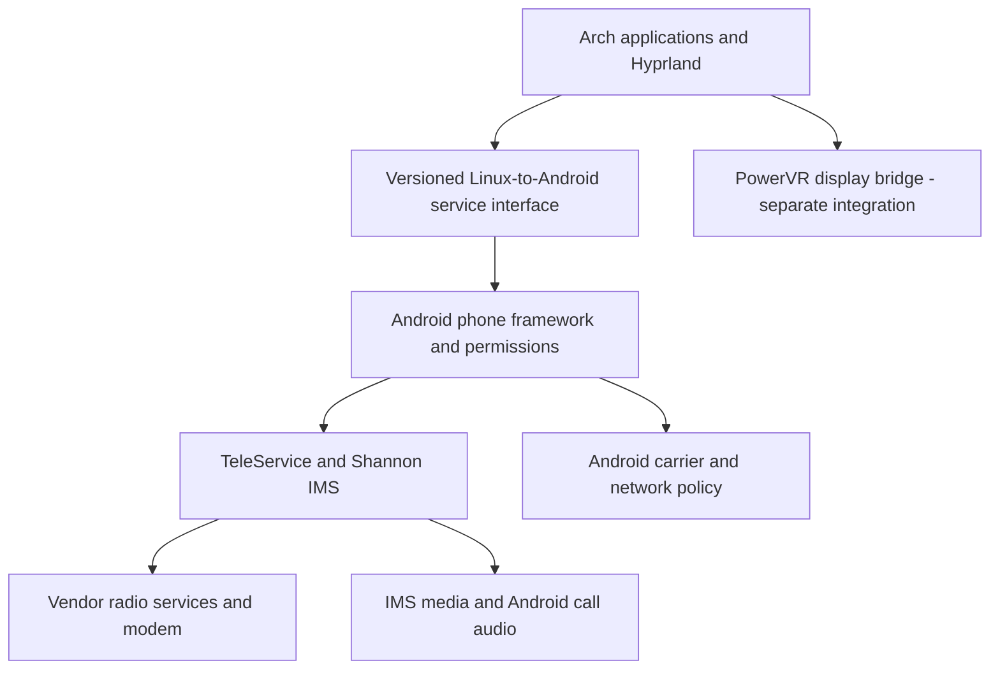

# Pixel 10 cellular and IMS dependency audit

The12 October target in [smartphone-goal.md](smartphone-goal.md) supersedes the
retained-Android production recommendations below: shared native Rust services
and hardware-specific backends on matched Google kernel/modules/firmware.
This11 October stock-reuse audit remains historical reference evidence. Android
and Java are test/reference infrastructure; unresolved retained vendor userspace
is an explicit gate, not the completed architecture. Current native progress is
recorded in [the handoff](development-handoff.md).

Follow-up: [Android framework runtime tests](android-framework-tests.md) now verify bridge permissions, Telecom callbacks, and reference IMS activation. Stock Shannon reaches framework binding but hits hidden-API failures; Pixel IMS Media is rejected by the emulator shared-UID signer check.

Audited 11 October 2026. Factory build: frankel `CP3A.261005.005`, Android 17 / API 37. No phone was accessed. All execution was inside isolated Harbour containers or the existing ARM64 Linux VM.

**Finding: preserving Google's stock IMS implementation requires an Android framework execution environment, not just Bionic, libhybris, and radio libraries.** The factory explicitly selects the `com.shannon.imsservice` Android service. Its APK references Android connectivity, carrier configuration, subscription, power, and application-service APIs. A separate Android phone process and privileged IMS media service are present.

This is an evidence-backed retention boundary, **not an exact minimal bootable image**. Static analysis cannot prove which optional paths a particular SIM, carrier, recovery event, or update will use. No Android phone-service environment has been booted in this project. Carrier functionality remains untested.

## Evidence and reproducibility

- Existing factory archive verification and partition provenance: `../../pixel-10-factory-evidence.json`.
- Newly extracted product partition: 4,859,404,288 bytes; SHA-256 `a506e99b5179ee987846922ccbddae6b487bf7c83d9e0ede987d362eaf42d607`. ZIP size and CRC passed. Downloaded from the same pinned factory archive on Harbour.
- `../artifacts/telephony-audit/results/evidence.json`: file hashes, decoded manifests, DEX type/method references, init definitions, and selected ELF dependencies/strings.
- `../artifacts/telephony-audit/results/resources/`: Android 17 `aapt2` resource dumps and indexed evidence. The older Debian `aapt` decoded manifests but could not correctly decode some new resource tables; it was not used to establish IMS resource values.
- `../artifacts/telephony-audit/results/native-graph.json`: conservative native dependency graph, explicitly not a resolved linker namespace.
- `../artifacts/telephony-audit/results/verification.json`: real-file checks and negative controls.
- `../artifacts/radio-runtime/radio-manifest.json`: separate 74-file native radio load-probe payload. This is not an Android phone runtime.
- `../artifacts/telephony-audit/pro-review.md`: independent Pro critique and verification record.

The complete selected-file pass examined 248 files and decoded 121 APK manifests. DEX method tables include both definitions and references. They are not a call graph. Reflection, JNI, downloaded configuration, and conditional service discovery can add dependencies. Resource values are the shipped defaults; carrier overrides can change runtime selection.

## Confirmed factory relationships

| Layer | Exact factory evidence | Consequence |
|---|---|---|
| Modem startup | `/vendor/etc/init/cbd.rc`: `cpboot-daemon /vendor/bin/cbd`; `/vendor/etc/init/rfsd.rc`: `rfsd`; `/vendor/etc/init/rild_exynos.rc`: `ril-daemon /vendor/bin/hw/rild_exynos` | Preserve their startup identities, property triggers, storage access, capabilities, and recovery behaviour if retaining the stock path. Merely starting three executables is not sufficient. |
| Native radio implementation | `vendor.rild.libpath=libsitril.so`; `rild_exynos` links `libril_sitril.so`; `libsitril.so` links Google call-audio extensions and radio protocol libraries | Include dynamic selection as well as ELF `DT_NEEDED` dependencies. |
| Radio control | Vendor VINTF declares AIDL V3 config/data/messaging/modem/network/sim/voice; two slot instances for the per-SIM services; SAP and Samsung `radioExternal` are also declared | These are Android Binder interfaces. No directly usable ModemManager interface has been demonstrated. Radio AIDL declarations do not supply a complete IMS implementation. |
| IMS selection | `/vendor/overlay/TeleService__frankel__auto_generated_rro_vendor.apk`: `string/config_ims_mmtel_package = com.shannon.imsservice` | Shannon IMS is a configured stock voice-service provider, not just a filename that happens to contain IMS. |
| IMS service | `/system_ext/priv-app/ShannonIms/ShannonIms.apk`: package `com.shannon.imsservice`; service `com.shannon.imsservice.ShannonImsService`; `BIND_IMS_SERVICE`; `android.telephony.ims.ImsService` action; MMTEL and emergency-MMTEL declarations | Its normal activation requires Android package discovery, permissions, framework binding, and application lifecycle. Declaring emergency capability does not verify emergency calling. |
| Phone process | `/system/priv-app/TeleService/TeleService.apk`: package `com.android.phone`, shared UID `android.uid.phone`, persistent application | Keep the phone framework and process for the stock control path. `TelephonyGoogle` is an additional provider; it is not a replacement for `TeleService`. |
| IMS media | `/system_ext/priv-app/PixelImsMediaService/PixelImsMediaService.apk`: package `com.android.telephony.imsmedia`, shared UID `android.uid.phone`, persistent/direct-boot-aware application, `ImsMediaController` service, minimum API 37 | This particular component is tied to Android 17 APIs. A small older Android service container cannot be assumed compatible. |
| Media library | `/system_ext/lib64/libpixelimsmedia.so` links `libandroid_runtime.so`, `libbinder.so`, `libcamera2ndk.so`, `libmediandk.so`, `libnativewindow.so`, EGL/GLES, and Google audio extension V8 | Those hard libraries must be loadable if this unchanged media library is loaded. This does not establish that voice calls exercise camera/video services. |
| Carrier configuration | `/product/priv-app/CarrierSettings/CarrierSettings.apk`; Shannon references `CarrierConfigManager.getConfigForSubId` | Retain carrier configuration for the initial stock baseline. Shipped defaults do not determine every SIM-specific runtime value. |
| IMS entitlement | `/product/priv-app/ImsServiceEntitlement/ImsServiceEntitlement.apk` | Provisioning/activation is a separate path from ordinary call operation. Presence is confirmed; necessity depends on carrier and feature. |
| eSIM management | `/product/priv-app/EuiccGoogle/EuiccGoogle.apk`; Pixel eUICC support packages and vendor update APEX are present | Existing-profile operation and profile download/switch/delete are distinct capabilities. Preserve management components initially if complete eSIM support is in scope. |
| Wi-Fi calling | `/system_ext/priv-app/Iwlan/Iwlan.apk`: package `com.google.android.iwlan`, shared UID `android.uid.system`, telephony data/network service bindings | IWLAN is a separate Android integration path. Cellular IMS success would not prove Wi-Fi calling. |

Shannon's DEX method table includes `ConnectivityManager.requestNetwork`, `CarrierConfigManager.getConfigForSubId`, `PowerManager.newWakeLock`, `ServiceManager.waitForDeclaredService`, and `ImsService.onBind`. It also includes Samsung `radioExternal` and Android IMS-media interface types. These establish concrete integration surfaces; they do not prove all referenced code executes in every call.

The native binaries contain paths to `/dev/umts_ipc0`, `/dev/umts_ipc1`, `/dev/umts_rfs0`, modem boot devices, modem partitions, and EFS/NV files. These strings are leads, not a verified device-access trace. Factory files cannot replace device-specific calibration or provisioned state. No such state was read, synthesized, or changed.

## How much Android to keep

For **reuse of the stock phone implementation**, use the following initial retention set. It is deliberately labelled a candidate baseline, not a proven minimum:

1. **Native Android service environment:** Bionic/linker, applicable Binder service managers, writable property service, init semantics, linker configuration, service credentials and SELinux policy, device access and matched firmware/kernel modules. Our current immutable graphics property snapshot is insufficient for modem state and restart triggers.
2. **Framework environment:** ART, Zygote/application startup, `system_server` services needed for package/activity/permission/power/subscription/connectivity operation, matching Java framework libraries/resources, APEX modules and classpaths, settings and telephony providers. The stock IMS APK cannot run as an ordinary glibc daemon.
3. **Phone and vendor packages:** `TeleService`, `ShannonIms`, `PixelImsMediaService`, `TelephonyGoogle`, `OemRilService`, `PixelModemService`, `grilservice`, `ril-extension`, their declared shared libraries and permission files. Retain these as candidates until their individual activation and recovery paths can be tested.
4. **Network and call-media services:** relevant connectivity/network modules, resolver/netd, carrier/APN/subscription state, audio policy/server and the vendor audio HAL. Android should initially own cellular/IMS routes and call audio.
5. **Feature-dependent components:** entitlement, IWLAN, eSIM manager, carrier-location and other selected carrier services; camera/video paths where used. Scope them separately rather than assuming that a successful voice call makes them removable.

`system` and `system_ext` must start from a matched release. Android explicitly permits private APIs between them; stable radio AIDL does not guarantee that these privileged APKs work with an arbitrary GSI. [Android partition contracts](https://source.android.com/docs/core/architecture/partitions/shared-system-image)

The launcher, wallpapers and unrelated consumer apps are early removal candidates. **Do not yet remove all Android UI, the preloaded dialer, WebView or Play services on the claim that they are irrelevant.** Entitlement/eSIM flows can need UI; Android documents a preloaded-dialer emergency fallback. Their exact retention status remains feature- and carrier-dependent. [IMS entitlement](https://source.android.com/docs/core/connect/ims-service-entitlement), [default phone application](https://developer.android.com/develop/connectivity/telecom/dialer-app)

This changes the initial goal from “Arch plus a few vendor libraries” to “native Arch desktop plus a retained Android phone-service environment” if we want stock cellular behaviour. A framework-free radio implementation is a separate replacement project; this audit does not rule it out, but it cannot be called a small compatibility patch.

## Ownership and integration

This is a proposed boundary, not a deployed topology. Let Android be the only modem controller. Do not run a second Linux radio controller against the same services while Android manages subscriptions and data calls. Export general-data connectivity to Arch through an explicit interface; do not independently manipulate IMS routes. Preserve Android call-audio ownership until a real route/priority contract is verified.

A new Android integration helper needs a per-operation API, role, permission and signing plan. A new APK cannot assume `android.uid.phone` or obtain signature-only permissions just by being put in `priv-app`. Public Telecom/default-dialer interfaces are candidates for call controls; lower-level IMS/network operations require separate authorization design. Partition-specific privileged allowlists must remain with their packages. [Permission allowlists](https://source.android.com/docs/core/permissions/perms-allowlist), [phone-role contract](https://developer.android.com/develop/connectivity/telecom/dialer-app)

Whether Android remains the initial hardware owner or can run underneath an Arch-controlled boot is still open. Moving Android into a container changes mounts, Binder/device visibility, network ownership, identities and policy. Keeping Android services does not require supporting arbitrary Android apps. Hyprland must still independently obtain a working Pixel display path.

## Camera, audio and power

- **Camera:** the factory packages the camera HAL in `com.google.pixel.camera.hal.apex`; init starts `android.hardware.camera.provider@2.7-service-google` from that APEX. Its native dependency inventory is included. Preserve the matched processing libraries and configuration for an initial camera adapter; a camera Linux API or working preview has not been built.
- **Audio:** init starts `android.hardware.audio.service-aidl.aoc` as `audioserver` with Android audio-related groups and restarts `audioserver` when the HAL restarts. The radio implementation also links Google call-audio libraries. Do not assume ordinary ALSA playback proves call audio.
- **Power/thermal:** the Pixel power service has Android property triggers, including reactions to Zygote restarts. Native Linux policy cannot be substituted solely on the basis of a sysfs file inventory. Thermal protection, charging, suspend and modem wake remain hardware tests.

## What was built and tested

- Built `pixel-hardware-audit:20261011-b472` on Harbour. Added manifest/DEX/init/ELF audit tooling and a repeatable offline suite.
- Eight audit unit tests passed after red/green implementation. Real factory checks hash every selected input. Negative controls remove the IMS APK, remove the IMS selection overlay, and insert an unsupported hardware-success claim; each is rejected.
- Conservative graph: 561 candidate native files and 4,895 edges from eight service/library roots. Every requested basename has at least one candidate. **3,628 edges have multiple candidates. These numbers are not a minimum Android footprint and do not prove namespace or symbol compatibility.** The graph also excludes dynamic/Binder/Java relationships from its closure calculation.
- Assembled a separate 74-file radio load-probe payload. Actual stock `libsitril.so` loading through the graphics libhybris runtime aborts with SIGABRT (134). Logs, QEMU syscall trace, and debugger output are retained. The abort caller maps to the stock `/vendor/lib64/libcrypto.so`, file offset `0xa41c8`, after a thread-local state check. The complete cause is not resolved; it must not be described as merely an absent modem. No crypto checks were bypassed.
- Google’s original Bionic `linker64 --list /vendor/bin/hw/rild_exynos` completed with exit 0 under QEMU and explicit library search paths. It warned that `/linkerconfig/ld.config.txt` was absent. This lists dependencies only: it does not run constructors, start the daemon, or validate production linker namespaces. Keep this result separate from the failing libhybris probe.
- Rebuilt the ARM64 graphics bridge on Harbour; all nine CTest groups passed, including the added audit unit tests.
- Existing full ARM64 Linux VM regression passed all ten checks: boot, architecture, stock ABI fixture, software EGL, Hyprland, rendered Wayland client, touch press/release, shared output ownership, and compositor shutdown. It uses Mesa/virtio graphics, not the Pixel GPU.
- No Android framework boot, Binder radio-service registration, IMS registration, voice call, SMS, mobile data, eSIM transaction, camera capture, or phone suspend test has passed in this project.

## Repeat the audit

Run `python3 tools/download-audit-tools.py` once on the Linux build host, then build `build-support/Dockerfile.audit`. Run `tools/hardware-audit-suite.sh` inside that image with no network, no host devices, dropped capabilities and a task-directory mount; the exact command is in the project README. This regenerates manifests, resource dumps, the graph, and verification results from the included hashed factory inputs.

For native diagnostics, run `tools/radio-load-probes.sh stock-list` or `hybris-load` in a **read-only** audit container with only a temporary `/tmp`. Keep their exit codes and stderr separate. `tools/debug-radio-load.py` uses the container’s private loopback for QEMU/GDB; it requires no published port or device access. The native probes are intentionally not green service-readiness tests.

## Remaining proof gates

1. Build/boot a matching Android framework test environment and establish package discovery, permissions and actual service activation. An Android virtual device with reference/mock radio services can test framework contracts, not the real modem.
2. Resolve linker namespaces, symbol versions, JNI and service activation for the proposed retained set. The candidate graph is only the first static pass. A full `check_vintf` result with device properties and kernel inputs has not been produced.
3. Implement the authorized desktop-facing phone interface, with distinct availability, subscription, data, IMS, call and media states. Test service death, reconnect and denied operations. Do not replay uncertain dial/SMS requests after a lost acknowledgement.
4. Validate the real Pixel boot/display path before combining desktop and phone-service environments. No phone action is authorized by this document.
5. Only on later authorized hardware tests: compare with stock carrier behaviour, then test registration, data, SMS, IMS, bidirectional calls/audio, locked boot, suspend/wake and recovery. eSIM, Wi-Fi calling and emergency behaviour each need their own controlled validation.

The defensible result is a pinned starting retention set and explicit unknowns. It is not possible to derive an exact universal minimum, or confirm carrier service, from the factory image and VM alone.
