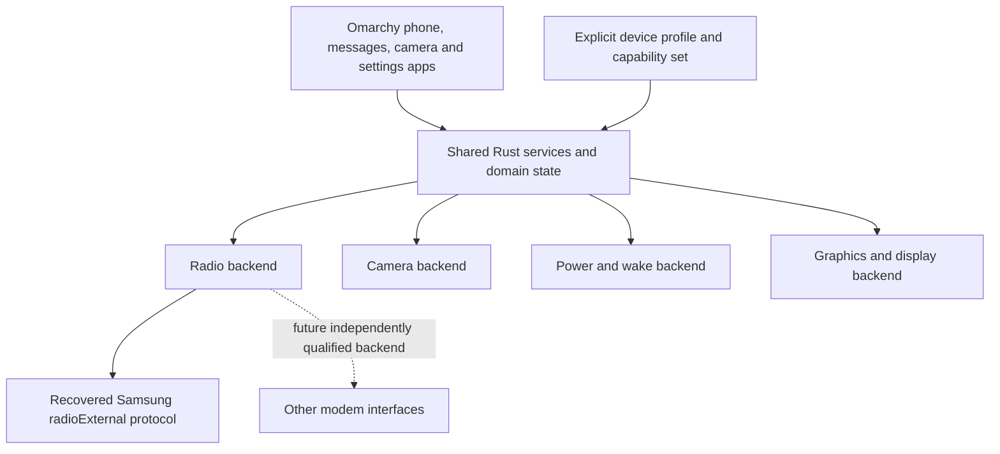

# Device portability

Decision, 12 October 2026: build shared smartphone services with separate hardware
backends. Pixel 10 is the first test target. Do not encode Pixel identities,
Samsung message IDs or vendor Binder parcels in apps or shared phone policy.

## Boundaries

| Layer | Owns | Must not assume |
|---|---|---|
| Apps and shared services | User intent, permissions, call/message state, notifications, lifecycle and theme integration | Vendor message IDs, Binder transaction numbers or fixed device nodes |
| Vendor backend | Wire encoding, discovery, callback decoding, vendor error mapping and transport recovery | That an IPC acknowledgement means a call connected or an SMS was delivered |
| Device integration | Matched kernel/modules/firmware, service names, policy, audio routes, wake sources and available capabilities | That another device with the same modem or SoC has identical wiring or policy |

The current `native-radio` crate is specifically a Samsung radioExternal backend.
Its generic-looking `RadioTransport` and `RadioEvent` names are scoped to that
crate; they are not a universal radio service API. `native-ims` contains recovered
Shannon contracts and must not become the shared phone domain model either.
New production consumers must translate vendor events at this boundary.

Design the device-neutral service contract from user-visible behavior and real
backend evidence. Do not prebuild speculative adapters or a universal protocol.
Multiple hardware backends implement the one current contract; this is not
backward compatibility with earlier project runtimes.

## What the recovered code proves

The inspected APK exposes a Samsung-specific `radioExternal` Binder interface,
including slot routing and segmented payloads. These are reusable protocol
components if another device exposes the same verified contract. Slot support is
not proof of support for multiple handset families. This audit does not establish
compatibility with another Samsung device or with Qualcomm or MediaTek modems.

Each additional device needs an explicit profile and qualification: interface
version/hash and original-code checks, permission and lifecycle integration,
then hardware tests for modem/carrier, audio, camera, graphics and suspend/wake.
Missing capabilities must be reported as unavailable, not silently mapped to a
Pixel fallback. No second device is currently qualified.

The emulator validates IPC and synthetic behavior. ARM64 user-mode QEMU validates
CPU/runtime behavior. The separately qualified [ARM64 radio Binder](native-arm64-binder.md)
executes under an unchanged Arch ARM kernel with synthetic peers and separately
retained Android runtime interop. It does not qualify Pixel policy or any second
device. None of these evidence classes proves a backend works on physical hardware.

The [native device contracts](native-device-contracts.md) keep exact Pixel AIDL/FMQ, firmware and calibration details in backends while shared Rust services own policy, permissions, leases and lifecycle. Static hash/source agreement does not qualify live hardware or make retained userspace a completed native architecture.

The [current deployment profile](native-deployment.md) binds an explicit device,
component set, required resource owners/dependencies and unavailable capabilities
before checking actual staged package/file identity. The authoritative AOSP table
confirms Pixel10's frankel codename; it does not authenticate the selected factory
build or kernel/KMI. Missing set pins and unresolved offline requirements refuse
deployment. Runtime ownership and device qualification require their own evidence.

The [owned native session identity](native-session-owned-focus.md) now retains
and transfers the actual Wayland socket peer pidfd, comparing it with the already
owned app-generation handle through one pinned protected procfs view and joint
final liveness. Host6.8 shared anon-inode and ARM7.1 kernel tests pass; scalar
pidfs equality and the earlier wire are removed. Common protected PID/user
namespace deployment remains a gate. Pixel's matched6.6 image/config/KMI remains
unqualified by those tests; keep matched assets unchanged. Original compositor,
synthetic actor and joint installed-app evidence remain distinct. Trusted locker/
configuration provisioning and physical hardware have separate gates.
