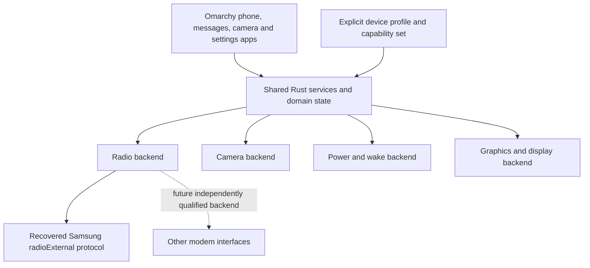

# Device portability

The new [native session owner](native-session-owner.md) keeps compositor Child
custody and service composition outside hardware backends.32 host boundary cases,
host/ARM64 compilation and Make staging add no qualified phone model; matched
Pixel graphics, audio, modem, camera and suspend remain physical gates.

Decision, 12 October 2026: build shared smartphone services with separate hardware
backends. Pixel 10 is the first test target. Do not encode Pixel identities,
Samsung message IDs or vendor Binder parcels in apps or shared phone policy.
Zero physical phone models are currently qualified. Kernel/HAL commonality makes
shared implementations possible; each additional model still requires matched
assets, an explicit hardware backend/profile and its own hardware evidence.

The [offline diagnostic boot bundle](native-boot-development-bundle.md) is
explicitly bound to the retained frankelCP3A.261005.005 factory inputs and8MiB
init_boot geometry. Exact restoration files do not establish the current phone's
state, another model's partition layout or any bootloader acceptance. Native
PID1 remains shared Rust; selecting a different device requires its own matched
assets, loader/diagnostic/recovery evidence and backend profile. Zero models
are hardware-qualified.

## Kernel choice

The Android-derived kernel is an initial device-support choice, not a requirement
of Rust services or Omarchy. Keep Google's matched kernel/modules/firmware for
the first Pixel target; keep kernel/vendor operations behind explicit backends.
This retains existing Linux drivers rather than rewriting the kernel in Rust.
[Android GKI](https://source.android.com/docs/core/architecture/kernel/generic-kernel-image)
separates the common Linux kernel from board/SoC vendor modules. Changing the
kernel alone does not replace Android userspace, modem control or firmware.

The September2026 [Pixel10 upstream series](https://patchew.org/linux/20260918-contrib-pg-pixel10-initial-dts-v4-0-745eaca28b1a@linaro.org/)
explicitly establishes basic initramfs-shell boot. That is useful alternative
bring-up evidence, not complete display/camera/modem/power qualification. Moving
to upstream would require separately qualified device support; current synthetic
virt boots prove neither kernel's full Pixel hardware behavior. Do not execute
a public author's flash recipe or assume its partition/policy choices fit this
project. The matched-kernel strategy remains in effect.

The [retained CPIF receive checkpoint](native-cpif-receive-boundary.md) qualifies
only the selected4K module and conditional factory path. Its static queue facts
do not apply automatically to the16K variant, another phone or a different CPIF
build. Channel, DT, KMI and physical qualification remain per profile.

The [native CPIF local policy](native-sit-cpif-policy.md) remains inside the
Samsung backend and exposes local syntax, without a qualified source or device
acquisition path. Common services gain no CPIF node names, numeric states or
assumed modem authority from it.

The [native Media catalog](native-audio-output-selector.md) uses logical IDs
and labels. Only the trusted audio profile maps them to private PipeWire nodes;
shared UI code carries no Pixel device names. Host virtual routes qualify no
physical audio backend or additional phone model.

The [fixed Sounds desktop request](native-sounds-desktop.md) selects only the
installed app profile; it carries no device identity, route or vendor parcel.
Host launch/ownership tests and ARM compilation qualify separately from normal
Source/audio deployment and physical-device support.

The [MediaRoute lifecycle boundary](native-audio-lifecycle.md) likewise carries
logical IDs and current app permission only. Its provider owns the existing audio
connection, while the backend profile retains private physical routing. Neither
host permission/PCM proofs nor the separately qualified four-group
[generic ARM normal UI join](native-audio-arm-lifecycle.md) qualify a phone model.
That join uses virtual routes and root-authored lifecycle controls; the current
installed Source/audio session owner remains separate.

The [brightness vertical](native-brightness.md) carries percent intent and fresh
readback revisions through shared Rust app/lifecycle/service code. Identical
fresh reads preserve value revisions; raw changes and freshness gaps invalidate
them independently of rounded percent or observation cadence. Deployment
alone selects a backlight backend and device. LinuxBacklight requires the Linux
sysfs class; the qualified SyntheticTree tests use authored files with no driver
fallback. A separate generic ARM kernel/PID1 qualification now exercises the
actual LinuxBacklight class with the existing matching GPIO backlight module and
one authored virtual device: raw0→1→0, then unavailable on removal, with normal
Stop. It proves a shared Rust service/kernel interface, not a Pixel panel or
independent light output. The prepared normal Settings touch/change/unavailable/recovery path
also passes in an x86 KVM session with the authored backend. The current Rust
client/owner cohort now completes25→explicit75→unavailable with disabled inputs
and no mutation→readonly recovery75→new explicit25 in one normal app/window.
Five original Pixel10-profile captures and the full owned closure pass; earlier
failed cohorts remain separate with unknown causes. This prepared result does
not qualify all-input reliability, cold startup or an ARM visible window.
The current ARM battery/brightness pair separately passes fresh automatic cold
boot and typed readonly presence→absence→recovery against the kernel virtual-GPIO
class; it does not inherit the earlier ARM Set result or x86 graphical result.
Requested and optional actual attributes are
distinct, and neither is physical luminance. A Pixel panel without a usable Linux backlight interface will
need its own independently qualified backend; these host tests add no supported
phone model.

## Boundaries

| Layer | Owns | Must not assume |
|---|---|---|
| Apps and shared services | User intent, permissions, call/message state, notifications, lifecycle and theme integration | Vendor message IDs, Binder transaction numbers or fixed device nodes |
| Vendor backend | Wire encoding, discovery, callback decoding, vendor error mapping and transport recovery | That an IPC acknowledgement means a call connected or an SMS was delivered |
| Device integration | Matched kernel/modules/firmware, service names, policy, audio routes, wake sources and available capabilities | That another device with the same modem or SoC has identical wiring or policy |

The current `native-radio` crate is specifically a Samsung radioExternal backend.
Its generic-looking `RadioTransport` and `RadioEvent` names are scoped to that
crate; they are not a universal radio service API. `native-ims` contains recovered
Shannon contracts and must not become the shared phone domain model either.
New production consumers must translate vendor events at this boundary.

The [native kernel observer](native-network-observer.md) uses Linux rtnetlink
and a retained namespace without vendor IDs or fixed interface names in its
production API. Actual generic ARM TUN creation/address/removal qualifies one
local lifetime; each new observer/namespace needs its own evidence. This grants
no modem context or physical connectivity and does not qualify the matched
Google kernel, device namespace/policy or another phone model.

The [local-network status path](native-network-status.md) composes that observer
with a portable coarse-count service, fixed read-only Rust client and themed
Settings card. Native generic ARM now joins the actual installed PID1 service to
the Rust reader and offscreen Qt6.12 component through Stop, expiry and fresh
reconnection. The host Qt6.8.2 result remains separate. Neither qualifies usable
connectivity, the matched Pixel kernel, radio, namespace/policy or another phone
model; the normal ARM app window remains unexecuted.

The [frozen public Data V3 boundary](native-cellular-data-abi.md) qualifies one
Rust/NDK ABI exchange on generic ARM. Its API has no slot argument. Do not infer
a mapping between production Data instances, Android subscriptions and recovered
radioExternal slot values from that exchange. Per-device discovery, permissions,
actual endpoint version/hash and carrier policy still need backend qualification.

The [Data/kernel owner](native-cellular-data-owner.md) additionally joins a
controlled provider report to numeric local addresses and a continuously
witnessed link lifetime. Three further actual generic ARM runs qualify ordinary
public-poll setup and separate link/list/death withdrawal; list/death withdraw
while the independent controller still observes the same positive kernel link.
[Evidence](evidence/native-cellular-data-public-poll-provenance.json).

The [supervised Data tracer](native-cellular-service.md) now carries those local
observations through an actual native worker and restricted operator diagnostics
with a conservative synced attempt journal and native child wait. It remains
one authored public endpoint and independently created TUN on generic ARM; no
production Data-instance/SIM/vendor slot mapping, acquired APN or additional
qualified phone model follows.

These observations are local to each retained endpoint, observer and VM boot.
Namespace device/inode numbers may repeat across separate VMs, as they do in
the list/death cases; namespace/ifindex/lifetime values are not durable global
identities. Matching a fixture name/address does not establish that a production
provider owns or created that link, and adds no qualified phone model.

Design the device-neutral service contract from user-visible behavior and real
backend evidence. Do not prebuild speculative adapters or a universal protocol.
Multiple hardware backends implement the one current contract; this is not
backward compatibility with earlier project runtimes.

## What the recovered code proves

The inspected APK exposes a Samsung-specific `radioExternal` Binder interface,
including slot routing and segmented payloads. These are reusable protocol
components if another device exposes the same verified contract. Slot support is
not proof of support for multiple handset families. This audit does not establish
compatibility with another Samsung device or with Qualcomm or MediaTek modems.

Each additional device needs an explicit profile and qualification: interface
version/hash and original-code checks, permission and lifecycle integration,
then hardware tests for modem/carrier, audio, camera, graphics and suspend/wake.
Missing capabilities must be reported as unavailable, not silently mapped to a
Pixel fallback. No second device is currently qualified.

The emulator validates IPC and synthetic behavior. ARM64 user-mode QEMU validates
CPU/runtime behavior. The separately qualified [ARM64 radio Binder](native-arm64-binder.md)
executes under an unchanged Arch ARM kernel with synthetic peers and separately
retained Android runtime interop. It does not qualify Pixel policy or any second
device. None of these evidence classes proves a backend works on physical hardware.

The [native device contracts](native-device-contracts.md) keep exact Pixel AIDL/FMQ, firmware and calibration details in backends while shared Rust services own policy, permissions, leases and lifecycle. Static hash/source agreement does not qualify live hardware or make retained userspace a completed native architecture.

The [current deployment profile](native-deployment.md) binds an explicit device,
component set, required resource owners/dependencies and unavailable capabilities
before checking actual staged package/file identity. The authoritative AOSP table
confirms Pixel10's frankel codename; it does not authenticate the selected factory
build or kernel/KMI. Missing set pins and unresolved offline requirements refuse
deployment. Runtime ownership and device qualification require their own evidence.

The [owned native session identity](native-session-owned-focus.md) now retains
and transfers the actual Wayland socket peer pidfd, comparing it with the already
owned app-generation handle through one pinned protected procfs view and joint
final liveness. Host6.8 shared anon-inode and ARM7.1 kernel tests pass; scalar
pidfs equality and the earlier wire are removed. Common protected PID/user
namespace deployment remains a gate. Those Arch tests do not qualify Pixel's matched6.6 image/config/KMI. A later
[Google-kernel prerequisite run](native-google-kernel-services.md) separately
passes14 existing identity tests and three standalone lifecycle groups under the
unchanged authenticated6.6 image. It still qualifies no physical model or vendor
module KMI; keep matched assets unchanged. Original compositor,
synthetic actor and joint installed-app evidence remain distinct. Trusted locker/
configuration provisioning and physical hardware have separate gates.

The [initial SIT attempt gate](native-sit-attempt.md) keeps request/report policy
and one-source lifecycle in shared Rust, with transport custody external. Its
actual generic ARM kernel Unix-record fixture qualifies no device backend,
CPIF framing, slot/channel identity or matched Pixel KMI. Factory-specific I/O
and cleanup semantics remain behind a separate backend; decoded CID and report
presentation index cannot select a network interface or hardware owner.

The [owned SIT receive copy](native-sit-received-chunk.md) separates Rust byte
lifetime from validation and hardware custody. Its65,568-byte ingress bound and
factory classifier observations belong to the SIT backend; apps and shared phone
state acquire no Samsung fields, C++ layouts or device-node assumptions. Original
Bionic execution, native ARM user-QEMU components and generic ARM kernel Unix
fixtures remain separate evidence, with zero physical models qualified.

The [owned SIT descriptor primitive](native-sit-owned-transport.md) keeps its
65,568-byte ingress policy and raw I/O inside the hardware backend. Shared apps
and phone state gain no descriptor, Samsung layout, channel identity or retry
policy. Source custody, complete-record admission and provider/APN ownership
remain independent; Unix fixture success qualifies no physical model.
