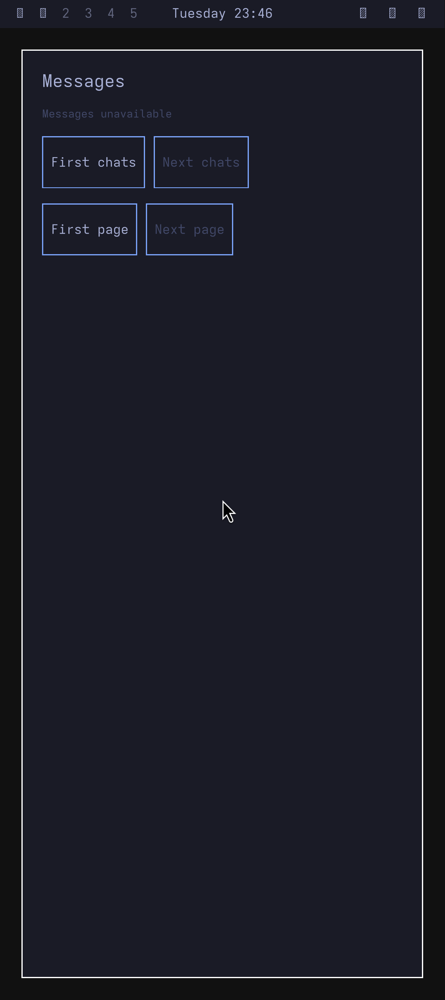
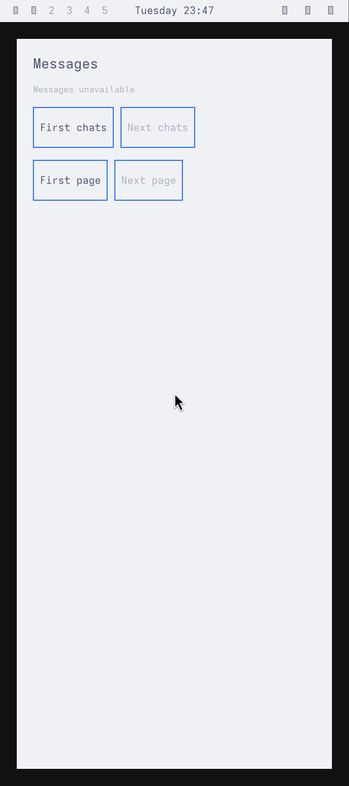

# Installed native appearance boundary

The [native Rust publisher](../native-appearance/README.md) now implements an
owned collector and typed public palette. Seventeen actual host component groups
and two separate held-exec/descriptor controls pass. These are synthetic Linux
boundaries; the original installed desktop RED below remains open. Historical
same-UID theme comparisons and the tracer's immutable public copy do not establish
a live installed owner. The partial typed Qt prototype remains a private worktree
change; the public application's full typography/font/settings path is preserved
until that migration is qualified.

## Implemented owner and component evidence

Snapshot-only mode0666 `appearance.sock` and root-only mode0600
`appearance-control.sock` have separate client capacity and500ms idle/reply
budgets. One owned UID1000 collector performs source IO and retains the original
theme-set shared lock/generation through publication ACK. Completion requires
actual packet credentials, exact PID/pidfd, incarnation/token and the original
one-second `CLOCK_BOOTTIME` deadline. Stop withdraws output before killing;
occupancy persists through actual wait. Read-only recollection cannot retry a
radio registration or imply vendor cleanup.

The final single-thread launcher retains a forked child without waiting for exec,
uses the startup-selected trusted ELF through `execveat`, sanitizes descriptors,
establishes waitable SIGCHLD disposition and signals through the retained pidfd.
No blocked worker is detached. Executable/config ancestry must be root owned.
An exclusive root filesystem lock protects socket-node recovery and refuses a
second live owner. It does not establish a crashed predecessor's process-tree
closure: the restart test independently subreaps the orphan before restarting.

Eleven real process groups pass, including actual UID11010 public access/private
control denial, held collector/Stop responsiveness, expiry/reap-before-recovery,
input symlink/hardlink refusal and owner restart/exclusion. Four real SEQPACKET
controls exercise the production flush method with directly established
same-process owner state. They prove exact-wire EAGAIN, retained queue, invalidation
by expiry/revision/Stop, writable transport and refused output/EOF; the positive
reply sends exactly once. They are not whole-service controls or a chronological
new defect. The ignored app-role helper executes as the real UID11010 child of
its parent group and is not counted as an extra standalone pass.

Two actual kernel controls observe UID1000, empty groups, zero effective
capabilities and an added architecture-checked seccomp filter. New content opens,
networking, clone/exec and other unlisted syscalls are refused. The x86 incompatible
architecture case terminates with SIGSYS. Path metadata remains observable; this
is not whole-filesystem privacy. Later actual ARM filtering is qualified separately
below; matched Google kernel capabilities and the installed service capability
profile remain unqualified.

Chronological REDs precede the public-client starvation and executable-ancestry
repairs. Abrupt-restart RED1 has weak pathname readiness; fresh RED2 requires actual
status readiness and records EADDRINUSE before endpoint recovery is repaired.
The first held-exec run fails tracer cleanup; fresh chronological RED2 records
the owner stuck in `kernel_clone`, three200ms request timeouts and inherited root
mode0600 FD198 after UID1000/filter transition, with actual parent reap. The fork
launcher/descriptor repair follows. A new argv0 fixture preflight launches no
container; corrected-v2 baseline RED3 is explicitly a post-fix replay, not the
chronological RED. Inherited SIGCHLD ignore is a later genuine RED: one collection
then permanently occupied reaping state. Signal normalization/pidfd fencing
precedes the final seventeen-group GREEN. All failed labels remain unchanged.

Final unchanged-v2 held-exec GREEN3 binds the final Rust ELF: status/snapshot/Stop
take6.39/6.47/6.17ms while its actual child is stopped before execveat. Stop kills
it before successful exec and parent wait4 actually reaps it. The unrelated FD
is absent after credential/filter transition. Root independently checks fifteen
input bindings, current source against the frozen compiler selection, exact
public control bytes and parent reaps. Actual compiler/container waits, separate
exact-CID absence and input closure pass. The ptrace fixture has Docker default
capabilities plus test-only SYS_PTRACE; it is not the production profile.
Other fixture capabilities are listed in the Rust README. Raw homes/logs/captures
remain private; [bounded provenance](evidence/native-appearance-owner-provenance.json)
and the [authored control](../tools/native-appearance-owner/process-control.py)
are public.

The final Rust source cross-compiles to static AArch64 GNU code. A separate normal
Qt6.12 Messages build executes its compiler under Arch ARM7.1.6 without the isolated
observer define. Neither compiler selection qualifies new service/app runtime,
original live theme behavior, desktop admission or current Source/lock integration.

## Separate original ARM palette composition

A later fresh control now executes the exact Rust ARM ELF and normal Qt prototype
under generic Arch ARM7.1.6 with genuine pinned Omarchy. All five narrow groups
pass: actual original setters/oracle, authenticated public palette at UID11010,
same normal app/window recoloring, private HOME isolation and whole native output
capture/decode equality. Tokyo Night → Catppuccin Latte → Tokyo Night changes
background `#1a1b26` → `#eff1f5` → `#1a1b26` and foreground `#a9b1d6` → `#4c4f69`
→ `#a9b1d6`. The same app PID/window survives all three changes; appearance revisions
are1→2→3. HOME remains UID1000/mode0700; actual UID11010 read returns EACCES each time.
No copied theme home is created.

Root independently decodes each complete1080×2424 PNG, compares every normalized
RGBA byte hash with the native output buffer, checks the preselected nine-pixel
background patch and1619 exact original foreground pixels, and verifies87 input
bindings. The virtual422PPI/420 logical profile is qualified separately through
its measurement surface; the normal app's own QWindow DPR/buffer equality remains
unobserved. No capture is resized or cropped. Broker controlled Stop/direct wait0,
all guest direct children, observed collector pidfd death/proc absence, actual
Docker CLI0, independent exact-CID absence and unchanged input closure pass.

This control directly launches the root-installed normal UID11010 ELF with two
narrow Wayland ancestor/socket ACLs. Its Messages backend is absent, so the normal
UI says unavailable. No actor, Source, desktop ingress, per-app display owner or
lock integration participates. It does not close the original desktop-installed
RED, qualify complete font/settings/alpha migration or establish production
supervision. Missing Omarchy bar icon fonts remain a fixture provisioning gap.
The typed consumer stays private pending full feature migration. See
[bounded ARM provenance](evidence/native-appearance-palette-arm-provenance.json).

| Tokyo Night | Catppuccin Latte |
| --- | --- |
|  |  |

## Separate actual ARM kernel component controls

A later headless generic Arch ARM7.1.6 guest runs the exact Cargo-selected static
ELFs, without Original Omarchy/UI, Android peers or vendor inputs. Eleven process,
four same-process kernel SEQPACKET and one actual ARM confinement group pass.
The ignored UID11010 helper runs through its parent group; the x86 wrong-architecture
case is not compiled. Real kernel denials, UID1000/groups[]/CapEff0/NNP1, added
production filter and direct wait are observed. Guest Root capabilities are fixture
provisioning permissions, not an installed service profile.

The first label remains a zero-test fixture failure: its overly strict mode0755
check rejects existing root `/`. A later read-only backing probe reports0555;
that is separate static metadata, not a retroactive guest observation. Fresh
successor keeps identical ELFs/source/deadlines and records actual UID0/GID0/0555
before checking the service's real nonsymlink/UID0/no022 ancestry rule. New copied
directories/ELFs still require exact0:0/0755. No production repair or behavior RED
is claimed from this fixture correction.

Root independently verifies57 hash bindings, all complete harness summaries,
direct waits, no unexpected adopted descendants and separate exact-CID absence.
Guest and runner aggregates pass; all selected/original inputs remain unchanged.
This closes the generic ARM component/filter boundary only. Matched Google kernel,
external crash supervision, current Source/lock and full phone gates remain.
See [bounded ARM kernel evidence](evidence/native-appearance-arm-kernel-provenance.json).

## Chronological original full-style RED

A later frozen generic ARM run executes the original text-size command and an
owned atomic user-shell override before any style repair. An independent Qt
QObject probe reads the real Rust socket as UID11010; the normal app remains
uninstrumented in the same PID/window. Actual original observations are stable
before comparison. All8font/6spacing tokens plus fontScale match at the12px
baseline, then all15 differ after original size18 and after user body23/display45,
control-gap17/panel-padding31. The native reader stays at12/24 and8/18 while the
original reports18/36 and12/27, then23/45 and17/31. Actual palette colors remain
correct, with private UID1000/mode0700 HOME and UID11010 EACCES preserved.

Compiler setup succeeds with eight actual direct child waits0. Both guest and
runner contract aggregates remain FAILED. Root rehashes49 frozen files, decodes
all three complete1080×2424 rasters and verifies normalized RGBA against the
native buffers. Controlled Rust Stop/direct wait0,44 direct guest cleanup rows,
actual Docker CLI0, separate exact-CID absence and input closure pass. This epoch
records zero collector pidfd rows; its all-observed flag is vacuous and supplies
no independent collector reaping proof. No Source, desktop ingress, current lock,
normal QWindow font/DPR, concrete font-resource or alpha migration is qualified.
See [bounded style RED](evidence/native-appearance-style-red-provenance.json).

## Genuine installed RED

The fresh `native-appearance-private-home-red-2` label uses unchanged normal
Messages, actual desktop launch and per-app display context, genuine Omarchy
v4.0.4 and the existing synthetic incoming fixture in a booted Arch ARM guest.
The root-installed app profile passes `/home/alarm` as its appearance input.
No public theme-home copy is created and the home remains UID1000/mode0700.

Actual original `omarchy-theme-set tokyo-night` succeeds. UID1000 reads the
generated regular palette; a real UID11010/GID11010/no-supplementary-groups child
gets `EACCES` on that same path. The read-only original Color/Style oracle reports
background `#1a1b26`. The installed app's native capture renders `#101315` in the
preselected uniform3×3 interior patch, six logical pixels from the client left
edge and halfway down it. This excludes the themed bar, border and content.

The 1080×2424 capture qualifies the virtual422PPI/420 logical density profile and
the original native-buffer/PNG pixel proof. Root independently decodes the whole
PNG, verifies the exact nine sample pixels and checks all171 selected file hashes.
The app ELF is unchanged
`4aa50f980eab1100637d582a2752090f7545e1eb30630888753dfb9a7d2512c8`.
No Source adapter is loaded during this isolated palette assertion; the actor
remains locked and normal history access is denied. It does not test live
appearance collection under the existing25ms/100ms Source cadence.

The assertion fails as intended; both guest and runner aggregates remain
`passed:false`. Guest owned-process cleanup, actual Docker CLI wait0, independent
exact-container absence and unchanged original/selected input closure pass.
The earlier fresh `red-1` label remains a setup failure: its incorrect event
precondition treated an app-context event as a Source sample. It is not a palette
RED. Both labels and raw captures stay private and unchanged.

| Binding | SHA256 |
| --- | --- |
| RED2 selection | `e2d7a396b852c6a190a2c46583f6878a428e1978091958132cef379f4688da08` |
| RED2 command | `e459e309e82123dc22551180eee4f9783ef03c5d565825ffbe82709b6ae8c2c8` |
| RED2 result | `c3869655346ba22ff66ebfa476a03ab5d51b8c407897c794903e057977338a1f` |
| RED2 execution | `c938742072d3e117d09e721127b3e24bb2e79ee20cb2433cbfe78efdeb506085` |
| Root independent RED review | `87366d6ce60c0a61a271bb57149610c5df4044959790672c2184ea1e54c51235` |
| Native PNG | `abcf8b2a631e7409223c541cf9861d2036efa8a3c7f6ee1db3512d466bfdf1a3` |

This reuses the tracer's pre-lock service closure compiled from `052c63c`,
published at `9804b02`. It does not qualify newer joint lock/camera runtime,
Google kernel boot, a production modem, native IMS or any physical phone.

## Remaining installed acceptance gates

The component is an independent Rust appearance service with a bounded
root-authenticated SEQPACKET presentation interface. It exports typed palette
values rather than raw desktop files/XML, uses an appearance incarnation/revision,
and qualifies availability with `CLOCK_BOOTTIME` expiry. Cached
last-known colors must be distinguishable from live available publication.
Appearance revisions confer no Source, focus, permission or lock authority.

Source traversal, parsing and other potentially blocking IO must stay in an owned
collector. Completion acceptance needs actual packet credentials, the exact
owned PID/pidfd, token/incarnation and original deadline. A blocked or stopping
worker occupies its slot until actual reap; Stop/status remain responsive.
UID1000 alone is not filesystem confinement. Input type/ownership/bounds,
symlinks, hardlinks, generation replacement and real kernel containment need
separate actual controls.

Collection must respect original theme-set's shared lock and retain its selected
generation protection through the publication decision. That qualifies cooperating
theme writers, not arbitrary same-UID mutation. Font-family resolution and
independently changed user settings need their own consistency and confinement
qualification; neither raw XML copying nor a pure parser test closes those gates.

Installed GREEN requires the normal app to follow actual original Tokyo Night
and Catppuccin Latte changes in the same window, with private-home isolation.
Then replay receiving, close/reap and fresh reopen with the current lock graph,
unchanged Source cadence and independently classified captures. Test expired and
late completion, held collectors, malformed packets, owner death/restart and
unsupported kernel capabilities at actual process boundaries. A direct-launch
palette control can qualify an intermediate consumer composition but cannot close
desktop/display-owner admission or current lock behavior. No installed GREEN or
full phone completion is claimed by these component tests.

The [Omarchy Mobile review](omarchy-mobile-reuse.md) identifies public desktop
components for the later mobile-shell/input slice; it does not replace this
appearance owner.
