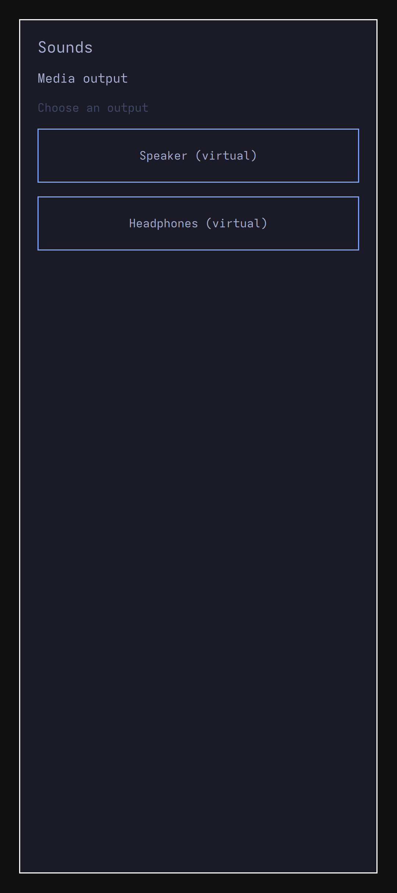

# Normal ARM Sounds through the lifecycle actor

The normal native Sounds window now composes with the Rust lifecycle actor and
sole Rust audio owner under a generic ARM64 kernel. Four groups pass using
actual UI input, independent PipeWire graph inspection and paired sink-monitor
samples. This selects the d982 actor cohort, before the later fixed desktop
endpoint. Root-authored grants/focus remain test infrastructure; installed
Source/audio session startup and phone hardware remain open.

The unchanged native capture is1080×2424. Actual target QWindow DPR is2.625;
the selected display reports65×146mm, approximately422PPI. QScreen's integer3
DPR is retained as a diagnostic, not substituted for the target window DPR.
Original Omarchy theme code supplies Tokyo Night in an authored theme-only host;
this epoch qualifies neither full-shell provisioning nor a new live-theme suite.

## Executed path

The actor owns the normal Qt child as UID/GID11042 with empty supplementary
groups. Its production packet client connects to the root lifecycle actor. The app's
MediaRoute requests reach native-audio UID11040 through the actor's admitted
connection. Configured UID0 admission trusts the root deployment, without
uniquely identifying a particular root actor.
The app's direct audio mutation is denied. PipeWire1.6.9 and WirePlumber0.5.18
run on the private test graph under Arch ARM7.1.6; virtual routes carry no phone
backend or device qualification.

1. With no MediaRoute grant, the actual disabled touch admits no selection;
   independent graph and samples remain quiet.
2. An independent grant and root-authored foreground state permit a normal
   Speaker touch, through the actor to the sole audio owner, with440Hz samples.
3. Actual revoke closes the provider and silences media. Regrant plus one normal
   Reconnect creates a fresh incarnation; the ordered quiet observations and
   samples show no route replay. This does not claim every Qt request is absent.
4. A fresh Headphones touch routes440Hz. A privileged880Hz call preempts it;
   revoking MediaRoute preserves the call. Call release restores no media.
   Actual window-manager close retires the app while the actor remains healthy.

Fourteen finite raw PCM windows each contain33,600 F32LE frames. The fixed
9,600-frame discard leaves24,000 measured frames per window,336,000 total.
Independent recomputation preserves the original tone/silence thresholds and
six-second capture deadlines; observed captures finish in0.770–0.819 seconds.
The32 prior Qt component passes are reused from the earlier build epoch, whose
overall runtime failed. They are not rerun or relabeled as this epoch's tests.

## Setup repair and ownership

Earlier normal joins produced no qualified frame or PCM group. Passive startup
observation established early death. A separate private parent-wait diagnostic
recorded SIGXFSZ25 while the capture wrapper imposed a global4MiB file-size cap;
the exact triggering file/write was not observed. No raw core, memory, backtrace
or environment was inspected or published.

The successful fixture repair restores the original production actor and normal
Qt ELF. Capture files instead occupy a dedicated8MiB tmpfs, with own0700 parent
and fresh own0600 files, distinct from ordinary HOME/cache storage. Accepted
metadata/stderr budgets remain16,392 bytes/4MiB. Mount ownership is reserved
before admission and actual unmount wait0 is required for success. Functional
assertions, sample thresholds and deadlines stay fixed. This is fixture A/B
repair, without a production-bug or chronological TDD RED claim.

The final Qt metadata file is1,040 bytes and stderr is empty; both are regular
files, without PIPE EOF claims. The app's retained pidfd becomes dead and proc
entry disappears before an authenticated snapshot from the same actor reports
zero principals. The selected actor polls Apps before that snapshot, and Apps
actually tries the child wait before clearing it/revoking/removing the slot.
The actor then stops with actual wait0 and drained ownership. This ordered,
source-bound witness exports neither a numeric Qt exit nor app generation;
pidfd death alone is not relabeled as a parent wait receipt.

All82 direct guest waits,7 outer host waits,3 boot waits and the shutdown wait
close within their original cutoffs with applicable PIPE EOFs. Separately,
84 observed descendant pidfds become dead with proc entries absent. The71 PCM
observer child waits and seven ECHILD checks qualify independently;57 stdout
and43 stderr PIPE EOFs exclude14 DEVNULL outputs and28 regular stderr files.
QEMU and its container CLI actually wait0, the exact owned container is absent,
the Docker daemon is unchanged, and capture unmount/cleanup pass. Root's native
runner is also actually reaped0. All225 selected and350 external input pins
remain unchanged.

The first retrospective author checker incorrectly required every quiet
snapshot to complete before the three-second endpoint. The frozen loop admits
observations before that endpoint; its last completion falls113.5ms after it,
within the unchanged command/work deadlines. The failed checker is retained;
a corrected read-only checker follows the selected loop's admission contract.
No runtime, oracle or deadline changes follow that checker failure.

[Hash-only provenance](evidence/native-audio-arm-lifecycle-provenance.json)
binds this selected cohort, earlier failures, independent samples and captures.
Raw samples, journals, process audit artifacts and VM disks remain private.

Next qualify the installed native session owner, fixed desktop/profile launch,
genuine Source focus and terminal loss with per-app display/audio custody.
Independent policy provisioning, trusted restoration, PAM/secure frames,
physical routes/AoC, app PCM brokerage, carrier audio, Pixel graphics/device
policy and all physical-phone tests remain open. No physical phone was accessed.
