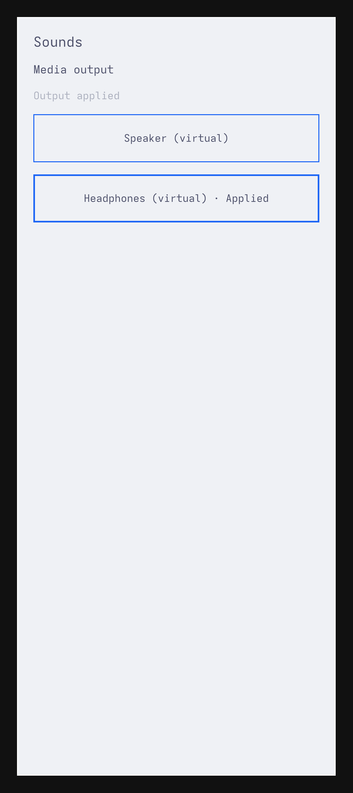

# Normal Sounds audio and theme tracer on ARM

One complete generic ARM kernel run now joins normal Sounds input to the native
Rust audio owner, original PipeWire/WirePlumber virtual links and independently
measured samples. All five groups pass, with process and VM closure. This is the
direct-stream source selection preserved at03647c5, separate from the newer
lifecycle-permission client and from phone hardware.

| Boundary | Actual observation |
|---|---|
| Normal input | Real uinput taps select speaker then headphones; sole owned-source links and paired440Hz samples match |
| Call interruption | Privileged880Hz call preempts Media; release restores the same Media admission and440Hz output |
| Genuine theme change | Original Tokyo Night→Catppuccin Latte→Tokyo Night changes native pixels in the same window/PID, with unchanged audio intent, core and links |
| Backend loss | Actual PipeWire loss disables UI mutation; fresh PipeWire/WirePlumber remain quiet without replay until explicit privileged reconciliation |
| Window close | Actual WM close yields Qt wait0, connection/lease withdrawal and independently empty graph/quiet samples; audio service remains live |

Seven paired PCM checks contain14 complete33,600-frame mono48kHz F32LE windows.
Each discards9,600 frames and measures24,000, for336,000 measured frames. Frozen
signal, wrong-tone and silence thresholds pass. An independent reader recomputes
all14 windows. These are virtual output samples, without physical speaker, DSP,
microphone or carrier evidence. Recovery after privileged reconciliation is
observed through owner state and active links; no additional recovered-tone
window was sampled before the final close check.

The fresh ARM Qt build passes all18 socket behaviors, including the seven new
held-status controls, plus setup/cleanup. The29 appearance IPC cases are not
rerun by this epoch. Kernel7.1.6-1-aarch64-ARCH, Qt6.12.0, PipeWire1.6.9 and
WirePlumber0.5.18 are selected in a closed package layer. Every UI preview uses
actual1080×2424 native output, QWindow DPR2.625 and65×146mm virtual metadata
(nominal422PPI); integer QScreen DPR3 remains a diagnostic. Captures are never
resized or cropped. These simulation metadata establish no physical dimensions.

## Native captures

[Tokyo Night](images/sounds-arm-tokyo-night.png) and
[Catppuccin Latte](images/sounds-arm-latte.png) are unchanged native captures from
the successful run. Returning to Tokyo Night produces identical PNG bytes.

The retained upstream theme setter/templates and original Color/Style singletons
execute in an authored theme-only host. The selected public commit is
`c668141e9c42b13c80c9ca4ea108e11708c5e8a5`. The current Rust schema3 publisher and
normal Qt theme component carry its colors without opening the app's private
HOME to theme files. Original background/foreground/accent publication and
native background/foreground recoloring are checked. Full original shell,
font-family/settings/style fidelity and status-text contrast polish remain open.

## Preparation, failures and closure

Earlier setup failures and partial runs remain preserved. One actual sample
failure recorded pre-link zeros because the recorder always processed before
its monitor links existed. The narrow observer preparation correction disables
that unlinked processing. All window lengths,6s limits, discard counts and tone
thresholds remain unchanged. Sink driver priority makes the existing source
follow the selected output clock. These are fixture preparation changes,
without a fabricated service RED or production audio change.

A later fixture required `application:uncertain` for every unavailable backend.
The existing contract also yields `pending` for a valid unavailable observation.
The final check admits only these two non-observed states and still requires
empty links, graph-epoch advancement, unchanged intent and independent no-replay
observations. Its earlier failed run is not relabeled as successful or as a
service defect. Failed asynchronous unavailable captures also remain retained;
the accepted native frame visibly shows unavailable controls.

Actual closure covers7 host,3 boot,116 guest and1 shutdown direct waits with
applicable EOF, original cutoffs and output bounds. The72 observer waits are a
separate nested proof, with DEVNULL/regular-file exclusions recorded.82 observed
audio descendant deaths/proc absences are not relabeled as native-parent wait
receipts. QEMU and outer CLI return0; exact owned-container absence, unchanged
inputs and the same daemon qualify. [Hash-only provenance](evidence/native-audio-arm-ui-provenance.json).

The next vertical is normal Sounds through current lifecycle MediaRoute
permission and its actor-owned audio connection in this existing ARM environment.
Trusted Source ingress, production desktop/service provisioning, app PCM
brokerage, matched Google-kernel audio, real suspend/wake and physical routes/AoC
remain open. No phone, authentication/PAM path or full original shell was used.
