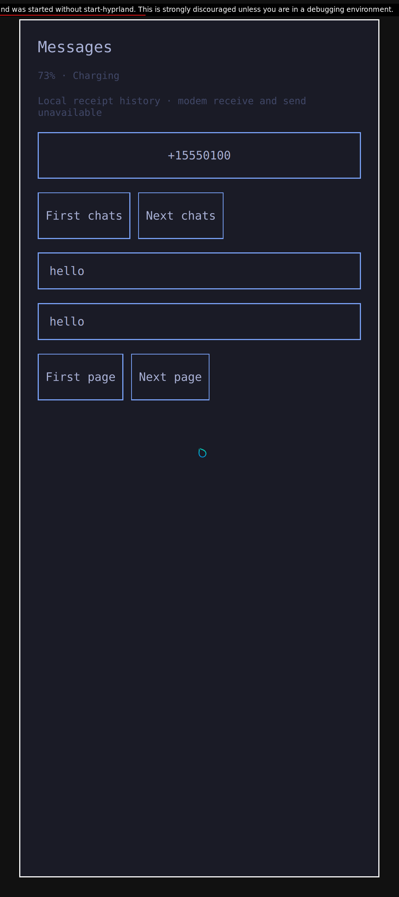
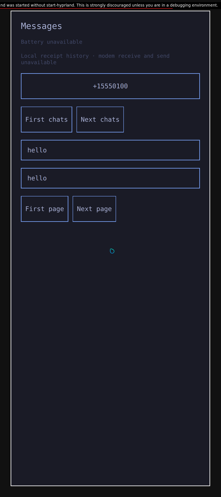

# Battery in the normal Messages app

The normal app now links three Rust client engines: Messages, appearance and
readonly battery state. Rust owns the battery socket, root:root peer validation,
bounded nonblocking I/O, strict JSON, original CLOCK_BOOTTIME request deadlines
and publication expiry. Qt copies scalar properties and presents them using the
existing Omarchy caption font and muted color. No additional app argument,
permission grant or command endpoint is introduced.

The header shows capacity and charging status when available. Unavailable,
expired or invalid replies clear the percentage and status. A partial reply
cannot renew the original500ms request deadline. Getters resample BOOTTIME so
stale values expire even after a late presentation timer. Actual physical
suspend remains unqualified.

Seven real Unix boundary groups first compiled and failed against a
nonconnecting stub. The implementation passed those groups and a C ABI lifetime
control. Three further protocol controls then exposed two actual assertion
failures for the unavailable deadline sentinel. The corrected implementation
passes all11 groups, formatting, strict Clippy and the optimized static archive
build. An actual nonroot server rejection remains untested.

A separate offline native x86 KVM guest built the normal Qt6.12 Release app with
all three pinned archives linked exactly once. It compiled the actual thin
battery adapter and matching header, checked all strong C exports, passed the
nine original Messages C ABI groups and verified the protected real-filesystem
installation and loader dependencies. This epoch did not execute the normal
app or create a window. Reused Messages/appearance archives have exact matching
compiled inputs; README-only differences are explicitly separate.

The [hash-only provenance](evidence/native-battery-ui-build-provenance.json)
records source selections, actual RED/GREEN, ELF and archive identities, and
process/container closure. A separate locked/offline ARM64 static crossbuild
also passes with432 AArch64 ELF objects and exactly four strong C exports;
it executes no ARM code or tests. Its first precompile script-permission refusal
is retained separately. The native Qt build closes24 inside waits/merged-pipe EOFs and
seven host waits/fourteen pipe EOFs with unchanged selected inputs. These are
native x86 build and host Unix component results, separate from the battery
service's real kernel/PID1 tests, ARM64 crossbuilds and physical hardware.

The existing offscreen QML fixture initially failed its original creation
assertion with the newly required battery property omitted. That compiled RED
ran only the installed group and both root peers exited0; Qt emitted no specific
missing-property diagnostic, and the driver did not run the other two modes.
After wiring the actual battery adapter and archive into this fixture, all three
unchanged installed/live-appearance/Messages-policy groups pass as UID11010 with
six actual root-peer exits0. Production QML, the other fourteen selected files
and all three archives are identical between these runs. This is component
composition evidence without a normal main or window.

The first graphical attempt stopped in setup at an executable-identity assertion
without recording the mismatching hashes, before app start or any capture. The
failed guest also exceeded its test-driver unload subdeadline and reported a
separate custody error. Its [hash-only record](evidence/native-battery-gui-attempt-provenance.json)
keeps guest closure false despite outer QEMU/container shutdown. No visible
battery feature follows from this attempt. The later successors below are separate epochs; their results do not upgrade
that failed attempt. Pixel battery readings, charging policy,
suspend, drain, ARM graphical startup and a bootable phone image remain open.

## Kernel to visible battery status

The later prepared native x86 KVM run passes all three actual driver states in
one normal Messages process/window:73% charging,51% discharging, then battery
unavailable. Independent kernel attributes and fresh root-credentialed service
snapshots bracket every capture. Root read the expected label in each original
image; no UI observer, model access, text injection, cropping or resizing is used.

| Charging | Discharging | Source unavailable |
| --- | --- | --- |
|  |  |  |

These are original1080×2424 native output captures, approximately422PPI at
scale2.625, with actual output and mapped-window metadata. Direct normal QWindow
DPR is not measured. Tokyo Night values come from the selected genuine Omarchy
source. This run retains the explicitly older qualified session/Source/audio/
appearance providers and one fixture-authored MessagesRead grant. The local
history is authored test data, without real SMS reception or sending. The
compositor's debug-launch banner and prototype layout remain in the originals;
this is not a finished phone shell or full theme/accessibility qualification.

The first successor fixed fixture readiness and cleanup, then reached a mapped
normal app but failed before capture because a dictionary binding shadowed a
helper function. Its readiness, normal Stop and guest closure pass separately;
the feature remains failed. Renaming those dictionary bindings preserves every
function and assertion. The following fresh run passes all three captures,
normal owner Stop and battery PID1 exit0, empty cgroup, dead Main, socket removal
and actual test-driver unload. QEMU/container closure and all selected inputs
also pass. No Source policy or production deadline is changed. The explicit
fixture unload allowance is15s within the original700s close budget; its earlier
5s failure remains recorded separately.

See [graphical provenance](evidence/native-battery-gui-provenance.json) for exact
inputs, images, readiness and closure, and the
[public helper timeout regression](evidence/native-owned-timeout-provenance.json)
for the separate current helper. That helper was not substituted into these
frozen VM epochs. Cold graphical startup, current all-service integration,
physical Pixel battery/charging, ARM window startup, suspend and drain remain
open. No physical phone was accessed.
