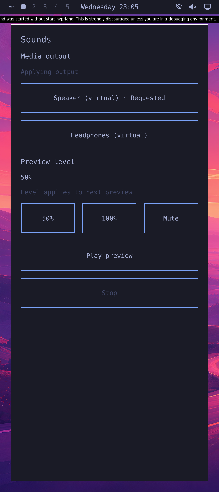
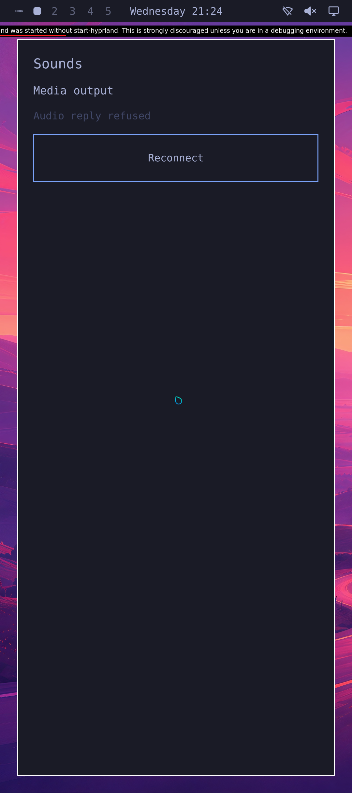

# Fresh Omarchy and native Sounds startup

## Source recovery prefix; whole audio repetition failed

A later fresh x86 KVM repetition with genuine Omarchy and the current timing
recovery implementation qualifies a narrow pre-Play Source prefix. The same
compositor 1412, Rust owner 1410 and Sounds app 1719 retain their held pidfds,
starttimes and mapped window. Authenticated Source sequence 150 is observed before
SIGSTOP; after its unchanged 100 ms lease expires the actor reports `recovering`,
locked denial and null first failure. Following SIGCONT, fresh sequence 153 is received
52.257 ms after the CONT request. The app is not relaunched. Preview is idle and
the media source absent during this pause, so audio-active cancellation is not
qualified.

Boundary 1 passes genuine focus, the actual 1080 × 2424 simulated Pixel 10 output,
QWindow DPR 2.625 and 48,000 measured silent PCM frames. The whole cohort still
**FAILED** later: Play produces only the first 1,024 authored 50% frames, without
a full tone window or `tone.json`. Main's fixed diagnostic records Starting-state
retirement at guest monotonic 73.004120 s with reported callsite 271; the producer is
observed dead around 73.009 s. The observer later reaches its 64-graph bound. No
revoke success is established. These observations identify neither which guard
retired the preview nor its cause; Source continuity around retirement is not
established.

Host, boot and guest closure independently pass their actual wait/EOF and original
cutoff checks, QMP-observed guest shutdown/QEMU exit 0, same-daemon exact-container
absence and unchanged input checks. The full functional and positive manager
Stop-after-Ready qualifications remain false. This is x86 KVM evidence only,
without an ARM, phone or sustained-audio recovery claim. No new screenshot is
published. [Hash-only provenance](evidence/native-session-timing-recovery.json)
binds this prefix and whole audio failure; the earlier selections below keep
their original results.

## First passing current trace

One fresh x86 KVM cold trace now passes with genuine Omarchy, real compositor
Source/focus and the pinned current Rust-backed Sounds frontend and normal audio
service. Actual uinput touches select Speaker, 50% and Play; no Reconnect is
needed. Operator grant/revoke is test administration, not a user-consent UI.

This unmodified 1080 × 2424 capture precedes Play. It shows 50%, Speaker Requested
and Applying output; it is not a screenshot of active playback. The development
compositor warning remains visible. Native QWindow DPR 2.625 and the selected
Pixel 10 density/physical metadata qualify the simulated display.

Separate PCM evidence measures 24,000 frames per route after 9,600 discarded
frames in each of two paired windows. The 440 Hz speaker RMS is 0.0883867;
earpiece is silent. After an actual operator permission revoke, the retained Main-owned
`pw-cat` producer's pidfd becomes terminal, its process/client/source/links are
absent before the original 3 s bound after Play, and both routes measure exact zero.
These 96,000 measured frames fit the original 6 s work cutoff; the separate initial
permission-withheld window supplies 48,000 silent frames. Producer credentials,
normal ELF, direct Main parent and mono F32LE format at 48 kHz are checked
independently of UI text. The observer exits 0 before audio Stop; Source, PID 1 Stop-after-Ready,
service PID 1 exit observations, child wait/EOF, QEMU and exact-container closure
pass. Native component checks also pass: 34 Qt cases, five C ABI cases and 29 appearance cases.

This is the first passing current full trace, not a functional repair or a
repeatability result. Two earlier runs reached Play but lost the producer before
a full tone window; both remain unexplained failures. The immediately preceding
failed diagnostic run uses the same normal `a499d675…` audio ELF, functional
consumer and PCM oracle. The added filtered journal collection runs after cleanup and does not repair
playback. Its Main log records
Playing→Failed retirement during the actual revoke request; it does not identify
the cause of either earlier failure. Repeat diagnosis remains the next gate.
The sinks are virtual; live host-audio egress is not exercised.

The next launched repetition stops at the actor metadata prerequisite before any
boundary step, Play or PCM measurement. Source accepts sample 88 at
67,855,440,932 ns, then rejects sample 89 (67,957,882,919 ns) for `sample_gap` at
67,964,289,104 ns: a 102,441,987 ns interval. Full closure, unchanged inputs and
exact-container absence pass. This is a Source prerequisite failure, with no
scheduling cause or audio failure inferred. A separate preceding preparation
fails a root file-mode check before any owned host helper, container or VM launches.
Source freshness architecture remains under review; no code repair is selected.

## Earlier frozen frontend and failed successors

An earlier fresh x86 KVM run starts the selected PID1 profile, initializes genuine
Tokyo Night theme state, brings up the real Omarchy shell and launches the native
Sounds window through the Rust session owner. Real compositor focus identifies
the app's UID11042 process. There are no authored Source snapshots, theme-only
host, manual first Source load or preparatory compositor warmup in this case.

The captured Sounds frontend is the frozen selection used by this run. It
predates the current Rust client and playback/level/mute controls in the
repository. Its original result does not qualify those newer controls; the
current trace above records that scope separately. The
[hash-only evidence](evidence/native-cold-omarchy-sounds.json) records the compared
frontend source hashes separately from the executed result.

The selected audio daemon also predates the current client: source comparison
finds that its status reply lacks the now-required `policy_settled` and `preview`
fields. Source comparison identifies this mismatch; the new actual baseline
below records the visible failure separately.
A replacement normal x86 Release build from current source passes 56 existing
scoped tests, formatting and strict Clippy; 52 frozen source pins and 17 actual
wait/EOF completions were independently checked. The current owner and appearance
daemon retain exact matching source bindings.

A new actual cold baseline builds and installs the current frontend and Rust
client archives: 34 Qt cases (32 behaviors plus setup/cleanup), five C ABI cases
and 29 appearance checks pass. Genuine Omarchy, fresh Source, the normal current
window and the Pixel10 display profile pass; 48,000 measured initial frames are
silent. Its profile keeps the `source.media` selector but omits the old fixture's
permanent media producer.

This baseline deliberately retains the historical audio daemon. An operator grant
succeeds, followed by exactly one touch on the enabled Reconnect button. Eight
valid subsequent captures still show no route controls and disabled Play. This
is an actual desired UI failure, with complete guest/VM/container closure, rather
than a build or capture setup failure. Play and the new finite-preview observer
never start. Operator grant is test administration, not a user-consent interface. The baseline's overall
functional and positive manager-Stop-after-Ready qualifications remain false.

Earlier current-daemon attempts remain failed. The first caught an initial Wayland
configure transition: Qt still reported 411×923 while the mapped compositor
client was already 369×855. Readiness now requires the same app PID and matching
sizes within the original frame deadline. The second passes that startup check,
initial silence and the current route controls, then reaches real Speaker, 50%
and Play touches without needing Reconnect.

That run records only one 1,024-frame speaker quantum (21.33ms), matching the
first authored 50% PCM samples exactly; the remaining speaker samples and all
earpiece samples are zero. The source appears briefly and disappears before the
observer can bind its producer identity and qualify a full tone window. Its
64-observation bound is reached; no revocation action occurs. All observer,
guest and VM closure checks pass. This is useful failure evidence, not qualified
sustained playback. The pre-Play screenshot still contains a pressed-button
buffer and 100% label, so it does not establish visible level publication.

Normal-service diagnostics now report fixed local retirement/completion facts
and the retirement callsite, without logging app requests, tokens or PCM. The
normal diagnostic Release build passes the same 56 existing tests, formatting
and strict Clippy. These diagnostics change no routing, lifecycle guard or
deadline. The first diagnostic run also loses its producer before a full tone
window. Its saved 256-line unit tail misses the earlier Main diagnostics amid
PipeWire child output. That failure remains unresolved; the passing successor
adds a separate 64-line query for fixed preview messages under the retained Main
PID and invocation, while preserving the original unit tail.

In the original frozen-frontend run, audio permission was withheld. Its captured
“Audio reply refused” message
does not establish that withholding permission was its sole cause: the selected
frontend predates the current actor/client protocol. Independently, direct audio
access was denied and measurement found zero RMS/peak across 48,000 PCM frames.
This does not demonstrate authorized playback or a healthy current app/service pair.
The visible direct-Hyprland startup warning and desktop-oriented shell layout
remain development rough edges; the capture is unmodified.

The native capture is 1080 × 2424 pixels. The actual app QWindow reports DPR2.625,
with the selected420 logical density and approximately422PPI physical metadata.
The integer QScreen DPR3 is retained only as a diagnostic. Native-buffer and PNG
pixel hashes match, with no resizing. This is a simulated Pixel10 display profile,
not a physical Pixel result.

The deployed profile contains253 files. Its genuine Omarchy base has196 files:
54 QML files receive the existing explicit Commons.Color namespace correction,
and142 retain their original bytes. Forty genuine theme assets are included
(the license overlaps the base). The normal Rust provisioner and presentation
launcher are the separately qualified Release binaries. The launcher inherits
only two compositor presentation values and execs Quickshell in the same PID;
Source permissions remain separate.

PID1 reports successful theme oneshot completion with an empty cgroup. The native
owner reaches Ready, and the positive manager Stop-after-Ready case passes.
Audio and appearance finish with their authenticated Stops and PID1 exit0; app,
compositor, guest child, QEMU and exact-container closure all qualify. Selected
inputs remain unchanged. Quickshell closes by manager SIGTERM with successful
unit status; its process exit is not relabeled as exit0. The previous Color and
unset-instance warnings disappear, while missing shell backend/helper integrations
remain visible in the journal. A preceding static preflight label mismatch happened
before container creation and remains recorded separately.

[Hash-only evidence](evidence/native-cold-omarchy-sounds.json) and
[executed consumer sources](../tools/native-cold-omarchy/) record the scope.
Earlier Source/appearance failures remain failed; this new passing epoch does
not change their results.

Remaining gates include actual failed-provision PID1 propagation, authorized
repeatable current playback/revocation and user-facing permission flows, live
theme changes,
launcher/menu interactions, trusted authentication/locking, shell bindings to
native phone services, ARM graphical integration and a reproducible full preview.
Calls/IMS, carrier SMS, camera, suspend and every physical-phone gate remain open.
This one cold-start slice is not completion of the smartphone system.
