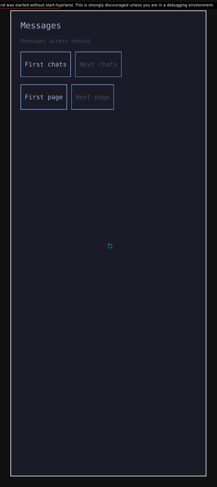
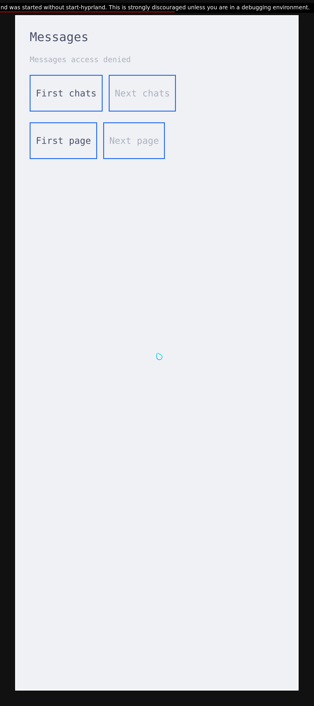

# Messages window with both Rust client engines

A fresh prepared x86 KVM session now passes denial, granted local history, a live
Omarchy theme change and revocation in the normal Messages app using the
[published shared appearance Rust client](native-appearance-rust-client.md).
All four groups keep the same app process and mapped window. The earlier
[Messages captures](native-messages-prepared-tracer.md) remain evidence for their
pre-port appearance client.

| State | Actual observation |
| --- | --- |
| Denied | The fixed UID1000 native launcher starts normal Messages as UID11010 with six production arguments. Real Source focus is observed; access is denied and both lists are empty. |
| Granted | An independent MessagesRead grant lets the app's ordinary requests display one authored conversation and two literal `hello` messages. |
| Theme changed | Original Omarchy setter/templates and Color/Style through the authored theme-only host change Tokyo Night to Catppuccin Latte; the same app/window retains both messages. |
| Revoked | The next ordinary denied reply clears the conversation and both messages. The native Stop client and owner are actually waited with exit0. |

The existing isolated Rust seed fixture runs once before owner startup. These
are two authored local receipt occurrences, with no modem producer or auxiliary
history reader feeding the UI. Launching grants no read permission. The real Rust
Source observer retains its unchanged100ms freshness rule. Revocation is checked
at the next denied response; this does not establish retroactive erasure or
zero-frame withdrawal.

## Original native captures

These four unedited1080×2424 output captures use the Pixel10 virtual profile:
output scale2.625 and65×146mm, approximately422PPI on each axis. The actual mapped
Messages client, protected-listener registry and separate nonpresenting discovery
bind the external window/output measurements. Independent PNG CRC/decompression
and row unfiltering reproduce RGBA pixels and the original native BGRA buffer
hashes. No image was resized, cropped or repainted.

| Granted: Tokyo Night | Same window: Catppuccin Latte |
| --- | --- |
|  |  |

| Initial denial | Revocation in the light theme |
| --- | --- |
|  |  |

Root viewed all four original native frames and checked both literal messages
and their later absence. Border-band predicates2/5/5/2 are rendering checks,
not model counters or text recognition. The upstream debug-start warning and
pointer remain visible. Direct normal-app QWindow getters and Qt DPR were not
sampled; that part of the [display-profile gate](native-phone-display-profile.md)
remains open.

## Fresh build and owned closure

The guest builds and installs the current normal frontend with Qt6.12
CMake/Ninja. Its final link contains exactly one Messages Rust archive and one
appearance Rust archive, exposing12 and11 strong public APIs respectively. Loader
resolution, protected QML/desktop installation and the frozen nine-group Messages
consumer pass in this epoch. No observer instrumentation is added to the app.
Rust owns request/model and appearance policy; Qt performs native I/O and QML
presentation. This GUI epoch does not repeat the separate eight-group appearance
or29-case Qt component suites.

The selected frontend has44 source rows. All42 non-Markdown inputs match
`d896aa322a47161cbee9a9a708e189c4980661c6`; one unchanged core README and one
historical Messages README complete the source cohort. The documentation bridge
is explicit in the provenance. Reused service, seed, theme and compositor inputs
retain their own pins. The required Sounds profile retains an inactive historical
ELF; no Sounds execution or current Sounds window is claimed.

The closed review verifies128 selected and136 external input pins. It counts102
primary waits and109 PIPE EOFs, plus one separate nested C ABI child wait with no
additional PIPE. QMP socket EOF is separate; regular capture/focus files and
compiler subprocesses are not added to these counts. Original cutoffs, exact
container absence, same-daemon identity and unchanged-input closure pass.

After native Stop, the retained app pidfd is dead and the process is absent.
The owner does not expose the app's numeric wait result, which remains null;
owner exit0 does not supply app exit0 or a direct Qt-thread join.
[Hash-only provenance](evidence/native-messages-appearance-rust-tracer-provenance.json)
binds the closed execution, independent review, visual review, providers and four
new original assets. The historical report, captures, provenance and failed
attempts are preserved.

Full original shell/menu, cold startup, current Sounds GUI, ARM composition and
physical Pixel behavior remain open. Earlier ARM build/install results use their
recorded pre-port appearance cohort. Incoming modem SMS, sending, suspend and
carrier behavior are not demonstrated. No physical phone was accessed.
