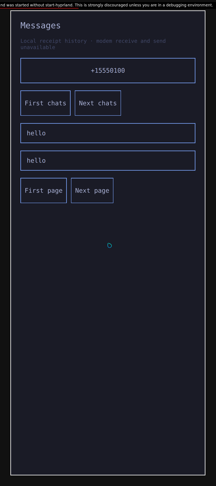
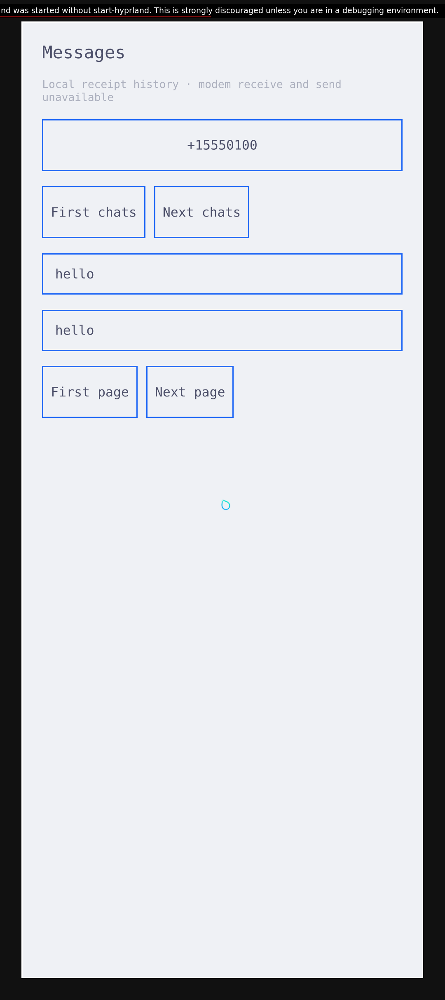
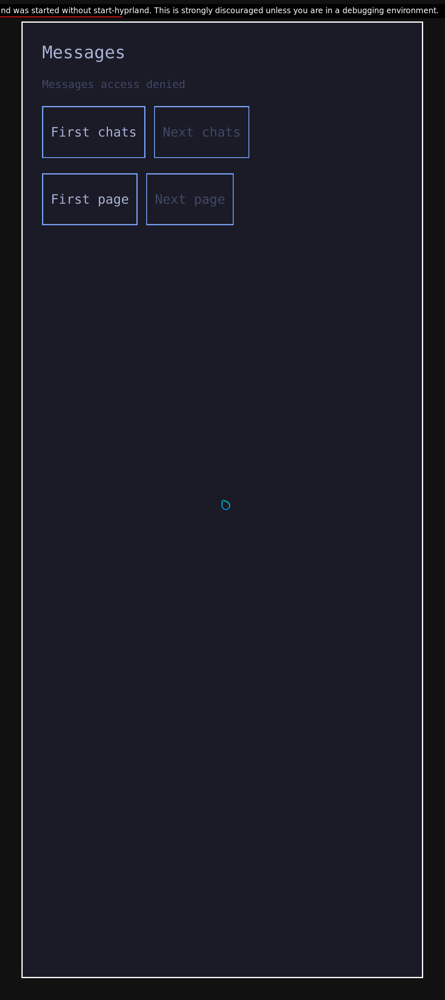
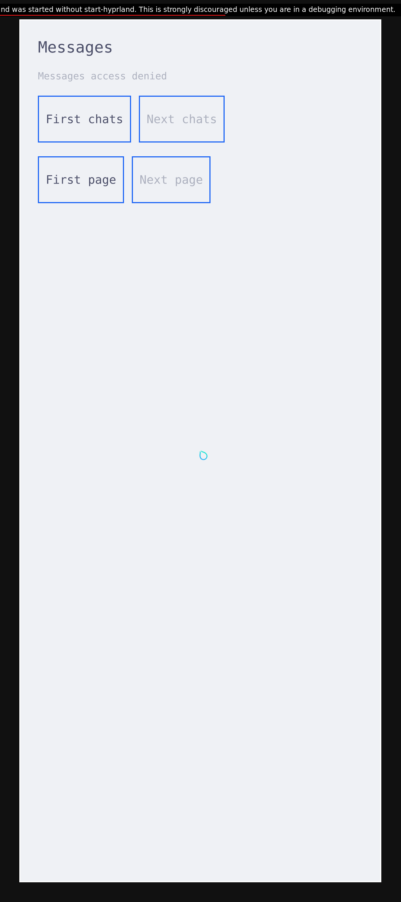

# Prepared Messages window with the Rust engine

This earlier normal Messages epoch uses the pre-port shared appearance client.
A later [session with both Rust client engines](native-messages-appearance-rust-tracer.md)
now passes independently; the four assets and provenance here keep their original
source cohort and are preserved.

This native x86 session passes four visible states: denied access, granted local history, a live Omarchy theme
change and revoked access. One app process and window survive the whole sequence.
The app's request/model engine and service ownership are Rust; Qt presents QML and
performs native operations. These are authored local messages in a prepared VM.

| State | Actual observation |
| --- | --- |
| No permission | Fixed UID1000 native launcher starts the normal UID11010 app; real Source focus is observed; access denied and no history rows |
| Independent grant | Root grants MessagesRead; the app's own ordinary service requests display one authored sender and two literal `hello` rows |
| Live theme | Original Omarchy theme setter/templates and Color/Style through the theme-only host change Tokyo Night to Catppuccin Latte; both rows remain in the same app/window |
| Revoke | The next ordinary denied response clears both visible lists and restores access-denied text; native owner Stop then completes |

The seed runs once before owner startup through the existing isolated Rust
fixture. Private raw/inbox directory identities stay fixed. No auxiliary history
reader supplies the app model, and launching the app grants no read permission.
Source retains its original100ms validity rule. Revocation is measured at the
next ordinary denied reply; no retroactive erasure or secure-lock promise follows.

## Native screenshots

All four files are original1080x2424 native output captures. The compositor
reports output scale2.625 and65x146mm, approximately422PPI on both axes. Actual
mapped Messages client metadata, protected-listener logical-output registry and
separate nonpresenting output/DRM discovery are retained. The capture tool verifies
whole decoded PNG/native-buffer pixel equality. Nothing is resized, cropped or
repainted; the upstream debug-launch banner remains visible.

These external measurements do not sample the normal app's QWindow getters or
its direct Qt DPR. The full direct-Qt DPR/DPI qualification in the
[display-profile report](native-phone-display-profile.md) remains open for this
normal app; the current pass is explicitly the external output/window scope. Full original Omarchy
shell/menu execution is also unclaimed: genuine theme code runs through the
existing authored theme-only host in the prepared session.

| Granted: Tokyo Night | Same window: Catppuccin Latte |
| --- | --- |
|  |  |

| Initial denial | Revocation after the light-theme change |
| --- | --- |
|  |  |

Root independently reviewed all four full native frames. Automated border-edge
counts are rendering predicates, not direct model counters or text recognition.
Both literal message rows and their later absence were checked visually.

## Fresh code and preserved failures

The guest builds and installs the normal app with Qt6.12 CMake/Ninja, the current
public header and exactly one qualified Rust archive. Its twelve strong exports,
loader resolution and frozen nine-group consumer are checked again in this epoch.
The owner, fixed launchers and isolated seed are fresh default/selected-feature
Rust Release builds. Unchanged appearance/audio providers and inactive Sounds
retain explicit source-cohort identities; no old app result supplies this pass.
The app and owner have no added observer instrumentation.

Two earlier attempts remain failed. The first stopped during setup because the
harness tried to overwrite an already-running audio executable. The successor
verifies that installed provider's protected identity instead. The second reached
the actual denied Messages window but its pixel predicate wrongly assumed that
surface and background colors differ. Independently decoding that original frame
confirmed the control borders. Only the predicate changes to published border
edges; row counts, eight-capture/20s limit, identity, permission, Source and
closure requirements stay fixed. No production repair is attributed to either
harness correction.

## Closure and remaining gates

The native Stop client receives success and is actually waited; the owner is
actually waited with exit0. The retained app pidfd becomes dead and its process
is absent. The production owner does not export the app's numeric wait status,
so app exit0 and a direct Qt-thread join are not inferred from owner exit0.
Guest/VM/container ownership, original cutoffs and unchanged-input checks pass;
regular-file handles are not reported as PIPE EOFs. The independent review
counts101 primary process waits and108 PIPE EOFs, plus one separate nested
C ABI child wait with no additional PIPE EOF.

[Hash-only provenance](evidence/native-messages-prepared-tracer-provenance.json)
binds the actual epoch, failures, selected source, native frames and independent
reviews. The separate [ARM build/component result](native-messages-rust-client.md#manual-arm-build-and-component-execution)
uses a generic ARM kernel and supplies no ARM window.

The next product milestone is one installed ARM cohort using production build
and package paths, normal Messages/Sounds, genuine shell/menu and live themes.
The [shared appearance Rust port](native-appearance-rust-client.md) separately
passes the same29 native cases and fresh host full-app/default-Cargo/install
checks. The four captures here retain the pre-port client. The later [current appearance
Rust session](native-messages-appearance-rust-tracer.md) now passes separately;
the complete current ARM stack remains open. Cold startup still needs a concrete
repair; repeated diagnostic ladders are parked. Matched Pixel graphics, real
incoming/SMS sending, notifications/wake, suspend, carrier and all phone hardware
remain unqualified. No physical phone was accessed.
