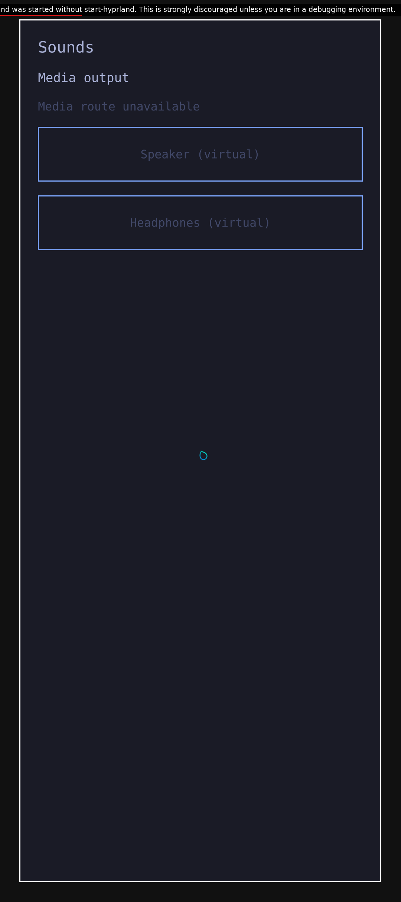
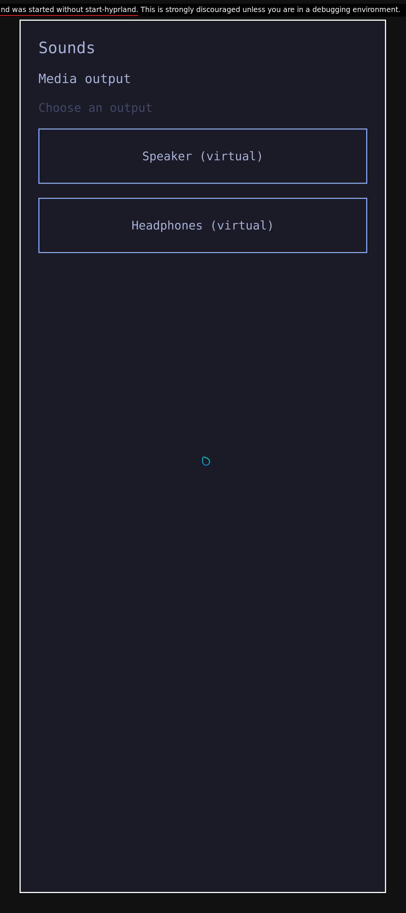

# Normal upstream compositor tracer

The next app/service slice uses normal upstream Hyprland under the Rust session
owner. The experimental custom renderer is component research. A prepared
Sounds/Source/permissions/audio/PCM/theme/Stop slice now passes all four original
behavior groups. Cold startup, live theme changes in this combined slice, the
full shell and rendering-stall behavior remain unqualified.
[Hash-only provenance](evidence/native-normal-upstream-tracer-provenance.json)
retains two separate closed failed native x86 KVM epochs; private logs stay private.

## Actual current-services baseline

A fresh signed installed guest uses unchanged upstream Hyprland0.56.2-4, its
matched SDK and the separately qualified current Rust owner, launcher, audio and
appearance services. The normal Qt app builds; its32 audio component cases
include two setup/cleanup cases, and all29 appearance cases pass. These component
checks do not qualify the integrated app. No ARM result is inherited.

The real native Source accepts sequence1, then its cached sample expires at
100.303285ms against the unchanged100ms lease. This occurs before Sounds launch,
so none of the four functional/PCM groups executes. The failure establishes
startup Source unavailability; it identifies no exclusive renderer operation.

## Unsuccessful startup candidate

A separate one-file experiment delays initial publication until both the genuine
Wayland timer and a native successful-present notification from a current enabled
output have been observed. Its adapter compiles against the signed installed SDK.
The shared sampler, Source wire, consumer and freshness rule remain unchanged.

A fresh runtime still fails: sequence1→2 spans111.005417ms. Sequence2 is only
7.045065ms old at validation, but the producer gap already violates the contract.
The failure stays terminal. The retained existing compositor log does not contain
the activation witness; ordering remains unqualified. This absence establishes
neither a presentation failure nor a buffering cause. No app/PCM group executes.
The candidate remains private and unmerged; it is not a production repair.

Both epochs retain authenticated locked failure snapshots and accepted native
Stop requests followed by actual owner wait0. Their guest children, output EOFs,
external descendant pidfds, QMP shutdown and actual QEMU/CLI waits close within
the original bounds. The exact container is absent on the same daemon and inputs
remain unchanged. These are closure observations after failure; they do not prove
Stop during a stalled compositor or native display/vendor cleanup.

## Prepared normal session reaches Sounds

The first prepared attempt fails only fixture setup: UID1000 cannot open its QML
under the private results directory. Source stays awaiting-first. The unexpected
client255 also correctly prevents guest closure qualification; it is not a
production functional RED. A fresh selection stages that exact QML as a readable
Root-owned file under the existing user runtime, keeping results permissions.

The corrected selection observes one ordinary client layer, one native1080×2424
capture with its expected pixels, actual warmup child wait, then one baseline
adapter load. Authenticated snapshots remain awaiting-first before that load.
The real Source then reaches sequence1 readiness and later sequence87 with no
failure. The Rust owner launches the normal Qt Sounds app as UID11042 through its
protected per-app Wayland listener. This establishes prepared startup and app
launch only; no cold-start fix is claimed. The warmup capture is not a Sounds
screenshot.

The original strict metadata check stops the run before any functional group:
Sounds' window reports DPR3 then2.625, but its QScreen geometry remains360×808,
while earlier trusted discovery reports411×923. Both QScreen DPR diagnostics
are3. Screen physical-DPI observations differ accordingly. The100ms Source
remains healthy when the failure is observed. All owned guest children/output
EOFs, external pidfds, native Stop/owner wait0 and outer VM/container/input custody
close without errors. No qualified Sounds capture, audio permission/touch/PCM
result or full app composition follows.

## Next measured boundary

An exact [upstream allowlist review](https://github.com/hyprwm/Hyprland/blob/efb50993780079460b0cbed1363e2166a2de1d9f/src/managers/ProtocolManager.cpp#L348)
finds the existing logical-output protocol missing from sandbox access.
[Qt's geometry fallback](https://github.com/qt/qtbase/blob/v6.12.0/src/plugins/platforms/wayland/qwaylandscreen.cpp#L114)
then divides native dimensions by integer scale3, explaining360×808.

A fresh actual boundary run now qualifies missing-protocol RED before any
dependency edit. The unchanged public raw Wayland probe runs as UID1000 on the
original listener and UID11042 on the exact Rust-owned app listener. The former
advertises `zxdg_output_manager_v1` version3; the latter omits it. Both can bind
normal compositor and XDG-shell globals. All five prior privileged protocols are
present on the trusted listener and remain hidden from the app: lock, security
context creation, screencopy, virtual keyboard and layer shell. Genuine Source
remains observed through sequence79. Normal owner/guest/VM/container/input closure
passes; the aggregate still fails its required logical-output assertion, with no
behavioral/PCM group or qualified Sounds screenshot.

The later correction below adds exactly one allowlist entry in otherwise normal
upstream Hyprland. The same frozen registry consumer and strict app/PCM contract
now pass. This is a small native dependency correction, not a Rust port.

For a later positive metadata observation, wait within the original single30s
frame deadline for the actual current QWindow's negotiated2.625 scale; retain the
exact positive screen/window/physical/native Pixel guards. Do not transform or
rescale metadata, inject a scale environment or renew the deadline. The full four
behavioral/PCM groups and Source/cleanup assertions remain required.

A successful prepared composition still cannot qualify cold startup, render-stall
availability, the real installed Omarchy shell/menu, native display cleanup, ARM
composition or any physical-phone gate.

## Prepared full app/service slice passes

The [one-entry dependency patch](../patches/hyprland-unprivileged-logical-output.patch)
adds `PROTO::xdgOutput->getGlobal()` to the unprivileged allowlist at the pinned
upstream commit. All other original source blobs remain unchanged. The actual
normal Release compositor and complete matching498-file SDK build successfully,
with truthful local dirty-version metadata. This is a local source build on the
signed367-package base, not a signed Arch package or exact Arch recipe rebuild.
The original signed guest preflight runs before the local ELF and whole SDK are
installed; all display helpers and plugins then compile against that new SDK.
The installed Aquamarine14 and system libraries remain unchanged.

A fresh native x86 KVM session now passes the unchanged registry consumer. The
owned app listener exposes logical-output version3 while all five previously
checked privileged protocols remain hidden. The actual Sounds QScreen is411×923
logical pixels, with the same exposed QWindow geometry and negotiated DPR2.625.
Actual Wayland and DRM modes are1080×2424; physical metadata gives approximately
422PPI. Integer QScreen DPR3 remains a diagnostic. No scale environment, metadata
transformation or resized capture supplies the positive result.

All four original groups then pass:

1. Normal Rust-owned launch without a grant shows disabled controls and measured
   silence on both virtual outputs.
2. An independent grant and genuine Source focus permit one touchscreen selection;
   the independent graph and recorded PCM confirm440Hz on the virtual speaker,
   with the other output silent.
3. An actual exclusive layer removes eligible focus. Further selection is denied
   while already-approved speaker audio continues.
4. After one authenticated Source-unload request, the actor reaches terminal
   state, app/compositor/listener ownership closes, measured audio is silent and
   another fixed desktop launch is refused. The request does not prove that
   plugin unload completed or identify the exact first terminal cause.

Eight captured PCM windows contain192,000 measured frames in total. Native owner
Stop acknowledges and actually waits0; guest, QMP shutdown, QEMU, CLI, exact-CID
and locked input closure pass within the original limits. Process closure does
not prove native display or vendor cleanup.

| Without permission | With permission |
|---|---|
|  |  |

These are original unresized1080×2424 native captures from this successful epoch.
The debug-launch banner is visible. The enabled capture precedes the measured
touch/audio step; it is not itself evidence of a selected route or physical
sound. Initial Tokyo Night appearance comes through the original Omarchy setter
and theme host. This epoch does not exercise a live theme change, the installed
Omarchy shell/menu, secure lock presentation, a stopped compositor, ARM or a
phone. Its one prepared client warmup does not repair either earlier cold-start
Source failure. All those gates remain open.
