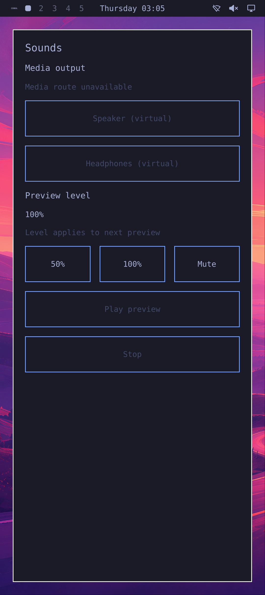

# Genuine Omarchy app close and reopen

One cold x86 KVM session now completes the user loop: open the genuine Omarchy
menu, choose Apps → Sounds, close with Super+W, open Sounds again, then shut down
normally. The same Rust session owner remains running; the second window belongs
to a fresh native app process. This is a VM checkpoint, not a usable phone release.

## Change and actual RED → GREEN

The selected preview compositor configuration omitted Omarchy's close binding.
The baseline passes menu launch, native window/focus checks and permission-withheld
silence, then one real keyboard gesture leaves the original app alive through its
10-second close deadline. The compositor reports no bindings. Its last observation
still has a live app PID/descriptor/listener and fresh, unlocked Source state.

The candidate appends only [window-bindings.lua](../tools/native-omarchy-menu/window-bindings.lua)
to the selected compositor configuration. It uses the standard Super+W gesture
from pinned Omarchy `c668141e9c42b13c80c9ca4ea108e11708c5e8a5` and the matched
Hyprland Lua dispatcher. The RED and GREEN use identical consumers, service/app
binaries, resource limits and deadlines. No direct compositor close command or
signal to the app substitutes for the keyboard gesture.

In GREEN, app 1990 retires: its retained pidfd signals death, its process, window
and private display listener disappear, and the actor reports zero principals.
A second three-tap menu navigation launches app 2267 under the same owner 1413,
with the same normal app ELF, UID/GID 11042 and a fresh private display listener.
These external observations do not claim a native parent's wait result or app
numeric exit status.

Both windows pass the Pixel 10 profile: native 1080 × 2424 capture, actual target
QWindow DPR 2.625, nominal 422 PPI and 420 logical density. Each app instance passes
48,000 independently measured silent PCM frames across the two virtual routes;
all 96,000 frames are zero. No permission grant or Play occurs. The full manager
Stop-after-Ready result passes, with normal owner/audio/appearance exits, empty
service cgroups, actual owned test-process waits/required PIPE EOFs, QEMU exit 0 and
exact container removal. Process reaping is not a claim about vendor cleanup.

The original screenshot is unresized. Disabled route/play controls show the actual
permission-withheld state. The earlier menu-only captures do not inherit this
window's density qualification.

## Preserved failures and test scope

The first close-test invocation failed on host qualification-file readability
before any container. The next VM launched the app but saw Source Recovering at
an immediate post-registry check, before window qualification or a close gesture.
Both remain failed prerequisites. The revised consumer starts the existing
30-second frame deadline earlier and shares it with a read-only Source readiness
wait, preserving the first snapshot. It does not renew a deadline, change the
100 ms Source policy, relaunch an app or replay input. Only this revised consumer
is used for the qualified close RED and GREEN above.

The capture-only exec wrapper requires empty output files. The consumer preserves
the first instance's files after its identity/display retire, then prepares fresh
files for the second instance. This measurement setup is not an unlimited-use
interactive launcher. Native app/window evidence and the two capture epochs remain
separate. The older menu run's later audio failure is not repaired or reclassified.

The input here is actual guest uinput, not remote-viewer input. A separate host-only
paused/diskless test has transferred the full native-size framebuffer through a
private Unix RFB socket and closed its processes; it has not driven this guest.
The next gate is viewer → SDL/QEMU → guest input → menu/app lifecycle. A public
fresh-checkout build/preview command, visible permission flow, repeatable playback,
ARM integration and all physical Pixel gates remain open. No phone was accessed.

[Evidence summary](native-omarchy-app-lifecycle-evidence.json) records the exact
result/input hashes. [Consumer patches](../tools/native-omarchy-menu/close-reopen-consumer-pins.json)
reconstruct the executed consumers from the published cold-consumer bases; they
still require separately prepared runtime and deployment inputs.
