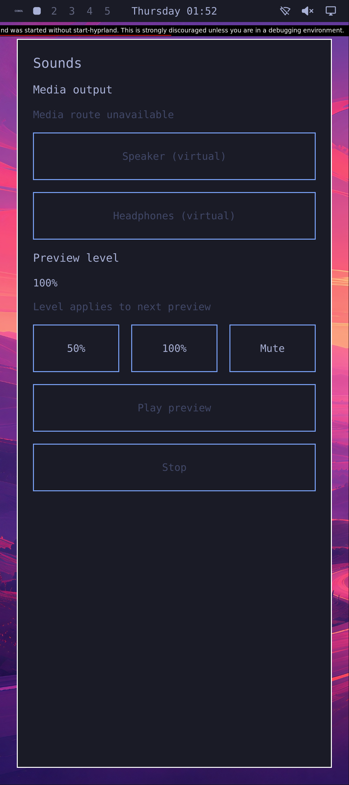

# Opening native apps from Omarchy

**The real Omarchy menu now launches Sounds through the Rust-owned app service.**
Three actual touches—bar, Apps, Sounds—open a new native app. Its real window,
compositor focus and permission-withheld silence checks pass in an x86 VM at the
Pixel 10 display profile.

This unmodified 1080 × 2424 screenshot shows disabled routes and Play, the default
100% selection, and the upstream development warning. The actual app window is
visible/exposed, 369 × 855 logical pixels with DPR 2.625. It is not a playback or
physical-phone screenshot. The separately captured menu panels do not inherit
this app-window density qualification.

## Actual menu RED and narrow GREEN

Before the change, a real touch reached the genuine bar button but no menu layer
appeared within the original ten-second navigation budget. The shell was alive
and its bar geometry authenticated. An earlier attempt failed in deployment
staging before reaching the UI and supplies no menu evidence. The RED journal
contains no specific post-touch wrapper error and did not capture the actual
shell PATH, so an exclusive failure cause is not claimed.

The candidate traverses the same bar and genuine menu with three real uinput
touches. Menu navigation takes 4.03 seconds inside the original ten-second budget;
that is not a total boot or app-startup measurement. The actual five-entry desktop
catalog and genuine menu model agree before and after capture, with Sounds at
index four. The controller never invokes the desktop client directly.

The new app is PID 1971, an actual child of Rust actor 1413, with UID/GID 11042 and
no extra groups. A new prerequisite check binds the exact root-owned Sounds
.desktop file, its fixed Rust-client Exec and the retained shell's actual data
paths; neither higher-priority desktop override exists. The guard creates no
entry and launches no process. The actual installed 255-file manifest includes
all three overlay rows.

Boundary 1 then qualifies native focus, live app identity, the actual window and
output profile, and 48,000 measured PCM frames that are bitwise silent without a
grant. This is a passing menu/app boundary, **not a passing whole audio run**.
The later Play continuation fails because the PCM observer exits before its tone
record, after reaching its graph-count bound. No full tone or revoke-silence
window qualifies. Retained Main/Owner journals contain no preview diagnostic
lines; this does not establish whether a request was dispatched or identify a
Source, deadline or backend cause. Earlier passing and failed audio epochs retain
their original results.

Actual wait, required EOF and original bounds pass for seven host, five boot,
188 guest and 70 later PCM observer receipts. Nineteen observed native descendants
are terminal and absent; these are not relabeled as native-parent waits. QEMU
exits zero, exact-container cleanup passes, inputs remain unchanged and guest
closure qualifies. The full functional run and its composite manager
Stop-after-Ready qualification remain false.

## Implementation and remaining work

The reusable [overlay stager](../tools/native-omarchy-menu/) selects three files
from the hash-pinned public Omarchy archive:

- The unchanged original `omarchy-shell` wrapper at `/usr/bin/omarchy-shell`.
- The unchanged default menu JSONC at the path the genuine menu reads.
- One declared `AppLibrary.launch` adaptation: resolve the exact desktop ID,
  retain visibility and hidden-entry checks, then use Quickshell's parsed command
  and working directory through `DesktopEntry.execute()`.

The installed Rust client requests actor-owned app launch; the actor retains app
lifetime and permission checks. The generic deployment installer is unchanged.
The original 54 namespace adaptations remain separate from this one launch change;
141 of the original 196 base files remain unchanged. The wrapper/default add two
installed assets. Both published consumer patches reconstruct the exact executed
bytes from their pinned published bases.

This does not qualify arbitrary desktop applications: the pinned Quickshell
`execute()` ignores terminal handling and field codes. The fixed Sounds entry
uses two absolute arguments, no field codes and `Terminal=false`. Other upstream
menu commands remain separate work.

Next: a reproducible interactive VM preview with close/reopen and normal shutdown,
a visible Allow/Revoke permission flow, and the bounded audio regression. Playback
remains experimental. ARM graphics, complete phone services and all physical
Pixel gates remain open. No physical phone was accessed.

[Hash-only evidence](evidence/native-omarchy-menu-launch.json) records both menu
runs, the failed audio continuation, the overlay and the qualified screenshot.
