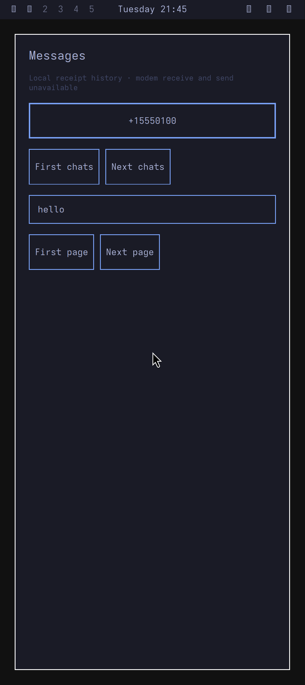
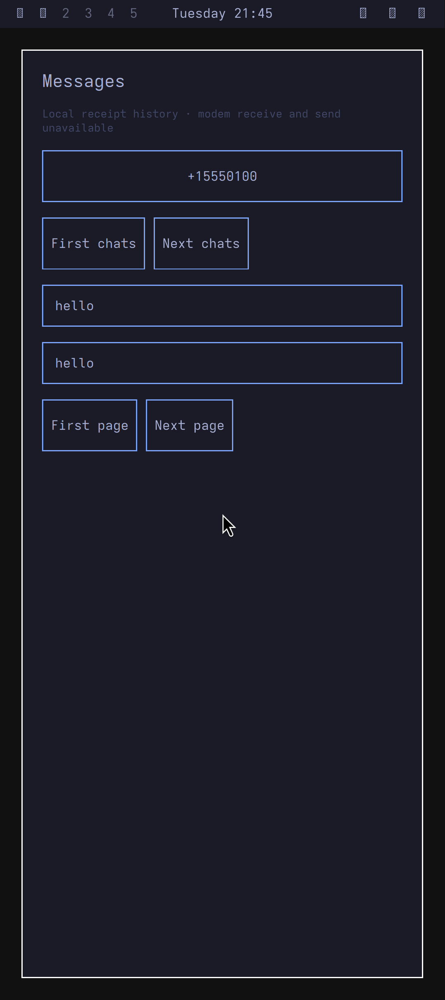

# ARM phone tracer: incoming SMS to normal Messages

Epoch12 qualifies a narrow offline path: authored incoming SMS reaches native
Rust storage while Messages is closed, then the unchanged normal Qt app opens
in genuine Omarchy, displays the message, closes, and reopens both arrivals.
Eight actual ARM runtime groups pass. Root independently reviewed both unscaled
1080×2424 captures and verified their complete PNG/XImage RGB equality. Earlier
epochs1–11 remain failed. This is synthetic incoming integration; production
modem paths and a complete smartphone remain unqualified.

## Selected runtime and results

The unchanged Arch ARM7.1.6 kernel supplies actual Binder, process, filesystem
and SQLite behavior. A synthetic peer uses retained original Android runtime
libraries to deliver an authored PDU; no original vendor service executes.
The service closure is compiled from `052c63c`, corresponding to the pre-lock
core published at `9804b02`. Later `0c27afa` lock changes and a joint lock/camera replay are outside
this selection. The normal Qt ELF remains
`4aa50f980eab1100637d582a2752090f7545e1eb30630888753dfb9a7d2512c8`.
Its UID/GID11010 and empty supplementary groups are separate from desktop
UID1000. Permission grants are explicit Root fixture controls.

| Boundary | Actual epoch12 result |
| --- | --- |
| Closed-window receive | One raw/inbox record commits before app launch. |
| Desktop and current read | Normal desktop launch, current Source/focus and independent grant deliver one exact history item to the normal app. |
| Keyboard submission | Actual QMP `tab`/`ret` input is followed by another normal-app history read. |
| First capture | One literal `hello`, authored sender, Tokyo Night app and original Omarchy bar are reviewed at native size. |
| Close and second receive | Actual app/context retirement precedes a second closed-window arrival using the same writer/incarnation. |
| Fresh reopen | A fresh normal app/context reads both exact local occurrences. |
| Revoke and restore | Explicit revoke denies a fresh read; explicit regrant restores both items. |
| Second capture | Both `hello` rows are visible with current Source healthy before/after. |

Owned guest process cleanup is recorded complete. The actual Docker CLI wait
returned0; separate exact-container inspection qualified absence. Frozen input
closure remained unchanged. Root independently rebound all169 selected files.
The [bounded provenance](evidence/native-phone-tracer-provenance.json) binds
selection SHA256 `fd1db173397c0f3cd934bd02d3a59063f5a9cee1aae5ccbe00b5a2a8731617b3`,
result `8a6ac27d6c7034f79749cc0590aa5c17ad0eb3613c86be1f6073bbf6766f6aa3`
and independent review `e5342cbd3d8f7c871c15b14304d23b8bb0cfe503348d8467e68e502b6da4bbd0`.

## Capture and appearance scope

The selected normal SDL `gl=on` frontend reaches native1080×2424 after the denied
normal app's initial render. Fixed host `XMoveWindow(0,0)` placement then occurs
before the first Source adapter load, while the actor already exists and is
locked. It changes only host-window origin. Later captures read the entire owned
mapped SDL client window with `XGetImage`, holding the exact QEMU/X-server process
identities and requiring unchanged native geometry at origin0,0. Direct helper
exit0 and helper absence are recorded. No resize, crop or guest model injection
is used.

This is **SDL/X11 frontend capture**. Independent full PNG/XImage RGB equality
passes for both frames. Native Wayland buffer equality remains false; the normal
Qt QWindow's DPR is unobserved. The independently applied [whole-output Pixel 10
profile](native-phone-display-profile.md) is1080×2424,422PPI and420 logical density.

The original Tokyo Night setter generates the actual appearance files. An
immutable appearance-only fixture view makes selected files readable to UID11010
without broadening the private session home beyond0700. Empty-groups UID/GID11010
readback matches original generated colors SHA256
`8b5f53ba35b9305aafa72776dd56ea2029faaf29015e2e42db5e19ef698a8e0e`.
Root reviewed the normal app's palette in both images and sampled app padding
at `#1a1b26`. Original Omarchy is visible; missing bar icon fonts remain a fixture
provisioning gap. A live native theme publication broker is unqualified.

| Capture | PNG SHA256 | Guest BOOTTIME health observations before/after |
| --- | --- | --- |
| First, one message | `8e5611cfd880688c1c4bcdeb985f77db80725d1890d9b11a383a85f72a1bc23d` |110968695261 /111262805264ns |
| Second, two messages | `4cd6750f47258a1dac5f19af9dd099f470eff0327fe29fb56139b3dab89e0cee` |115452418801 /115873796407ns |

Both health pairs are Ready, unlocked, with one current principal. Root's review
decodes both complete PNGs, compares every RGB byte with their raw XImages, and
records actual image viewing. File-byte readback alone is not the visual gate.

## Source and preserved failures

Source retains its original25ms publisher and100ms lease. No revival, reset or
lease relaxation was introduced. Epoch12 rejects any Source failure preceding
the owned Stop request. Stop was requested at115874243131ns; terminal
`NotConnected` was observed at115891724210ns,17.481079ms later. This qualifies
ordering only. It does not establish Stop causality, vendor cleanup or permission
to reattach. Failure/expiry remains terminal.

| Earlier epochs | Retained failed boundary |
| --- | --- |
| 1–3 | Host registration observation race/desktop denial, bounded trace reader, and stale reopen-window selection. |
| 4–5 | Current-health failures with Source `InvalidData`/`TimedOut`; partial observations remain separate. |
| 6–7 | Epoch6 discarded the actual QMP error reply;7 retained `GenericError: no surface`. |
| 8 | Offscreen native SDL window produced actual `XGetImage BadMatch`. |
| 9–10 | Fullscreen accepted but actual viewport stayed640×480 under bare Xvfb; SDL fullscreen-desktop bypasses the normal native resize branch. |
| 11 | Moving-EOF restoration observer bug; Source `NotConnected` lacks a Stop timestamp, so cleanup ordering remains unlocalized. Six runtime passes and its first reviewed capture do not change its failed aggregate. |

The frontend explanations use retained primary
[QEMU10.0.13](https://gitlab.com/qemu-project/qemu/-/blob/v10.0.13/ui/ui-qmp-cmds.c)
and [SDL2.32.4](https://github.com/libsdl-org/SDL/blob/release-2.32.4/src/video/SDL_video.c)
source. The earlier stable-refresh hypothesis was an incorrect fixture
expectation, not an established production regression RED. Epoch12 changes only
fixture observation/Stop chronology; native production code is unchanged.

## Remaining gates

Current joint lock/camera integration, trusted permission/unlock, secure
presentation, production appearance publication and complete desktop/font
provisioning remain open. So do notifications, retention/backlog policy,
suspend/wake, production producer/ACK/reset identity and carrier operation.
The guest has no NIC or host device attachment. Google kernel policy, Pixel
display/input/GPU and physical hardware are unqualified. No phone was accessed.
See the [integration map](native-integration-map.md).

Public evidence is authored source and bounded hashes/counts/dispositions.
Private payloads, raw traces, decompilation, credentials and host archive/cleanup
audits remain private.

The unchanged emulator frontend captures below contain only authored synthetic SMS.

