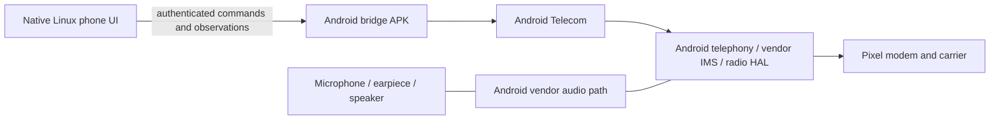

# Phone architecture and proof boundaries

The intended user interface is native Arch/Omarchy. The retained Android subsystem owns cellular services. This is not an Android-free operating system, and Android app compatibility is not the objective.

The [hardware boundary decision](hardware-boundary-decision.md) specifies native Linux first, with separate adapters only for demonstrated vendor dependencies. The Telecom APK is not a universal camera, input or power bridge. The smartphone product is a native app bundle plus shared system services that remain active when app windows close.

Answer, decline and end controls use Android Telecom APIs. A successful API submission does not prove a completed call. The client waits for subsequent observed state. The voice stream is not transported through the TLS command connection.

## Current test system

Harbour is temporary build and validation capacity. A real ARM64 Arch Linux VM runs Hyprland and the Linux client. A separate official Android emulator runs the bridge APK and Android framework. The simulator's synthetic modem produces test calls. No physical phone, SIM, carrier registration, audio device or Pixel GPU is involved.

The emulator-to-VM test route uses ADB forwarding. The separate direct-loopback test runs actual Arch glibc/Python under the emulator kernel and removes ADB forwards; ADB only launches test processes. That test passed with SELinux enforcing and a non-root process. This does not establish the final Pixel deployment.

Waydroid is not running in this setup. A Waydroid-derived Android container is one possible deployment structure, not a selected or verified Pixel platform. Stock Pixel services also require matching framework/APEX/vendor files, signatures, policy and device access; a generic Waydroid image does not supply those by itself.

## Intended phone structure, still to prove

Arch/Omarchy would provide the main desktop on Google's Pixel kernel and drivers. A retained Android environment would provide the framework and hardware services required by the Pixel vendor stack. The precise init/container arrangement, Binder device allocation, SELinux policy, display ownership, audio routing and suspend behavior are not established by the emulator tests.

The bridge's proposed steady-state data route is local loopback in a shared network namespace. It does not require Harbour, an Internet service, ADB, an open LAN port or unencrypted RPC. A deployment with separate network namespaces needs an explicitly designed local route; it must not silently bind the gateway to all interfaces.

## Calling scope

- Implemented and previously verified with synthetic emulator calls: local Android dialing UI; incoming observations; native GTK answer, decline and end controls; explicit outgoing dialing with a touch keypad; enrollment; independent gateway, boot and control settings.
- In progress: native Omarchy/QML presentation and an independent background service. The current Arch package still contains the GTK baseline. Local service socket tests do not by themselves establish full incoming alert delivery.
- Not implemented as complete native Linux phone features: background ringtone and wake integration, contacts, call history, DTMF, mute, speaker/Bluetooth selection and audio integration.
- Not verified: carrier registration, real voice audio, emergency calling, SMS, data connectivity, dual SIM/eSIM, handover, suspend/wake or battery behavior.

## Graphics scope

The PowerVR vendor libraries load through the compatibility runtime, but EGL display initialization stops at missing GPU devices. The VM desktop uses Mesa and a virtual GPU. The current EGL backend does not provide the GBM/device/allocation interface needed to make unmodified Hyprland use Pixel PowerVR. Pixel scanout and a bootable Omarchy phone image remain unproven.

These are separate milestones. A green call-command test does not establish a working mobile OS.
